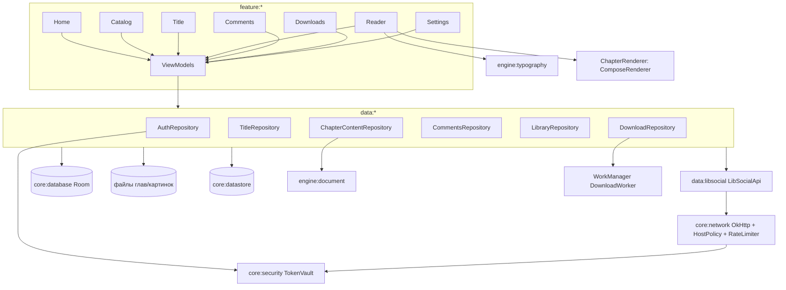
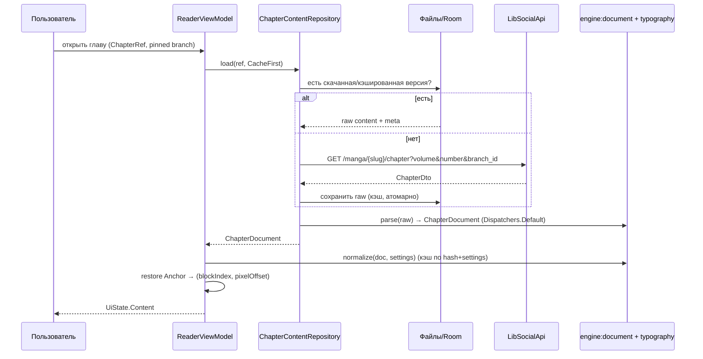
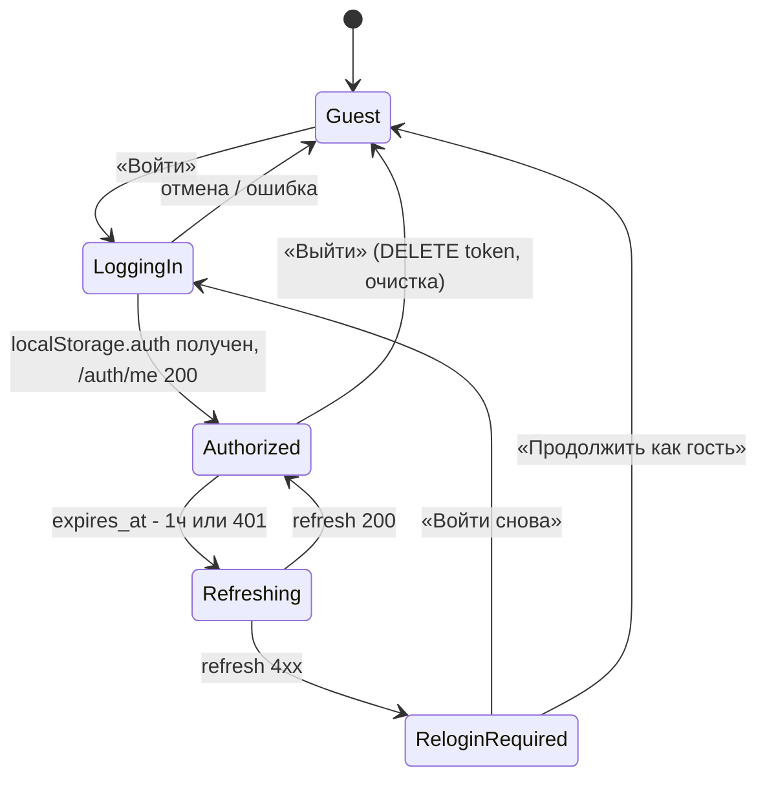
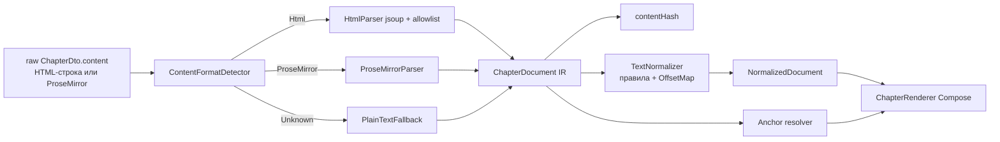
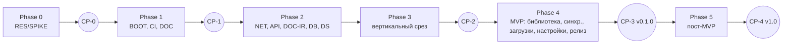

# План реализации Shiori

> Рабочее техническое задание и пошаговый план разработки **Shiori** — неофициального Android-клиента RanobeLib для чтения текстовых ранобэ.
> Файл в репозитории: `DEVELOPMENT_PLAN.md`. Версия плана: **1.0**, дата исследования: **2026-11-25**.

## Как пользоваться этим документом

- Документ самодостаточен: следующая сессия Claude Code может работать по нему без исходного диалога.
- Задачи имеют стабильные ID (`API-001`, `READER-002` …) и чекбоксы в [§14 Roadmap](#14-пошаговый-roadmap). Статус меняется так: `- [ ]` → `- [~]` (в работе, с датой и веткой) → `- [x]` (готово, с датой и ссылкой на PR/коммит).
- Решения фиксируются в [§17 Журнал решений](#17-открытые-вопросы-журнал-решений-и-источники) записью `DEC-NNN`. Решение пересматривается только новой записью, старые не удаляются.
- Пометки о достоверности сведений об API: **Verified live**, **Source verified**, **Historical**, **Hypothesis / blocked** (смысл — в [§2.2](#22-статусы-достоверности)).
- Числа, версии и пути, отмеченные «проверить в `TASK-ID`», — это допущения, которые нужно подтвердить при выполнении задачи, а не факты.

## Содержание

1. [Product vision и ограничения](#1-product-vision-и-ограничения)
2. [Результаты исследования](#2-результаты-исследования)
3. [Риски и предпроектные проверки](#3-риски-и-предпроектные-проверки)
4. [Выбор технологий (ADR)](#4-выбор-технологий-adr)
5. [Архитектура](#5-архитектура)
6. [API и доменная модель](#6-api-и-доменная-модель)
7. [Локальные данные и offline-first](#7-локальные-данные-и-offline-first)
8. [UX/UI спецификация и дизайн-система](#8-uxui-спецификация-и-дизайн-система)
9. [Движок читалки и обработки текста](#9-движок-читалки-и-обработки-текста)
10. [Реализация восьми групп требований](#10-реализация-восьми-групп-требований)
11. [Безопасность, доступность, лицензии, приватность](#11-безопасность-доступность-лицензии-приватность)
12. [Стратегия тестирования и QA](#12-стратегия-тестирования-и-qa)
13. [CI/CD и релизы](#13-cicd-и-релизы)
14. [Пошаговый roadmap](#14-пошаговый-roadmap)
15. [Матрица трассируемости](#15-матрица-трассируемости)
16. [Definition of Done и чек-лист релиза](#16-definition-of-done-и-чек-лист-релиза)
17. [Открытые вопросы, журнал решений и источники](#17-открытые-вопросы-журнал-решений-и-источники)

---

## 1. Product vision и ограничения

### 1.1. Цель

Shiori — читалка ранобэ с сайта RanobeLib, которая сохраняет знакомую структуру оригинала (каталог → карточка → главы → чтение → комментарии), работает с существующим аккаунтом пользователя и исправляет недостатки оригинальной читалки:

| Проблема оригинала | Ответ Shiori | Раздел |
| --- | --- | --- |
| Сложно вернуться к месту чтения | «Продолжить» одним нажатием, якорь до символа внутри абзаца | §10.1 |
| Список глав «прыгает» | Стабильные ключи, сохранение якоря видимого элемента | §10.2 |
| Самовольная смена переводчика | Закреплённая ветка перевода, без автоподмены | §10.3 |
| Комментарии разделены по переводам | Объединённая лента комментариев всех веток с метками | §10.4 |
| Неудобное оформление диалогов | Локальный движок «кавычки → тире», «'мысли' → «ёлочки»» | §9, §10.5 |
| Скудная типографика | Гибкая настройка с живым предпросмотром и профилями | §10.6 |
| Неудобное скачивание | Менеджер загрузок с диапазонами `120-150,155` | §10.8 |

### 1.2. Пользователи

- Основной: русскоязычный читатель ранобэ на Android-смартфоне, читает длинные тайтлы (сотни и тысячи глав), часто офлайн (транспорт), имеет аккаунт RanobeLib.
- Вторичные: читатели с особыми потребностями — слабое зрение, астигматизм, дислексия, светочувствительность, трудности концентрации — им нужны настраиваемые пресеты (без медицинских обещаний).
- Владелец проекта — один разработчик, знаком с JS/TS; проект сопровождается в публичном GitHub-репозитории.

### 1.3. Неизменяемые требования (из задания)

- R-PLAT: только Android.
- R-NOBACKEND: никакого своего сервера, прокси, удалённой БД, своей авторизации, обязательной облачной инфраструктуры. Всё работает на устройстве.
- R-AUTH: вход в оригинальный аккаунт RanobeLib/LibSocial, без своей регистрации.
- R-OFFLINE: офлайн-чтение ранее скачанных доступных глав.
- R-LOCAL-TEXT: преобразования текста — локально, без облачного AI и без передачи текста третьим лицам.
- R-IMMUTABLE: исходный текст главы не меняется ни на сервере, ни в хранилище; преобразования применяются при отображении.
- R-PUBLIC-CI: публичный GitHub, автоматическая сборка и релизы APK в GitHub Releases.
- R-FAIR: не обходить платный доступ, ограничения доступа, CAPTCHA, антибот-защиту, авторизацию. Если разрешённого пути нет — фиксировать ограничение.
- R-NOSECRETS: в репозитории нет токенов, паролей, данных аккаунтов, ключей подписи, персональных данных, приватных ответов API, скачанных произведений.

### 1.4. Non-goals (вне объёма)

- Манга, аниме и другие сайты LibSocial (MangaLib, AnimeLib и т. д.). Архитектура не должна мешать, но поддержка не планируется.
- iOS, desktop, web.
- Своя система комментариев, своя библиотека тайтлов вместо RanobeLib.
- Покупка платных глав, обход ранних доступов.
- Массовое зеркалирование каталога, экспорт для распространения.
- Облачный AI для обработки текста.
- Публикация в Google Play (не требуется; возможна позже как отдельное решение).

### 1.5. Название и позиционирование

- Название: **Shiori** (яп. 栞 — «закладка»), совпадает с именем репозитория. Не содержит товарных знаков RanobeLib/LibSocial.
- Везде (README, экран «О приложении», первый запуск, описание релиза): «Shiori — неофициальный клиент для RanobeLib. Не связан с RanobeLib/LibSocial и не одобрен ими».
- Иконка и графика — собственные. Логотипы, шрифты и графика RanobeLib не используются.
- `applicationId` (постоянный): `io.github.velcheor137.shiori` (решение `DEC-004`).

---

## 2. Результаты исследования

### 2.1. Методика и условия

- Дата: 2026-11-25. Среда: Linux, сеть с доступом в интернет; Android SDK/JDK в среде отсутствуют (сборки не выполнялись).
- Источники: исходный код сторонних клиентов (клонированы и прочитаны), их тесты и заметки, GitHub issues/PR, публичная страница RanobeLib в браузере (без входа в аккаунт), публичный JS-бандл сайта, метаданные Maven-репозиториев, документация Android.
- Живые запросы к API: выполнено **три** запроса `GET /api/constants` (см. §2.3, факт F-01). Дальнейшее зондирование гейта DDoS-Guard с подменой `User-Agent` сознательно **не проводилось**: подбор заголовков, проходящих антибот-фильтр, — это обход защиты (R-FAIR). Все прочие сведения о контракте получены из исходников и наблюдения за штатным сайтом.
- Авторизованные операции не проверялись (нет и не должно быть доступа к аккаунту). Для них составлена инструкция `RES-002` (§3.3).
- Официальная документация API, SDK, политика доступа для сторонних клиентов и журнал изменений API **не найдены**. Страницы документов сайта (`/ru/doc/...`) в браузере не отрисовали текст (пустая страница, 404 на `/ru/doc`), поэтому условия использования прочитать не удалось → `RES-001` (ручная проверка владельцем).

### 2.2. Статусы достоверности

| Статус | Значение |
| --- | --- |
| **Verified live** | Проверено безопасным запросом или наблюдением штатного сайта в браузере 2026-11-25 (без авторизации) |
| **Source verified** | Подтверждено конкретным актуальным исходным кодом/заметками (ссылка, дата коммита); не равно живой проверке |
| **Historical** | Найдено только в старых источниках |
| **Hypothesis / blocked** | Предположение или проверка невозможна без аккаунта/разрешения; указан следующий шаг |

### 2.3. Ключевые факты

| ID | Факт | Статус | Источник |
| --- | --- | --- | --- |
| F-01 | `api.cdnlibs.org` стоит за DDoS-Guard (`server: ddos-guard`). `GET /api/constants?fields[]=genres` без заголовков → **403 HTML**. С `Referer`+`Site-Id: 3`+браузерным UA → **200 JSON**, заголовки `x-ratelimit-limit: 100`, `x-ratelimit-remaining: 99`, `access-control-allow-origin: *`. С честным UA `Shiori/0.0 (...)` **без** `Referer` → 403 | Verified live (3 запроса) | S6 |
| F-02 | По заметкам libsocial-sdk (проверено ими 2026-09-30): фильтр гейта проверяет только **наличие непустого `Referer`**; `User-Agent` сам по себе не влияет; значение `Referer` не валидируется | Source verified | S2 «WAF 403» |
| F-03 | Штатный сайт ranobelib.me 2026-11-25 обращается к API на **`api.mangalib.me`** (не `api.cdnlibs.org`): `/api/manga/{slug}`, `/chapters`, `/chapter`, `/relations`, `/similar`, `/stats`, `/constants`, `/events`, `/comments`, `/comments/sticky`, `/chapters/players` | Verified live | S5 |
| F-04 | Известные домены API: `api.cdnlibs.org` (по умолчанию у LNReader/keiyoushi/libsocial-sdk), `api.mangalib.me`, `api.cdnrulib.link`, `api2.mangalib.me`, `api.imglib.info`, `hapi.hentaicdn.org` (последний не для нас), `api.lib.social` (исторический) | Source verified / Verified live (mangalib.me) | S3, S4, S5, S7 |
| F-05 | Разделение сайтов: заголовок `Site-Id: 3` для `/manga/{slug}`, `/chapters`, `/chapter`; для каталога — query `site_id[]=3`. Без `Site-Id` существующий тайтл даёт 404 | Source verified | S2 |
| F-06 | Без `Accept: application/json` ошибки возвращаются как HTML-страница SPA | Source verified | S2 |
| F-07 | Содержимое главы: поле `content` — **либо HTML-строка** (`<p data-paragraph-index="N">`, `em/strong/b/i/img/h3/ol/li`), **либо ProseMirror JSON** (`{"type":"doc","content":[...]}`: `paragraph`, `text` с марками `bold`/`italic`, `hardBreak`, `horizontalRule`, `image`, `heading`; встречаются `attrs.textAlign`). Формат определяется **на уровне главы**. Изображения ProseMirror резолвятся через `attachments[].name → url` (относительный, префикс `https://ranobelib.me`) | Source verified | S1, S2 |
| F-08 | Сайт при рендере ProseMirror присваивает `data-paragraph-index = ++counter` каждому узлу `paragraph` (пустой абзац получает `hardBreak`) | Verified live (JS-бандл) | S5 |
| F-09 | Ветки перевода: в `/chapters` у каждой логической главы массив `branches[]` с полями `id` (ID версии главы в ветке), `branch_id` (стабильный ID линии перевода, может быть `null`), `created_at`, `teams[]`, `user`, `restricted_view`, `expired_type`. `branch_id` ≠ `team.id`; ветка может не иметь команды (`teams: []`) | Source verified | S1, S2, S3 |
| F-10 | Без параметра `branch_id` API возвращает ветку по своему умолчанию, **не** `branches[0]`. Сайт получает ветку по умолчанию через `GET /api/branches/{mediaId}?team_defaults=1` | Source verified / Verified live (бандл) | S2, S3, S5 |
| F-11 | Команды тайтла: `fields[]=teams` → `teams[].details.branch_id` связывает команду с веткой | Source verified | S1 |
| F-12 | Нумерация: `number` — строка, может быть дробной (`"6.5"`, `"0.1"`); `number_secondary` дублирует `volume`; номера могут повторяться в разных томах; у главы есть `index`/`item_number` | Source verified | S2 |
| F-13 | Платные/ранний доступ: `restricted_view: {is_open, price, expired_at, can_open_with_content_key}`; закрытая глава без аккаунта → 200 без контента. Есть тайтлы с главами, удалёнными по требованию правообладателя (видно на странице тайтла) | Source verified / Verified live | S2, S5 |
| F-14 | Вход на сайте: **OAuth 2.0 Authorization Code + PKCE (S256)**, `client_id=1`, authorize на `https://auth.lib.social/auth/oauth/authorize`, `redirect_uri = https://ranobelib.me/ru/front/auth/oauth/callback`, `prompt=consent`; обмен кода и refresh — `POST /api/auth/oauth/token` (`grant_type=authorization_code\|refresh_token`, `client_id=1`); выход — `DELETE /api/auth/oauth/token`. Токен хранится в `localStorage.auth` сайта: `{token:{token_type, expires_in, access_token, refresh_token, timestamp}, auth:{id, username, avatar, ...}}` | Verified live (бандл) + Source verified (S1, S3) | S1, S3, S5 |
| F-15 | Сторонние клиенты (LNReader, Mihon/keiyoushi) авторизуются так: пользователь входит на ranobelib.me во встроенном WebView, клиент читает `localStorage.auth` и шлёт `Authorization: Bearer …`; валидность проверяют `GET /api/auth/me` | Source verified | S1, S3 |
| F-16 | Комментарии: `GET /api/comments?post_id={id}&post_type={manga\|chapter\|...}&sort_by=id&sort_type=desc&page=N[&post_page=P]` → `{data:{root:[...], replies:[...]}, meta:{has_next_page}}`; закреплённые — `GET /api/comments/sticky?post_id&post_type`; ветка обсуждения — `GET /api/comments/{id}`; создание — `POST /api/comments {comment, attachments, post_type, post_id, parent_comment, root_id, comment_level[, post_page]}`. **Для главы `post_id = chapter.id` текущей загруженной версии главы**, т. е. комментарии привязаны к версии главы конкретной ветки | Verified live (запрос для тайтла; бандл для главы) | S5 |
| F-17 | Закладка аккаунта на тайтл: `GET /api/manga/{slug}/bookmark`; `POST /api/bookmarks {media_type:"manga", media_slug, bookmark:{item_id, progress, status}, meta:{item_number}}`; `DELETE /api/bookmarks/{id}?media_type=manga`. **`progress` — номер абзаца (`data-paragraph-index`)**, `item_id` — ID главы. Ссылка вида `...?p=N` прокручивает к абзацу | Verified live (бандл) | S5 |
| F-18 | Ссылки сайта: тайтл `https://ranobelib.me/ru/book/{slug_url}`, глава `https://ranobelib.me/ru/{slug_url}/read/v{volume}/c{number}?bid={branch_id}` | Source verified / Verified live | S1, S5 |
| F-19 | Каталог: `limit` 10..60 (по умолчанию 60), `page ≥ 1`, ответ `{data, links, meta:{has_next_page}}`, общего числа нет; `genres[]` — AND; фильтра по автору/команде нет; поле `fields[]` валидируется (422) | Source verified | S2 |
| F-20 | Лимиты: устойчивая последовательная загрузка получала 429 примерно на 217-й главе; 429 от гейта приходит HTML без `Retry-After`; у API есть `x-ratelimit-*` | Source verified / Verified live (заголовки) | S2, S6 |
| F-21 | Обложки переехали: `cover.cdnlibs.org` → `cover.imglib.info` (2026-10-27); сайт сегодня грузит `cover.mangalib.me`. Обложки тоже требуют `Referer`. Картинки внутри глав — `https://ranobelib.me/uploads/...` | Source verified / Verified live | S2, S5, S8 |
| F-22 | Сайт предлагает экспорт книг (`epub`, `fb2`) **только для премиум-подписки** (`bookExportPremiumOnly: true` в константах бандла) | Verified live (бандл) | S5 |
| F-23 | Настройки читалки сайта (для понимания базового уровня): `fontSize 16`, `lineHeight 1.6`, `paragraphOffset 10`, `textIndent`, `textAlign`, `fontFamily`, `width`, `brightness`, темы, `mode` (вертикальный/постраничный), зоны нажатий, клавиши | Verified live (localStorage/бандл) | S5 |
| F-24 | Официальное Android-приложение именно RanobeLib не найдено (в RuStore есть «MangaLib — Манга на русском», `ru.mangalib.lite`); подтвердить отсутствие официального клиента RanobeLib не удалось | Hypothesis | поиск 2026-11-25 |

### 2.4. Таблица покрытия API

Базовый URL обозначен `{API}` = один из доменов F-04 + `/api`. Общие заголовки (§6.2): `Accept: application/json`, `Referer: https://ranobelib.me/`, `Site-Id: 3`, честный `User-Agent` Shiori, при входе — `Authorization: Bearer …`.

| # | Функция | Метод и путь | Параметры | Авторизация | Ключевые поля ответа | Источник (дата) | Статус | Ограничения | Дальнейшая проверка | Решение при недоступности |
| --- | --- | --- | --- | --- | --- | --- | --- | --- | --- | --- |
| 1 | Справочники | `GET {API}/constants` | `fields[]=genres,tags,types,status,scanlateStatus,format,ageRestriction,imageServers,relationTypes,countries` | нет | `data.{genres[]:{id,name,site_ids,...}}` | S6 (2026-11-25), S2, S3 | Verified live (genres), Source verified (остальное) | фильтровать по `site_ids∋3` | `API-001` фикстуры | кэш в APK (снимок справочников, обновляемый) |
| 2 | Каталог/поиск | `GET {API}/manga` | `site_id[]=3`, `q`, `page`, `limit`(10..60), `sort_by`(`rating_score`,`rate_avg`,`views`,`chap_count`,`last_chapter_at`,`created_at`,`name`,`rus_name`), `sort_type`, `genres[]`,`genres_exclude[]`,`tags[]`,`tags_exclude[]`,`types[]`,`scanlateStatus[]`,`manga_status[]`,`chapters[min]`, `fields[]=rate,rate_avg,userBookmark` | нет (с токеном — `userBookmark`) | `data[]:{id,name,rus_name,eng_name,slug_url,cover,type,status,...}`, `meta.has_next_page` | S1 (2026-11-21), S2 | Source verified | нет total; 422 на неизвестные поля | `RES-002` (снять запрос каталога сайта) | — |
| 3 | Последние обновления | `GET {API}/latest-updates` | `page` | нет | `last_item_at`, `items_count`, `metadata.latest_items` | S2, S3 | Source verified | без фильтров | `API-001` | раздел «Обновления» скрыть |
| 4 | Карточка тайтла | `GET {API}/manga/{slug_url}` | `fields[]=background,eng_name,otherNames,summary,releaseDate,type_id,caution,views,close_view,rate_avg,rate,genres,tags,teams,franchise,authors,publisher,userRating,moderated,metadata,metadata.count,metadata.close_comments,manga_status_id,chap_count,status_id,artists,format,last_item_at` | нет (`Site-Id: 3`) | `id`, имена, `cover`, `summary` (ProseMirror), `teams[].details.branch_id`, `items_count`, `metadata.count.branches`, `metadata.close_comments`, `status`, `scanlateStatus` | S5 (запрос сайта), S1, S2 | Verified live (набор полей запроса), Source verified (поля ответа) | `summary` бывает строкой и doc | `API-001` | — |
| 5 | Список глав | `GET {API}/manga/{slug_url}/chapters` | — | нет | `data[]:{id,index,item_number,volume,number,number_secondary,name,branches_count,branches[]:{id,branch_id,created_at,teams[],user,restricted_view,expired_type}}` | S5, S1, S2 | Verified live (запрос), Source verified (поля) | весь список одним ответом (308 глав проверено), поведение на 4000+ глав не проверено | `RES-002`, `API-003` | — |
| 6 | Ветка по умолчанию | `GET {API}/branches/{mediaId}` | `team_defaults=1` | нет | `data[]:{id,...}` | S3, S5 (бандл) | Source verified | структура кроме `id` неизвестна | `RES-002` | первая ветка по `created_at` + явный выбор пользователем |
| 7 | Содержимое главы | `GET {API}/manga/{slug_url}/chapter` | `volume`, `number` (обяз.), `branch_id` | нет для открытых; токен для купленных | `id,volume,number,name,branch_id,teams[],content(HTML\|doc),attachments[],restricted_view,likes_count,is_viewed,created_at,manga_id,moderated` | S5, S1, S2 | Verified live (запрос), Source verified (поля) | без `branch_id` — дефолт сервера | `API-002` | глава недоступна → явное состояние |
| 8 | Связанные/похожие | `GET {API}/manga/{slug}/relations`, `/similar` | — | нет | `data[]:{order,related_type,media}` | S5, S2 | Verified live (запрос) | связи ведут и на мангу/аниме | `API-001` | показывать только `site=3` как кликабельные |
| 9 | Статистика | `GET {API}/manga/{slug}/stats` | `bookmarks=true&rating=true` | нет | распределение оценок, списки | S5, S7 | Verified live (запрос) | формат не зафиксирован | `RES-002` | скрыть блок |
| 10 | Комментарии (тайтл) | `GET {API}/comments` | `post_id={mediaId}`, `post_type=manga`, `sort_by=id`, `sort_type=desc`, `page` | не требуется для чтения (запрос сайта гостем) | `data.root[]`, `data.replies[]`, `meta.has_next_page` | S5 | Verified live (запрос, тело не читалось) | поля комментария неизвестны | `RES-002` | — |
| 11 | Комментарии (глава) | `GET {API}/comments` | `post_id={chapter.id версии}`, `post_type=chapter`, `sort_by`, `sort_type`, `page`, `post_page` (для манги — страница) | вероятно нет | как №10 | S5 (бандл) | Source verified (бандл) | **H-COM-1**: `chapter.id` из `/chapter` = `branches[].id` | `RES-002`, `SPIKE-COM-001` | загружать комментарии только к открытой версии |
| 12 | Закреплённые | `GET {API}/comments/sticky` | `post_id`, `post_type` | нет | список | S5 | Verified live (запрос) | — | — | — |
| 13 | Тред | `GET {API}/comments/{id}` | + sort | нет | `root`, `replies` | S5 (бандл) | Source verified | — | `RES-002` | — |
| 14 | Написать комментарий | `POST {API}/comments` | `comment`(ProseMirror?), `attachments`, `post_type`, `post_id`, `parent_comment`, `root_id`, `comment_level`, `post_page` | да | созданный комментарий | S5 (бандл) | Hypothesis | формат `comment` не подтверждён | `RES-002` (после go) | функция отключена |
| 15 | Комментарии к абзацам | ? | ? | ? | ? | — | **Hypothesis / blocked** | в бандле не найдено явных «абзацных» комментариев для ранобэ; `post_page` связан со страницами манги | `RES-002` | не реализовывать до подтверждения |
| 16 | Вход | WebView: `https://auth.lib.social/auth/oauth/authorize?...client_id=1...redirect_uri=https://ranobelib.me/ru/front/auth/oauth/callback` | PKCE S256 | — | код → токен на сайте | S5 (бандл) | Verified live (бандл) | `client_id=1` и `redirect_uri` принадлежат сайту | `RES-001`, `SPIKE-AUTH-001` | гостевой режим |
| 17 | Обмен/refresh токена | `POST {API}/auth/oauth/token` | `grant_type`, `client_id=1`, `refresh_token`, `code_verifier`, `code`, `redirect_uri` | — | `token_type, expires_in, access_token, refresh_token` | S5, S1, S3 | Source verified | срок ~7 дней (комментарий в S1; не проверено) | `SPIKE-AUTH-001` | повторный вход через WebView |
| 18 | Текущий пользователь | `GET {API}/auth/me` | — | да | `id, username, avatar, ...` | S3 | Source verified | — | `SPIKE-AUTH-001` | — |
| 19 | Выход | `DELETE {API}/auth/oauth/token` | — | да | — | S5 (бандл) | Source verified | — | `SPIKE-AUTH-001` | локальное удаление токена |
| 20 | Закладка тайтла | `GET {API}/manga/{slug}/bookmark` | — | да | `id, status, item{...}, progress?` | S5 (бандл) | Source verified | форма ответа не подтверждена | `RES-002` | локальные закладки |
| 21 | Сохранить закладку/прогресс | `POST {API}/bookmarks` | `{media_type:"manga", media_slug, bookmark:{item_id, progress, status}, meta:{item_number}}` | да | закладка | S5 (бандл) | Source verified | изменение — явное действие пользователя или опция авто-синхронизации | `RES-002` | локальный прогресс |
| 22 | Удалить закладку | `DELETE {API}/bookmarks/{id}` | `media_type` | да | — | S5 (бандл) | Source verified | — | `RES-002` | — |
| 23 | Папки закладок | `/bookmarks/folder/{folder}`, `authUserFolders` | — | да | папки (Читаю, В планах, …) | S5 (бандл) | Hypothesis | пути неполные | `RES-002` | фиксированный набор статусов |
| 24 | Уведомления | `GET {API}/notifications/count`, `/notifications` | — | да | счётчик/список | S5 (бандл) | Source verified (пути) | — | `RES-002` | post-MVP |
| 25 | Отметка прочтения/история | ? (`is_viewed` в главе) | ? | да | ? | S2 | Hypothesis | неизвестно, ставит ли сайт просмотр отдельным запросом | `RES-002` | не отправлять |
| 26 | Изображения | `cover.imglib.info`, `cover.mangalib.me`, `cover.cdnlibs.org`, `ranobelib.me/uploads/...` | `Referer` | нет | бинарные | S2, S5, S8 | Verified live / Source verified | хост меняется | `NET-001` | плейсхолдер |
| 27 | События | `GET {API}/events` | — | ? | ? | S5 | Verified live (запрос) | назначение неизвестно | — | не использовать |

### 2.5. Противоречия и расхождения

| Тема | Версия A | Версия B | Вывод |
| --- | --- | --- | --- |
| Домен API | `api.cdnlibs.org` (клиенты, заметки) | `api.mangalib.me` (сайт сегодня), `api.cdnrulib.link` (зеркало) | Домен — **конфигурация с fallback**, не константа (§6.2) |
| Обязательные заголовки | «любой браузерный UA обязателен» (S7) | «нужен только непустой `Referer`» (S2, проверено 2026-09-30) | Shiori шлёт честный UA + `Referer`. Если гейт начнёт требовать браузерный UA — это **no-go для подмены** (§3.1 R1) |
| Формат контента | «HTML-строка» (S7) | HTML **или** ProseMirror (S1, S2) | Поддерживаем оба через единую IR |
| `number_secondary` | дробная часть номера (старая гипотеза) | всегда равен `volume` (S2, 667 глав) | Не используем; дробь уже в `number` |
| Ветка по умолчанию | `branches[0]` | дефолт сервера ≠ `branches[0]`; сайт спрашивает `/branches/{id}?team_defaults=1` | Не полагаемся на дефолт; всегда передаём `branch_id` |
| Срок жизни токена | ~7 дней (комментарий S1) | сайт считает «просроченным более 14 дней назад» отдельным состоянием (бандл) | Хранить `expires_in`; refresh заранее; при неудаче — повторный вход |

### 2.6. Что известно о стабильности

- Публичного стабильного контракта нет. За последние 2 месяца наблюдались: включение фильтра `Referer` на гейте (2026-09-30), смена хоста обложек (2026-10-27), появление новых доменов API у сайта (PR keiyoushi от 2026-11-24/25). Это изменения **инфраструктуры**, а не формы JSON.
- Форма ответов `/manga`, `/chapters`, `/chapter` стабильна в течение 2026 года по истории LNReader-плагина и libsocial-sdk (их правки — в основном заголовки/домены). Важно: выход новой версии SDK ≠ изменение API (пример: issue #388 явно отделяет смену хоста обложек от обновления SDK).
- Чаще всего ломаются: домены, заголовки гейта, хосты картинок. Реже: поля контента (появление ProseMirror). Архитектура должна изолировать эти места (§5.4, §6.6).

---

## 3. Риски и предпроектные проверки

### 3.1. Реестр рисков

| ID | Риск | Вероятность | Влияние | Митигирование | Go/no-go критерий | Разрешённый fallback |
| --- | --- | --- | --- | --- | --- | --- |
| R1 | Гейт DDoS-Guard отклоняет честный `User-Agent` Shiori | средняя | критическое (нет данных) | Шлём `Referer` (признак контекста сайта, F-02) и честный UA. Проверка `RES-003` — 3 запроса | **Go**: честный UA + `Referer` → 200. **No-go**: только браузерный UA проходит → подмена UA запрещена | Обратиться к LibSocial за разрешением/ключом; до ответа — проект в режиме «блокировано» (без подмены). Альтернатива «запросы из WebView сайта» — только отдельным решением владельца после `RES-001` |
| R2 | Использование `client_id=1` и входа через WebView сайта может противоречить правилам | средняя | высокое (весь аккаунтный функционал) | Вход только на настоящей странице `auth.lib.social`/`ranobelib.me` во WebView, пароль никогда не проходит через код Shiori; запрос на отдельный OAuth-клиент у LibSocial | **Go**: правила не запрещают сторонние клиенты/встроенный браузер, или есть разрешение. **No-go**: прямой запрет | Гостевой режим (каталог, открытые главы, чтение комментариев гостем — если API отдаёт их без токена) |
| R3 | Комментарии к главе привязаны к версии главы ветки (F-16); объединение требует N запросов | высокая (факт) | среднее | Ограниченный параллелизм (≤2), k-way merge по ключу сортировки, кэш (§10.4) | **Go**: `post_type=chapter` + `post_id=branches[i].id` возвращает комментарии ветки i (`SPIKE-COM-001`) | Показывать комментарии только текущей ветки + кнопки «комментарии перевода X» |
| R4 | `branch_id = null` у однопереводных тайтлов и при появлении второй ветки смысл `null` неясен | средняя | среднее | Представлять ветку как `BranchKey` (`Line(id)` / `Default`), хранить также `teams` и `user` для диагностики | Проверка на тайтлах с 1 и ≥2 ветками (`RES-002`) | При неоднозначности спрашивать пользователя, не угадывать |
| R5 | Синхронизация закладок: сервер хранит одну закладку на тайтл с `item_id`+`progress`(абзац) | высокая (факт) | среднее | Локальный точный прогресс + серверный грубый (глава+абзац), политика конфликтов (§10.1) | **Go**: GET/POST закладки подтверждены `RES-002` | Только локальный прогресс |
| R6 | Скачивание глав может нарушать правила или вызвать блокировку | средняя | высокое | Только открытые пользователю главы, лимит скорости, уважение 429/`Retry-After`, без экспорта | **Go**: правила не запрещают офлайн-кэш в клиенте | Кэш «последних N глав» вместо массовой загрузки |
| R7 | Домен API меняется без предупреждения | высокая | высокое | Список доменов + автоматический fallback на сетевых/гейтовых ошибках + ручной выбор в настройках + выпуск обновления | — | Ручной ввод домена из allowlist-шаблона `*.mangalib.me`, `*.cdnlibs.org`, ... |
| R8 | Русская расстановка переносов в Compose недоступна на части устройств | средняя | среднее | `SPIKE-READER-001` на API 26/29/33/36 | **Go**: `Hyphens.Auto` с `LocaleList("ru")` переносит русские слова на ≥3 из 4 уровней API | Опция переносов скрывается там, где не работает; либо soft-hyphen по собственным шаблонам (лицензия шаблонов — проверить) |
| R9 | Движок нормализации даёт ложные срабатывания | средняя | высокое (порча текста) | Консервативный режим по умолчанию, негативные фикстуры, мгновенный «показать оригинал» | 0 ложных срабатываний на негативном наборе; ≥90 % полноты на позитивном стандартном | Отключить конкретное правило |
| R10 | Длинные главы (100k+ символов) тормозят на бюджетных устройствах | средняя | среднее | Ленивая отрисовка по абзацам, фоновой разбор, кэш IR, Baseline Profile | Цели §12.5 на эталонном устройстве | Упрощённый режим |
| R11 | Фоновые загрузки ограничены Android 14/15 (типы foreground service, лимиты dataSync) | высокая | среднее | WorkManager + foreground с типом `dataSync`, возобновление после убийства | `SPIKE-DL-001` | Продолжение при следующем запуске |
| R12 | Утечка токена (логи, бэкап, чужой хост) | низкая | критическое | Host allowlist, редактирование логов, `allowBackup=false`/правила бэкапа, Keystore | Тесты `SEC-*` | — |
| R13 | Правообладательские удаления и смена контента после скачивания | средняя | низкое | Показывать локальную копию с пометкой; не перепубликовывать | — | — |

### 3.2. Предпроектные проверки (Phase 0)

Порядок выполнения — по зависимостям: `RES-001` и `RES-003` блокируют сетевую часть; `SPIKE-READER-001` и `SPIKE-TYPO-001` можно делать параллельно (не требуют сети).

| ID | Проверка | Кто | Выход |
| --- | --- | --- | --- |
| `RES-001` | Прочитать пользовательское соглашение, правила, политику приватности RanobeLib/LibSocial: допустимость сторонних клиентов, автоматизированного доступа, офлайн-кэша, встроенного браузера для входа | владелец (вручную) + Claude (анализ текста, который владелец вставит в `docs/research/terms-YYYY-MM-DD.md` — только цитаты ≤ необходимого) | Решение go/no-go для R2, R6; запись `DEC` |
| `RES-002` | Снять обезличенные образцы авторизованных и неподтверждённых запросов через DevTools на собственном аккаунте владельца | владелец по инструкции §3.3 | Фикстуры в `core/network/src/test/resources/fixtures/` (синтетические после обезличивания) |
| `RES-003` | Проверить, принимает ли гейт честный UA Shiori с `Referer` | Claude в следующей сессии, только после подтверждения владельцем; не более 3 запросов к `/constants` | go/no-go R1 |
| `SPIKE-AUTH-001` | Прототип входа через WebView (одноразовая ветка, не в `main`) | Claude + владелец на своём устройстве | Подтверждение F-14/F-15 и refresh |
| `SPIKE-COM-001` | Проверка H-COM-1 и формы комментария | по данным `RES-002` | Модель `CommentDto`, решение по R3 |
| `SPIKE-READER-001` | Рендер в Compose: переносы ru, обводка, 150k символов, восстановление позиции | Claude | Решение `DEC-003` подтверждено или переключение на WebView-рендерер |
| `SPIKE-TYPO-001` | Прототип движка нормализации на синтетических фикстурах (чистый JVM) | Claude | Метрики точности, решение по правилам |
| `SPIKE-DL-001` | Поведение WorkManager + foreground `dataSync` на Android 14/15/16 | Claude | Решение по механизму загрузок |

### 3.3. Инструкция `RES-002`: как снять запросы и обезличить их

1. На компьютере открыть Chrome → `https://ranobelib.me`, войти в **свой** аккаунт.
2. DevTools (F12) → Network → фильтр `Fetch/XHR` → включить `Preserve log`.
3. Выполнить сценарии по одному, после каждого сохранять HAR (`Export HAR (sanitized)`):
   - открыть тайтл с ≥2 переводами (пример: любой тайтл, где на вкладке «Главы» есть выбор переводчика); переключить переводчика;
   - открыть главу ветки A, прокрутить до комментариев; открыть ту же главу ветки B;
   - нажать «Добавить в закладки» на абзаце (если есть), сменить статус тайтла («Читаю» → «В планах» → обратно);
   - открыть уведомления;
   - выйти и войти снова (фиксируется поток OAuth: authorize → callback → token).
4. Обезличить: прогнать HAR через скрипт `tools/har-sanitize` (будет создан в `RES-002`, Kotlin script или Node.js, не входит в APK), который:
   - удаляет заголовки `Authorization`, `Cookie`, `Set-Cookie`, `X-CSRF-*`, query `code`, `state`, `code_verifier`, `code_challenge`, поля `access_token`, `refresh_token`;
   - заменяет `user.id`, `username`, `avatar`, e-mail, IP на синтетические (`user_1`, `https://example.invalid/avatar.png`);
   - обрезает `content` глав до 2 абзацев и заменяет их текст на lorem-текст той же структуры;
   - заменяет тексты комментариев на синтетические, сохраняя структуру (`root`, `replies`, `votes`, `post_page`).
5. Владелец просматривает результат глазами, после чего Claude конвертирует его в фикстуры. **Сырые HAR в репозиторий не коммитятся** (они в `.gitignore`: `*.har`, `research/raw/`).
6. Пароль, токены, cookies никогда не пересылаются в чат.

---
## 4. Выбор технологий (ADR)

### 4.1. ADR-001: мобильный стек

**Контекст.** Ядро продукта — читалка с точными якорями, гибкой типографикой, стабильными списками, фоновыми загрузками и безопасным хранением токена. Владелец знает JS/TS, но это не ограничение.

**Сравнение** (оценка 1–5, 5 — лучше; обоснования ниже таблицы):

| Критерий | Kotlin + Jetpack Compose | React Native (New Arch) | Flutter | Capacitor/WebView-гибрид |
| --- | --- | --- | --- | --- |
| Русская типографика (переносы, кернинг, шрифты) | 4 — системный Minikin/`LineBreaker`, `Hyphens.Auto` | 3 — `Text` нативный, но настройки беднее, переносы через `android_hyphenationFrequency` | 3 — собственный движок, переносов «из коробки» нет | 5 — CSS `hyphens`, `text-stroke`, колонки |
| Сложное форматирование и точные якоря | 5 — `TextLayoutResult` даёт символ↔пиксель | 3 — нужен нативный модуль | 4 — `TextPainter`, но свой рендер | 3 — через JS-мост, асинхронно |
| Стабильность длинных списков | 5 — `LazyColumn` с `key`, сохранение по ключу | 3 — FlashList, нужна настройка | 4 | 2 |
| Жесты, TalkBack, системный масштаб | 5 | 4 | 3 (семантика своя) | 3 |
| Производительность длинного текста | 4 (ленивая по абзацам) | 3 | 4 | 3 |
| Локальная БД, миграции | 5 — Room | 3 | 4 — drift | 3 |
| Фоновые загрузки (Android 14+) | 5 — WorkManager нативно | 2 — модули/headless JS | 3 — плагины | 2 |
| Безопасное хранение токена | 5 — Keystore напрямую | 3 | 3 | 3 |
| Тестируемость | 5 — JVM unit + Robolectric + Compose UI tests | 4 (Jest) + нативные | 4 | 4 |
| Жизненный цикл Android | 5 | 3 | 3 | 2 |
| Размер APK | 4 (≈ 8–15 МБ, предположение) | 3 | 3 | 4 |
| Экосистема и актуальность | 5 (Google, ежемесячные релизы) | 4 | 4 | 3 |
| Поддержка одним разработчиком | 4 | 3 (две среды: JS + нативные модули) | 4 | 4 |
| Знакомство владельца | 2 | 5 | 2 | 5 |
| **Сумма** | **68** | **46** | **52** | **46** |

**Решение.** **Kotlin + Jetpack Compose**, один Android-проект на Gradle (решение `DEC-001`).

**Почему.** Решающие требования — точная привязка позиции к символу абзаца (§9.6), стабильные списки на тысячи элементов, WorkManager для загрузок и Keystore для токена. Всё это — родные API Android; в RN/Flutter они требуют нативных модулей, то есть две кодовые базы вместо одной. Знакомство владельца с TS важно, но меньше надёжности читалки.

**Отклонено.**
- React Native: читалка и загрузки потребовали бы нативных модулей на Kotlin — сложность выше, чем у чистого Kotlin.
- Flutter: собственный движок текста без русских переносов «из коробки», доступность через собственную семантику.
- Capacitor/WebView-гибрид: хорошая типографика, но жизненный цикл, загрузки, якоря и безопасность хуже; противоречит требованию «не делать приложение WebView-обёрткой».
- Kotlin Multiplatform/Compose Multiplatform: iOS вне объёма, лишняя сложность.

### 4.2. ADR-002: способ рендера текста главы

| Критерий | Нативный Compose (`LazyColumn` абзацев + `Text`/`TextMeasurer`) | Собственный рендерер на `StaticLayout`/Canvas | Локальный HTML/CSS в изолированном WebView |
| --- | --- | --- | --- |
| Переносы ru | `Hyphens.Auto` (платформенный) — проверить `SPIKE-READER-001` | то же (`StaticLayout.Builder.setHyphenationFrequency`) | CSS `hyphens:auto` + `lang="ru"` |
| Обводка текста | `TextStyle(drawStyle = Stroke(...))` + второй слой заливки | `Paint.Style.STROKE` | `-webkit-text-stroke`, `paint-order` |
| Вложенное форматирование, ссылки, картинки | `AnnotatedString`, `LinkAnnotation`, отдельные item для картинок | вручную | естественно |
| Якоря и восстановление позиции | синхронно: `TextLayoutResult.getOffsetForPosition`/`getLineTop` | синхронно | асинхронно через JS-мост |
| Постраничный режим | своя пагинация по строкам `TextLayoutResult` | своя | CSS columns |
| Выделение/копирование | `SelectionContainer` | вручную | естественно |
| TalkBack | семантика Compose, абзац = узел | вручную (сложно) | WebView-доступность (приемлемая) |
| Безопасность | нет исполнения контента | нет | нужен строгий sanitizer, запрет JS/навигации |
| Сложность | средняя | высокая | средняя + мост |

**Решение.** Нативный Compose (`DEC-003`): каждый блок IR — отдельный элемент `LazyColumn` со стабильным ключом; абзац рисуется `BasicText` с `AnnotatedString`. Обводка — два слоя (`Stroke` снизу, заливка сверху) с общим `TextLayoutResult`.

**Условие пересмотра.** Если `SPIKE-READER-001` покажет, что на целевых устройствах (а) нет русских переносов и нельзя добавить soft hyphen, или (б) прокрутка главы 150k символов не держит 60 fps на эталонном устройстве, — переходим на изолированный WebView-рендерер. Архитектура это допускает: рендерер — реализация интерфейса `ChapterRenderer`, IR и якоря от него не зависят (§5.3).

**Если WebView всё же понадобится** (зафиксировано заранее): `javaScriptEnabled` только для собственного скрипта из assets; загрузка через `WebViewAssetLoader` с `https://appassets.androidplatform.net`; `shouldOverrideUrlLoading` запрещает любую навигацию, внешние ссылки — через системный браузер после подтверждения; контент перед вставкой проходит тот же sanitizer IR → HTML с белым списком тегов; мост — `WebMessagePort` с JSON-сообщениями фиксированной схемы (`scroll`, `anchor`, `tap`), без `addJavascriptInterface` с доступом к объектам приложения; отдельный `WebView` без cookies/хранилища для читалки, а WebView входа — отдельный процесс-независимый экземпляр со своим профилем (`WebViewCompat`/`ProfileStore` при наличии поддержки, проверить).

### 4.3. ADR-003: библиотеки и версии

Версии проверены по `maven-metadata.xml` Google Maven и Maven Central **2026-11-25** (S16). При старте `BOOT-001` повторно проверить последние стабильные и совместимость.

| Назначение | Выбор | Версия (стабильная на 2026-11-25) | Почему | Альтернатива и почему нет |
| --- | --- | --- | --- | --- |
| Язык | Kotlin | 2.4.21 (2.5.0 — RC, не брать) | стабильная ветка | — |
| Сборка | Gradle wrapper | 9.9.2 (current) — проверить совместимость с AGP 9.5.x | | минимальная для AGP 9.5 — по таблице совместимости (в выдаче поиска: Gradle 9.6.0; проверить в `BOOT-001`) |
| Android Gradle Plugin | AGP | 9.5.2 | последний стабильный | 9.6 — alpha |
| JDK сборки | Temurin | 21 (LTS) | AGP 9 требует ≥17; 21 — LTS, поддерживается `setup-java` | 17 — допустимо, 25 — проверить |
| KSP | KSP2 | 2.3.14 | для Room/Hilt | kapt — медленнее, устаревает |
| UI | Compose BOM | 2026.11.01 (Material 3 1.5.0) | | Views — устаревший путь |
| Навигация | Navigation Compose | 2.10.2 (type-safe routes на kotlinx.serialization) | официальная | Navigation 3 — проверить статус в `BOOT-001`, не брать alpha |
| Жизненный цикл | lifecycle-runtime-compose / viewmodel | 2.11.1 | | |
| Activity | activity-compose | 1.13.0 | edge-to-edge | |
| DI | Hilt | 2.60.1 | проверка графа при компиляции, интеграция с WorkManager (`hilt-work`) | Koin 4.2.2 — проще, но ошибки в рантайме |
| HTTP | OkHttp | 5.5.1 | интерсепторы, кэш, TLS | Ktor — лишний слой |
| HTTP API | Retrofit + kotlinx-serialization converter | 3.0.0 | декларативные эндпоинты | ручные вызовы OkHttp — больше кода |
| JSON | kotlinx.serialization | 1.13.0 | без рефлексии, `JsonElement` для неизвестных полей | Moshi — рефлексия/кодоген |
| Корутины | kotlinx.coroutines | 1.11.0 | | |
| HTML-парсер | jsoup | 1.24.1 (MIT) | надёжный разбор HTML-строк контента | регулярки — ненадёжно |
| БД | Room (KSP) | 2.8.5 | миграции, Flow, тесты | SQLDelight — тоже хорошо, но Room ближе к Android-инструментам |
| Настройки | DataStore | 1.3.0 (типизированный JSON-сериализатор) | атомарность | SharedPreferences — устарели |
| Фоновые задачи | WorkManager | 2.12.0 | переживает перезапуск | JobScheduler UIDT (API 34+) — оценить в `SPIKE-DL-001` |
| Изображения | Coil 3 (`coil-compose`, `coil-network-okhttp`) | 3.6.3 | Compose-native, общий OkHttp | Glide — тяжелее для Compose |
| WebView (вход) | androidx.webkit | 1.18.0 | `WebViewCompat`, профили, безопасные настройки | — |
| Пагинация каталога | Paging 3 Compose | 3.5.3 | бесконечная лента каталога | своё — больше кода |
| Иммутабельные коллекции | kotlinx-collections-immutable | 0.5.2 | стабильность Compose | — |
| Шифрование токена | Android Keystore (AES-256-GCM) напрямую | платформа | `security-crypto` 1.1.0 помечен Google устаревающим (проверить) | EncryptedSharedPreferences — не использовать |
| Тесты unit | JUnit 4 + kotlin.test, Robolectric | Robolectric 4.18.1 | | |
| Моки | MockK | 1.14.12 | | |
| Flow-тесты | Turbine | 1.2.1 | | |
| HTTP-тесты | MockWebServer (OkHttp) | 5.5.1 | | |
| UI-тесты | Compose UI Test (через BOM), Espresso | espresso 3.7.0 | | |
| Производительность | Macrobenchmark, Baseline Profile, ProfileInstaller | benchmark 1.5.0, profileinstaller 1.4.1 | | |
| Линт | Android Lint, ktlint | ktlint 1.8.0 | | detekt 1.23.8 не поддерживает Kotlin 2.4 (2.0 — alpha) → не берём |

Решение о составе — `DEC-005`. Новые зависимости добавляются только через `gradle/libs.versions.toml` и с записью лицензии в `docs/licenses.md`.

### 4.4. ADR-004: минимальная и целевая версии Android

- `minSdk = 26` (Android 8.0): `java.time`, адаптивные иконки, надёжный Keystore AES-GCM, современный WebView; покрывает подавляющее большинство активных устройств (точную долю проверить по свежей статистике в `BOOT-001`). `DEC-006`.
- `compileSdk`/`targetSdk` = последний стабильный API, поддерживаемый AGP 9.5.x (по заметкам выпуска — до API 37; проверить наличие стабильной платформы в `sdkmanager` в `BOOT-001`).
- Только ABI-независимый код (нет NDK) → один универсальный APK.

### 4.5. ADR-005: лицензия проекта

Рекомендация: **GPL-3.0-or-later** (`DEC-007`, требует подтверждения владельцем — §17.1 Q1).

- Почему: клиент работает с аккаунтом пользователя и токеном. Копилефт обязывает форки публиковать исходники, что снижает риск закрытых «переупакованных» APK с внедрённой рекламой или кражей токенов. Все выбранные зависимости (Apache-2.0, MIT) совместимы с GPLv3. Шрифты OFL-1.1 можно поставлять в APK.
- Последствия: сторонний код под GPL-несовместимыми лицензиями нельзя включать; код LNReader (MIT), keiyoushi (Apache-2.0), libsocial-sdk (MIT) **не копируется** — используются только как источники сведений о протоколе. Если код всё же переносится — сохранить копирайт и лицензию в `NOTICE`.
- Альтернатива: Apache-2.0 (проще для чужого переиспользования, но разрешает закрытые форки).

### 4.6. Отложенные решения

| Тема | Когда решать | Критерий |
| --- | --- | --- |
| Переход на WebView-рендерер | после `SPIKE-READER-001` | §4.2 |
| UIDT-задачи (Android 14+) вместо WorkManager-foreground | после `SPIKE-DL-001` | надёжность длинной очереди |
| Navigation 3 | при стабильном релизе | без миграции экранов |
| Публикация в F-Droid | после v1.0 | воспроизводимая сборка |

---

## 5. Архитектура

### 5.1. Принципы

- Однонаправленный поток данных: UI → `ViewModel` (StateFlow `UiState`) → use case/репозиторий → источники (сеть, Room, файлы).
- Offline-first: экраны читают из Room/файлов; сеть только обновляет локальные данные.
- Изоляция нестабильного: всё, что знает о форме JSON LibSocial, живёт в `:data:libsocial`; домен и UI видят только доменные модели.
- Чистые JVM-модули для логики без Android (`:engine:*`, `:core:model`) — быстрые тесты, детерминизм.
- Без лишних слоёв: use case создаётся только если логика переиспользуется или нетривиальна.

### 5.2. Структура репозитория

```text
shiori/
├── app/                              # Application, MainActivity, навигация, DI-граф, splash
├── core/
│   ├── model/                        # [JVM] доменные модели: Title, Chapter, Branch, Anchor, Comment...
│   ├── common/                       # [JVM] Result/Outcome, диспетчеры, время, логгер-интерфейс
│   ├── network/                      # OkHttp, HostPolicy, HeaderInterceptor, RateLimiter, DomainFailover
│   ├── database/                     # Room: entities, DAO, миграции, схемы (schemas/ в git)
│   ├── datastore/                    # DataStore: настройки читалки/приложения, профили
│   ├── security/                     # TokenVault (Keystore AES-GCM), redaction
│   ├── designsystem/                 # токены, темы, компоненты Literary Minimalism
│   ├── ui/                           # общие composable: состояния загрузки/ошибки/пусто, офлайн-баннер
│   └── testing/                      # фейки, фикстуры, правила корутин
├── data/
│   ├── libsocial/                    # DTO, Retrofit API, мапперы DTO→домен, адаптеры форматов, ошибки
│   ├── auth/                         # AuthRepository, WebView-логин, refresh, SessionManager
│   ├── catalog/                      # CatalogRepository (Paging), справочники
│   ├── titles/                       # TitleRepository, ChapterListRepository, BranchRepository
│   ├── content/                      # ChapterContentRepository (сеть/файлы), DocumentStore
│   ├── comments/                     # CommentsRepository, MergedCommentsPager
│   ├── library/                      # прогресс, локальные закладки, синхронизация закладок аккаунта
│   └── downloads/                    # очередь, DownloadWorker, StorageManager
├── engine/
│   ├── document/                     # [JVM] IR документа, парсеры HTML/ProseMirror → IR, sanitizer
│   ├── typography/                   # [JVM] нормализация диалогов/мыслей/типографики, OffsetMap
│   └── ranges/                       # [JVM] парсер диапазонов глав для загрузок
├── feature/
│   ├── home/  catalog/  title/  reader/  comments/  downloads/  library/  settings/  auth/  about/
├── baselineprofile/                  # генерация Baseline Profile (Macrobenchmark)
├── benchmark/                        # Macrobenchmark сценарии
├── tools/                            # har-sanitize, генераторы фикстур (не входят в APK)
├── docs/                             # ADR, licenses.md, privacy.md, research/ (обезличенное)
├── gradle/libs.versions.toml
├── .github/workflows/{ci.yml,release.yml}  .github/dependabot.yml
├── README.md  LICENSE  NOTICE  CHANGELOG.md  SECURITY.md  PRIVACY.md  CONTRIBUTING.md
└── DEVELOPMENT_PLAN.md
```

Количество модулей вводится постепенно: на `BOOT-001` создаются `app`, `core:model`, `core:designsystem`, `engine:document`, `engine:typography`; остальные — в задачах, которым они нужны. Это снижает накладные расходы одного разработчика.

### 5.3. Компоненты и зависимости



Правила зависимостей: `feature:*` → `data:*` (через интерфейсы), `core:*`; `data:*` → `core:*`, `engine:*`; `engine:*` → `core:model` только; `feature` не зависит от другого `feature` (навигация через маршруты в `app`).

### 5.4. Ключевые интерфейсы (эскиз)

```kotlin
// core:model
@JvmInline value class TitleId(val value: Long)              // numeric id из slug_url
@JvmInline value class SlugUrl(val value: String)            // "6712--high-school-dxd-novel"
sealed interface BranchKey { data object Default : BranchKey; data class Line(val id: Long) : BranchKey }
@JvmInline value class ChapterVersionId(val value: Long)     // branches[].id / chapter.id
data class LogicalChapterKey(val titleId: TitleId, val apiChapterId: Long) // id элемента /chapters
data class ChapterRef(val titleId: TitleId, val slug: SlugUrl, val volume: String, val number: String,
                      val branch: BranchKey, val versionId: ChapterVersionId?)

data class Anchor(                                           // §9.6
  val titleId: TitleId, val branch: BranchKey, val versionId: ChapterVersionId,
  val blockIndex: Int,                    // индекс блока IR
  val siteParagraphIndex: Int?,           // совместимый с data-paragraph-index (для синхронизации)
  val charOffset: Int,                    // смещение в ИСХОДНОМ тексте абзаца
  val fingerprint: String,                // 32 символа исходного текста от charOffset (нормализованные)
  val contentHash: String,                // SHA-256 нормализованного текста главы
)

// data:content
interface ChapterContentRepository {
  suspend fun load(ref: ChapterRef, policy: CachePolicy): Outcome<ChapterDocument>
}

// engine:document
data class ChapterDocument(val blocks: List<Block>, val sourceFormat: SourceFormat, val contentHash: String)
sealed interface Block { val key: String }
data class Paragraph(override val key: String, val text: String, val spans: List<Span>,
                     val siteIndex: Int?, val align: Align?) : Block
data class Heading(override val key: String, val level: Int, val text: String, val spans: List<Span>) : Block
data class ImageBlock(override val key: String, val url: String, val width: Int?, val height: Int?, val alt: String?) : Block
data class Separator(override val key: String) : Block
data class Span(val start: Int, val end: Int, val style: SpanStyleKind) // Bold, Italic, Underline, Link(url)

// engine:typography
interface TextNormalizer {
  fun normalize(doc: ChapterDocument, settings: NormalizationSettings): NormalizedDocument
}
data class NormalizedParagraph(val displayText: String, val displaySpans: List<Span>, val offsets: OffsetMap)
interface OffsetMap { fun toDisplay(source: Int): Int; fun toSource(display: Int): Int }

// feature:reader
interface ChapterRenderer { @Composable fun Render(state: ReaderRenderState, callbacks: ReaderCallbacks) }
```

### 5.5. Потоки данных

**Открытие главы:**



**Сохранение прогресса:** `LazyListState` → вычисление `Anchor` (debounce 400 мс при прокрутке) → `ProgressDao.upsert` в транзакции; принудительно на `ON_PAUSE`/`ON_STOP`, при смене главы и в `onCleared`. Синхронизация с аккаунтом — отдельной задачей (§10.1).

### 5.6. Обработка ошибок

```kotlin
sealed interface AppError {
  data object Offline : AppError
  data class EdgeBlocked(val host: String) : AppError        // HTML 403 от DDoS-Guard
  data object Unauthorized : AppError                         // 401 / JSON 403 "not logged in"
  data class NotFound(val what: String) : AppError
  data class Restricted(val price: Int?, val opensAt: Instant?) : AppError // restricted_view
  data class RemovedByRightsholder(val titleId: TitleId) : AppError
  data class RateLimited(val retryAfter: Duration?) : AppError
  data class Server(val code: Int) : AppError
  data class Schema(val endpoint: String, val detail: String) : AppError  // не распарсили
  data class Storage(val reason: StorageReason) : AppError
}
```

Маппинг HTTP (§6.5) централизован в `:data:libsocial` (`ErrorMapper`). UI показывает каждую ошибку понятным текстом и действием («Повторить», «Войти», «Сменить домен», «Открыть на сайте»).

---
## 6. API и доменная модель

### 6.1. Идентификаторы

| Сущность | Идентификатор в API | В Shiori | Замечания |
| --- | --- | --- | --- |
| Тайтл | `id` (число), `slug_url` = `{id}--{slug}` | `TitleId`, `SlugUrl` | Запросы — по `slug_url`; работает и голый `id` (S2). Ключ в БД — `TitleId` |
| Логическая глава | элемент `/chapters`: `id`, `index`, `volume`, `number`, `name` | `LogicalChapterKey(titleId, apiChapterId)` | Сервер уже группирует переводы одной главы (одинаковые `volume`+`number`) в один элемент с `branches[]` |
| Версия главы в ветке | `branches[].id`; `data.id` в `/chapter` (H-COM-1: совпадают) | `ChapterVersionId` | К ней привязаны комментарии главы (F-16) и закладка аккаунта (`item_id`, F-17) |
| Линия перевода | `branches[].branch_id` (может быть `null`) | `BranchKey.Line(id)` / `BranchKey.Default` | `null` → `Default` (так же делают LNReader `'0'` и keiyoushi) |
| Команда | `teams[].id`, `teams[].details.branch_id` | `TeamId`, связь `Team ↔ BranchKey` | Ветка может быть без команды (`teams: []`, только `user`) |
| Пользователь | `auth.id` | `AccountKey("u{id}")` | Гость — `AccountKey.Guest` |
| Комментарий | `id`, `root_id`, `parent_comment` | `CommentId` | Сортировка по `id` монотонна (предположение, проверить `SPIKE-COM-001`) |

### 6.2. Сетевой слой

**Домены.** `ApiHostConfig`:

```kotlin
data class ApiHostConfig(
  val primary: String = "https://api.mangalib.me",          // F-03: так ходит сайт на 2026-11-25
  val fallbacks: List<String> = listOf("https://api.cdnlibs.org", "https://api.cdnrulib.link", "https://api2.mangalib.me"),
  val siteOrigin: String = "https://ranobelib.me",
  val siteId: Int = 3,
)
```

- Выбор домена по умолчанию подтверждается в `NET-001` (если `api.mangalib.me` и `api.cdnlibs.org` отвечают одинаково — оставить домен сайта).
- Переключение на fallback — только при сетевой ошибке, таймауте или HTML-403/5xx от гейта; **не** при JSON-ответах API (404/422/401). Выбранный рабочий домен запоминается в DataStore на 24 ч.
- Пользователь может выбрать домен вручную в «Настройки → Сеть» из списка; ручной ввод принимается только для хостов, совпадающих с allowlist-шаблонами `*.mangalib.me`, `*.cdnlibs.org`, `*.cdnrulib.link`, `*.lib.social`, `*.imglib.info` (защита от отправки токена на чужой хост).

**Заголовки** (`HeaderInterceptor`, только для хостов API):

| Заголовок | Значение | Зачем |
| --- | --- | --- |
| `Accept` | `application/json` | JSON-ошибки (F-06) |
| `Site-Id` | `3` | RanobeLib (F-05) |
| `Referer` | `https://ranobelib.me/` | Требование гейта (F-02); честно отражает, что клиент работает с контентом ranobelib.me |
| `User-Agent` | `Shiori/{versionName} (Android {release}; +https://github.com/Velcheor137/shiori)` | Честная идентификация (R-FAIR). **Не подменять на браузерный** |
| `Authorization` | `Bearer {access_token}` | Только при наличии сессии и только для хостов API из allowlist |
| `client-time-zone` | системная таймзона | Шлют LNReader и сайт; влияет на даты (проверить) |

Для картинок (`ImageHostInterceptor`): `Referer: https://ranobelib.me/`, без `Authorization`, без `Site-Id`.

**Ограничение скорости** (`RateLimiter`, общий на хост API для всего процесса — приложение + загрузки):
- интервал между стартами запросов ≥ 350 мс (≈ 170 запросов/мин в пике, ниже наблюдаемого `x-ratelimit-limit: 100`, если окно — минута; **значение окна неизвестно** → адаптивно: если `x-ratelimit-remaining` < 20 — интервал ×2; если 0 — пауза до сброса/60 с);
- параллельно не более 2 запросов к API;
- на 429: `Retry-After` (сек или HTTP-date), иначе экспонента 2 с → 4 → 8 → … ≤ 60 с, максимум 4 повтора для GET; для POST/DELETE — без автоповторов;
- HTML-429 гейта без `Retry-After` → базовая пауза 30 с для очереди загрузок.

**Таймауты:** connect 15 с, read 30 с, call 60 с. HTTP-кэш OkHttp 20 МБ (API отдаёт `no-cache, private` — фактический эффект малый; основная политика кэша — своя, §7.4).

**TLS:** только системные доверенные CA; никаких `TrustManager`-обходов; `network_security_config.xml` с `cleartextTrafficPermitted=false`.

### 6.3. DTO (сокращённо) и неизвестные поля

DTO в `:data:libsocial` на kotlinx.serialization с `ignoreUnknownKeys = true`, `explicitNulls = false`, `coerceInputValues = true`. Поля, чья форма меняется (контент, summary), — `JsonElement` с адаптерами.

```kotlin
@Serializable data class ChapterListItemDto(
  val id: Long, val index: Int? = null, @SerialName("item_number") val itemNumber: Int? = null,
  val volume: String, val number: String, val name: String? = null,
  @SerialName("branches_count") val branchesCount: Int? = null,
  val branches: List<BranchDto> = emptyList(),
)
@Serializable data class BranchDto(
  val id: Long, @SerialName("branch_id") val branchId: Long? = null,
  @SerialName("created_at") val createdAt: String? = null,
  val teams: List<TeamShortDto> = emptyList(), val user: UserShortDto? = null,
  @SerialName("restricted_view") val restrictedView: RestrictedViewDto? = null,
  @SerialName("expired_type") val expiredType: Int? = null,
)
@Serializable data class RestrictedViewDto(
  @SerialName("is_open") val isOpen: Boolean, val price: Int? = null,
  @SerialName("expired_at") val expiredAt: String? = null,
)
@Serializable data class ChapterDto(
  val id: Long, val volume: String, val number: String, val name: String? = null,
  @SerialName("branch_id") val branchId: Long? = null, val teams: List<TeamShortDto> = emptyList(),
  val content: JsonElement? = null,                 // String (HTML) | Object(doc)
  val attachments: List<AttachmentDto> = emptyList(),
  @SerialName("restricted_view") val restrictedView: RestrictedViewDto? = null,
  @SerialName("created_at") val createdAt: String? = null,
  @SerialName("likes_count") val likesCount: Int? = null,
)
@Serializable data class CommentsPageDto(val data: CommentsDataDto, val meta: PageMetaDto)
@Serializable data class CommentsDataDto(val root: List<JsonObject>, val replies: List<JsonObject>) // форма комментария — после SPIKE-COM-001
```

**Неизвестные поля** (явно): структура объекта комментария (кроме `id`, `root_id`, `parent_comment`, `comment`, `votes`, `post_page`, `comment_level`, `attachments` из бандла), ответ `/branches/{id}`, ответ `/manga/{slug}/bookmark`, папки закладок, `/auth/me` кроме `id`. До `RES-002` такие объекты разбираются из `JsonObject` защитно, а отсутствие поля не роняет экран.

### 6.4. Доменная модель

```kotlin
data class Title(val id: TitleId, val slug: SlugUrl, val names: TitleNames, val cover: Cover?,
                 val summary: RichText?, val status: Labeled?, val translationStatus: Labeled?,
                 val genres: List<Labeled>, val tags: List<Labeled>, val authors: List<Person>,
                 val artists: List<Person>, val teams: List<Team>, val rating: Rating?,
                 val chapterCount: Int?, val commentsClosed: Boolean, val ageRestriction: Labeled?)
data class Team(val id: Long, val name: String, val branch: BranchKey?, val cover: Cover?)
data class Branch(val key: BranchKey, val teams: List<Team>, val uploader: UserShort?, val label: String)
data class LogicalChapter(val key: LogicalChapterKey, val index: Int, val volume: String, val number: String,
                          val name: String?, val versions: Map<BranchKey, ChapterVersion>)
data class ChapterVersion(val id: ChapterVersionId, val branch: BranchKey, val createdAt: Instant?,
                          val access: Access)           // Open | EarlyAccess(opensAt) | Paid(price) | Unknown
data class ChapterNumber(val volume: String, val number: String) : Comparable<ChapterNumber> // десятичное сравнение
```

`Branch.label`: «Команда1, Команда2» или «Загрузил {username}» если команд нет, или «Перевод без подписи».

### 6.5. Ошибки и их распознавание

| Ответ | Признак | `AppError` | Повтор |
| --- | --- | --- | --- |
| 403 HTML (`Content-Type` ≠ JSON), `server: ddos-guard` | гейт | `EdgeBlocked` | нет (сменить домен один раз, затем показать ошибку) |
| 403 JSON `{"message":"User is not logged in."}` | API | `Unauthorized` | после refresh — 1 раз |
| 401 | API | `Unauthorized` → refresh → повтор 1 раз | |
| 404 JSON `{"data":{"toast":{"message":"Not Found"}}}` | API | `NotFound` (тайтл/глава) | нет |
| 419 | сессия/CSRF (встречается в keiyoushi) | `Unauthorized` | нет |
| 422 | валидация | `Schema` (баг клиента) — логировать без данных пользователя | нет |
| 429 | лимит | `RateLimited(retryAfter)` | по §6.2 |
| 5xx, 521 | сервер/CDN | `Server` | GET: 3 раза 1→2→4 с |
| 200 + `restricted_view.is_open=false` | платная/ранний доступ | `Restricted` | нет; **в кэш не пишется** |
| 200, `content` пуст при открытом доступе | возможное удаление | `NotFound`/`RemovedByRightsholder` | нет |
| `SerializationException` | смена схемы | `Schema(endpoint)` | нет; показать «Сервис изменился, обновите приложение» |

### 6.6. Адаптация к изменениям API

- Один `LibSocialApi` + `ContentFormatDetector` + мапперы — единственные места, знающие JSON.
- Версионирование адаптеров контента: `SourceFormat.Html`, `SourceFormat.ProseMirror`, `SourceFormat.Unknown(kind)`. Неизвестный формат → показать текст «как есть» (только `text`-узлы) + пометка «формат не поддерживается полностью».
- Диагностический экран «Проверка сервиса» (§11.5): последовательно дергает `/constants`, `/manga?q=…&limit=10`, `/manga/{test}`, `/chapters` и показывает статус/время, без отправки данных куда-либо.
- Контрактные тесты на обезличенных фикстурах (§12.2) ловят регрессии маппинга; **реальные запросы в CI не выполняются**.
- Ручной «живой» smoke-скрипт `tools/live-smoke` (запускает владелец локально, по желанию) — 5 GET-запросов с честным UA, вывод только кодов и наличия ключевых полей.

### 6.7. Жизненный цикл сессии



Подробности — §10.0.

---

## 7. Локальные данные и offline-first

### 7.1. Хранилища

| Что | Где | Почему |
| --- | --- | --- |
| Каталог-кэш, тайтлы, главы, ветки, команды | Room `shiori.db` (общая часть) | структурированные запросы, Flow |
| Прогресс, локальные закладки, выбор перевода, очередь загрузок, кэш комментариев | Room, таблицы с `account_key` | изоляция аккаунтов |
| Содержимое глав (raw JSON ответа, gzip) | `filesDir/content/{accountKey}/{titleId}/{branch}/{versionId}.json.gz` | большие объекты вне БД; атомарная запись |
| Картинки глав | `filesDir/content/.../img/{sha256(url)}.{ext}` | офлайн |
| Кэш IR (разобранный документ) | память (LRU 8 глав) + `cacheDir/ir/{contentHash}-{engineVersion}.bin` | быстрое повторное открытие, можно удалять |
| Обложки | Coil disk cache (`cacheDir/coil`, 150 МБ) | системный кэш, может очищаться |
| Настройки читалки, профили, тема, домен | DataStore `settings.json` (+ `profiles.json`) | атомарность, миграции через версию схемы |
| Токен | `filesDir/vault/session.bin`, шифрование AES-256-GCM ключом Android Keystore | §11.1 |

### 7.2. Схема Room (версия 1)

```sql
-- Общие (не зависят от аккаунта)
title(id INTEGER PK, slug TEXT UNIQUE, rus_name TEXT, eng_name TEXT, name TEXT, cover_url TEXT,
      summary_json TEXT, status_id INT, translation_status_id INT, age_restriction_id INT,
      comments_closed INT, chapter_count INT, last_item_at INTEGER, fetched_at INTEGER, raw_json TEXT)
team(id INTEGER PK, name TEXT, cover_url TEXT)
title_team(title_id INT, team_id INT, branch_key TEXT, PRIMARY KEY(title_id, team_id))
logical_chapter(title_id INT, api_chapter_id INTEGER, idx INT, volume TEXT, number TEXT, number_sort REAL,
      name TEXT, fetched_at INTEGER, PRIMARY KEY(title_id, api_chapter_id))
      INDEX(title_id, idx)
chapter_version(version_id INTEGER PK, title_id INT, api_chapter_id INTEGER, branch_key TEXT,
      created_at INTEGER, access TEXT, price INT, opens_at INTEGER, uploader_name TEXT, team_ids TEXT,
      removed INT DEFAULT 0)
      INDEX(title_id, branch_key), INDEX(title_id, api_chapter_id)
branch(title_id INT, branch_key TEXT, label TEXT, chapter_count INT, first_created_at INTEGER,
      PRIMARY KEY(title_id, branch_key))

-- Персональные (account_key = 'guest' | 'u123')
title_prefs(account_key TEXT, title_id INT, pinned_branch_key TEXT, pinned_at INTEGER,
      list_sort TEXT, list_anchor_key TEXT, list_anchor_offset INT, expanded_volumes TEXT,
      settings_override_json TEXT, PRIMARY KEY(account_key, title_id))
reading_progress(account_key TEXT, title_id INT, branch_key TEXT, version_id INTEGER, api_chapter_id INTEGER,
      block_index INT, site_paragraph INT, char_offset INT, fingerprint TEXT, content_hash TEXT,
      percent REAL, updated_at INTEGER, synced_at INTEGER, PRIMARY KEY(account_key, title_id, branch_key))
last_read(account_key TEXT PK, title_id INT, branch_key TEXT, updated_at INTEGER)   -- для «Продолжить»
local_bookmark(id INTEGER PK AUTOINCREMENT, account_key TEXT, title_id INT, branch_key TEXT,
      version_id INTEGER, block_index INT, site_paragraph INT, char_offset INT, fingerprint TEXT,
      excerpt TEXT, note TEXT, created_at INTEGER)  INDEX(account_key, title_id)
remote_bookmark(account_key TEXT, title_id INT, remote_id INTEGER, status INT, item_version_id INTEGER,
      progress_paragraph INT, fetched_at INTEGER, pending_op TEXT, PRIMARY KEY(account_key, title_id))
download_item(id INTEGER PK AUTOINCREMENT, account_key TEXT, title_id INT, branch_key TEXT,
      api_chapter_id INTEGER, version_id INTEGER, state TEXT, attempts INT, bytes INTEGER,
      with_images INT, error TEXT, batch_id TEXT, created_at INTEGER, updated_at INTEGER,
      UNIQUE(account_key, version_id))  INDEX(state)
downloaded_chapter(account_key TEXT, version_id INTEGER, title_id INT, file_path TEXT, bytes INTEGER,
      content_hash TEXT, images_complete INT, fetched_at INTEGER, required_auth INT,
      PRIMARY KEY(account_key, version_id))
comment_cache(account_key TEXT, post_type TEXT, post_id INTEGER, sort TEXT, page INT, json TEXT,
      fetched_at INTEGER, PRIMARY KEY(account_key, post_type, post_id, sort, page))
```

- `branch_key` сериализуется как `"d"` (Default) или `"l:{id}"`.
- `number_sort` — десятичное значение `number` для сортировки (`"6.5"` → 6.5); при нечисловом номере — `NULL`, сортировка по `idx`.
- Схемы экспортируются (`room.schemaLocation = core/database/schemas`) и коммитятся.

### 7.3. Миграции

- Каждая версия схемы — `Migration(n, n+1)` с тестом `MigrationTestHelper` (`DB-002`). `fallbackToDestructiveMigration` **запрещён** для персональных таблиц.
- Перед миграцией с риском потери — экспорт персональных данных в `filesDir/backup/pre-migration-{v}.json` (прогресс, закладки, выбор перевода), удаляется после успешного старта.
- DataStore: поле `schemaVersion` + функция миграции; неизвестные поля игнорируются.

### 7.4. Политика кэша и инвалидации

| Данные | Свежесть | Обновление |
| --- | --- | --- |
| Справочники (`/constants`) | 7 дней | фон при старте; встроенный снимок в assets на случай офлайна |
| Карточка тайтла | 12 ч | при открытии карточки (stale-while-revalidate) |
| Список глав | 30 мин при открытии карточки; принудительно — pull-to-refresh | фон, без сброса позиции списка (§10.2) |
| Содержимое главы (кэш чтения) | бессрочно, пока не вытеснено LRU (лимит 300 МБ, настраивается) | повторная загрузка только по «Обновить главу» или если `created_at` версии изменился |
| Скачанные главы | бессрочно, вне LRU | вручную |
| Комментарии | 5 мин | pull-to-refresh |
| Закладка аккаунта | при открытии тайтла/«Продолжить» и при старте приложения | §10.1 |

Ошибки записи: файл пишется во временный `*.part`, затем `fsync` + `rename`; запись в БД о скачанной главе — только после успешного `rename`. При старте `StorageJanitor` удаляет «осиротевшие» `*.part` и файлы без записи в БД.

### 7.5. Изоляция аккаунтов

- `AccountKey` вычисляется из `auth.id`; гостевые данные — `guest`.
- При входе: предложить перенести гостевой прогресс/закладки/выбор переводов в аккаунт (один раз, явным действием).
- При выходе: персональные данные аккаунта остаются на устройстве (чтобы повторный вход не терял прогресс), но экран переходит в `guest`. Опция «Удалить данные аккаунта с устройства» стирает строки `account_key` и папку `content/{accountKey}`.
- Главы, полученные только благодаря авторизации (`required_auth = 1`: были `restricted_view.is_open = true` для этого аккаунта), при выходе **удаляются по умолчанию** (с подтверждением), чтобы не оставлять купленный контент вне аккаунта.
- Переключение между аккаунтами — через выход/вход; одновременная мульти-сессия не планируется.

### 7.6. Экспорт и удаление пользовательских данных

- «Настройки → Данные → Экспорт»: JSON с прогрессом, локальными закладками, выбором переводов, настройками и профилями (без токена и без текстов глав) через системный диалог сохранения (SAF).
- «Импорт» того же формата (версия схемы в файле).
- «Удалить всё»: стирает БД, файлы, DataStore, токен (с подтверждением).
- Android Auto Backup: включён только для `settings.json`/`profiles.json` и экспортируемых таблиц через `data_extraction_rules.xml`; `vault/`, `content/`, БД кэша — исключены.

---
## 8. UX/UI спецификация и дизайн-система

### 8.1. Референс оригинала и чего не хватает

Референс — **мобильная версия сайта ranobelib.me** (официального Android-приложения RanobeLib не найдено, F-24). Наблюдение 2026-11-25 (гость, текст страницы):

- Шапка: «Каталог», «Поиск», «Форум», «Вход | Регистрация».
- Карточка тайтла: обложка, бейдж формата (LN/WN), счётчик «прочитано / всего», «Добавить в» (статус списка), название и альт. название, рейтинг и число оценок; вкладки **«О тайтле» · «Главы (N)» · «Комментарии» · «Обсуждения» · «Карты» · «Отзывы»**; блок «Тип / Статус / Перевод / Выпуск / Страна / Формат», авторы/художники/издатели, описание с «Подробнее…», возрастная метка, теги с «+ещё N», франшизы, **«Переводчики»** (список команд), «Связанное» (тип связи + карточка), «Похожее», распределение оценок, «В списках у N человек» (Читаю / В планах / Брошено / Прочитано / Любимые / Другое).
- Ссылки на главу: `/ru/{slug}/read/v{том}/c{глава}?bid={ветка}`.
- Скриншоты раздела «Главы» с выбором переводчика, читалки с настройками, каталога с фильтрами и профиля **не сняты** (просмотр шёл без аккаунта и не сохранял изображения). Список нужных референсов для владельца — `DS-REF-001` (§14): главная, каталог + фильтры, карточка (все вкладки), «Главы» с селектором перевода, читалка (меню, настройки, комментарии к главе), закладки/библиотека, профиль, уведомления. Снимаются на своём телефоне, хранятся **вне репозитория** (брендовые изображения не публикуются).

Shiori повторяет **структуру и информационную плотность**, а не цвета/шрифты/логотипы.

### 8.2. Карта экранов и навигация

Нижняя навигация (4 пункта, как привычные разделы сайта, но с «Библиотекой» вместо «Форума»):

```mermaid
flowchart LR
  BN[Нижняя панель] --> H[Главная]
  BN --> C[Каталог]
  BN --> L[Библиотека]
  BN --> P[Профиль/Настройки]
  H --> T[Карточка тайтла]
  C --> T
  L --> T
  T --> TA[О тайтле]
  T --> TC[Главы]
  T --> TK[Комментарии тайтла]
  TC --> R[Читалка]
  T --> BR[Выбор перевода]
  T --> D[Менеджер загрузок тайтла]
  R --> RC[Комментарии главы]
  R --> RS[Настройки чтения]
  R --> RB[Закладки главы]
  P --> S[Настройки]
  P --> DL[Загрузки (все)]
  P --> AU[Вход/аккаунт]
  P --> AB[О приложении/лицензии]
```

| Экран | Содержимое | Ключевые состояния |
| --- | --- | --- |
| Главная | Блок **«Продолжить чтение»** (крупная карточка: тайтл, перевод, «Том 3 · Глава 51 · 42 %», кнопка «Продолжить»), лента «Последние обновления» (`/latest-updates`), «Популярное» | гость/вошёл, офлайн (только локальные данные), пусто (первый запуск → подсказка «Найдите тайтл в каталоге») |
| Каталог | Поиск, фильтры (жанры вкл/искл, теги вкл/искл, тип/страна, статус тайтла, статус перевода, «только с главами»), сортировка; плотный список (обложка 56×80 dp + название + тип·статус·рейтинг) или сетка 3 колонки | загрузка (скелетоны фиксированной высоты), ошибка, пусто, конец списка |
| Карточка тайтла | Как на сайте: шапка, вкладки «О тайтле / Главы / Комментарии»; кнопки **«Продолжить»** (или «Начать читать»), «Добавить в» (статус аккаунта), «Скачать» | тайтл с удалёнными главами, закрытые комментарии, платные главы |
| Главы | Плашка закреплённого перевода «Перевод: RuRa-team ▾»; сортировка ↑↓; группировка по томам (сворачиваемые); строка главы: «Глава 51 · Название», дата, значки: прочитано/текущая/скачано/платная/ранний доступ/нет в этом переводе; FAB «К текущей главе» | тысячи глав, перевод без главы, обновление в фоне |
| Читалка | Текст; по тапу — верхняя панель (назад, название, комментарии, закладки, «Аа» настройки) и нижняя (прогресс главы, «пред./след.», переключатель «Оригинал/Оформлено») | офлайн, глава недоступна у перевода, платная, ошибка формата |
| Комментарии главы | Фильтр «Все переводы / Текущий / Команда X», сортировка, лента с метками перевода, ответы свёрнуты «Показать N ответов», спойлеры скрыты | частичная ошибка (один перевод не загрузился), закрыты, гость |
| Менеджер загрузок | Выбор перевода, поле диапазона, визуальный выбор (томами/чекбоксами), предпросмотр, опции (иллюстрации, только Wi-Fi), очередь с прогрессом | нет места, нет сети, лимит запросов |
| Библиотека | Вкладки: «Читаю» (по последнему чтению), «Скачано», «Закладки» (локальные), «Списки аккаунта» (папки сайта) | гость — без списков аккаунта |
| Настройки | Внешний вид, Читалка (по умолчанию), Преобразование текста, Доступность, Загрузки и хранилище, Сеть, Данные, Аккаунт | — |

### 8.3. Литературный минимализм: принципы

Источники вдохновления (изучены как идеи, не макеты): эссе Craig Mod «A Simpler Page» о книжной типографике на экране; описания современных читалок с акцентом на переносы, поля и интервалы (Leaf & Spine, Vellum Reader — маркетинговые описания App Store); концепция «Editorial Minimalism» (засечный заголовок + гротеск интерфейса, монохром, воздух). Ссылки — §17.4.

Что берём для RanobeLib:
1. **Текст и обложки — главные.** Интерфейс отступает: тонкие разделители вместо карточек, обложка — единственное крупное изображение.
2. **Иерархия типографикой, а не цветом и тенями.** Засечный шрифт — названия тайтлов и заголовки экранов; гротеск — интерфейс и метаданные.
3. **Плотность сохраняется.** Списки глав и комментариев показывают не меньше элементов, чем сайт (строка главы 56 dp, комментарий без карточки).
4. **Один сдержанный акцент** (приглушённый кирпичный/«чернильно-красный») для активных действий и текущей главы.
5. **Тишина в читалке.** Панели скрыты, анимации короткие, есть режим «уменьшить движение».
6. **Не декорировать:** без текстур бумаги, градиентов, стекла, японского декора, тяжёлых теней и крупных скруглений.

### 8.4. Дизайн-токены

Токены живут в `:core:designsystem` (`ShioriTokens`), экраны используют только семантические имена. Темы интерфейса и темы читалки — **независимы** (читалка имеет свою палитру, §10.6).

**Цвета интерфейса** (контраст рассчитан по WCAG 2.x относительно `bg`; все текстовые пары ≥ 4.5:1):

| Токен | Light | Dark | AMOLED | Назначение | Контраст к bg (L/D/A) |
| --- | --- | --- | --- | --- | --- |
| `bg` | `#F7F5F0` | `#151412` | `#000000` | фон экранов | — |
| `surface` | `#FFFFFF` | `#1D1C19` | `#0E0E0D` | листы, диалоги | — |
| `text.primary` | `#1F1D1A` | `#E8E5DE` | `#D9D5CC` | основной текст | 15.4 / 14.6 / 14.3 |
| `text.secondary` | `#5A564E` | `#B0AA9F` | `#A39D92` | метаданные | 6.7 / 8.0 / 7.8 |
| `text.tertiary` | `#6F6A61` | `#968F84` | `#8C867B` | подписи, даты | 4.9 / 5.8 / 5.8 |
| `divider` | `#E2DED5` | `#2F2D29` | `#24221F` | разделители (не несут смысла) | 1.2 / 1.3 / 1.3 |
| `accent` | `#8C3A2B` | `#E0A08C` | `#D4937F` | кнопки действий, текущая глава, ссылки | 7.0 / 8.4 / 8.3 |
| `on.accent` | `#FFFFFF` | `#2A120C` | `#1E0D08` | текст на акценте | 7.6 / 8.1 / 7.4 (к accent) |
| `state.error` | `#A12A2A` | `#F08C8C` | `#E88484` | ошибки (+ иконка, не только цвет) | проверить в `DS-001` ≥ 4.5 |
| `state.success` | `#2F6B3A` | `#8CCB97` | `#84C090` | скачано | проверить в `DS-001` |

Палитра проверяется скриптом-тестом `DesignTokenContrastTest` (JVM): для каждой темы все пары «текст/фон» ≥ 4.5, крупный текст и иконки ≥ 3.0.

**Типографика интерфейса** (sp, масштабируется системным размером шрифта):

| Роль | Гарнитура | Размер/межстрочный | Начертание |
| --- | --- | --- | --- |
| `display.title` (название в карточке) | Literata (OFL) | 26/32 | 600 |
| `headline` (заголовки экранов) | Literata | 22/28 | 600 |
| `title.list` (название в списке) | Literata | 17/22 | 500 |
| `body` | Onest или Golos Text (OFL; выбрать в `FONT-001`) | 15/22 | 400 |
| `label` | тот же гротеск | 13/18 | 500 |
| `caption` | тот же гротеск | 12/16 | 400 |
| `mono` (диагностика) | системный моноширинный | 12/16 | 400 |

Кандидаты проверяются в `FONT-001` по: полноте кириллицы (включая `ё`, `—`, `«»`, `„“`, `…`, `№`), наличию курсива и 4+ начертаний, хинтингу на малых размерах, лицензии OFL-1.1, размеру файлов. Сравнение с Noto Serif/Noto Sans и PT Serif/PT Sans как резервом.

**Интервалы:** шкала 4 dp: `space.1=4`, `2=8`, `3=12`, `4=16`, `5=20`, `6=24`, `8=32`, `10=40`. Боковые поля экранов — 16 dp; поля текста читалки — настраиваются.
**Размеры:** минимальная зона нажатия 48×48 dp; строка списка глав 56 dp; обложка списка 56×80 dp, в карточке 120×172 dp; нижняя панель 64 dp.
**Скругления:** `radius.s=4` (обложки, чипы), `radius.m=8` (диалоги, поля ввода); полностью круглые — только аватары.
**Тени/высота:** нет теней на поверхностях; листы снизу и диалоги — `divider`-контур 1 dp и `surface`.
**Иконки:** Material Symbols Outlined (Apache-2.0), вес 300, 24 dp; одна иконка — одно значение по всему приложению.
**Анимации:** `motion.short=120 ms` (появление панелей), `motion.medium=200 ms` (переходы), easing — стандартные Material; при «уменьшить движение» (системная настройка `ANIMATOR_DURATION_SCALE = 0` или опция) — мгновенно, без параллакса и автопрокрутки обложек.

### 8.5. Компоненты

| Компонент | Правила |
| --- | --- |
| `TitleRow` | обложка слева, название (Literata 17), строка метаданных `text.secondary`; разделитель снизу; без карточки |
| `ChapterRow` | 56 dp; слева «Глава N» + название (1 строка, многоточие), справа дата и значки (размер 16 dp, у каждого `contentDescription`); текущая глава — акцентная вертикальная полоса 2 dp слева, не фон |
| `BranchPill` | «Перевод: {label} ▾» — кнопка открытия выбора перевода; всегда видима в «Главах», читалке и менеджере загрузок |
| `ContinueCard` | на главной и в карточке: тайтл, перевод, позиция, крупная кнопка (48 dp) |
| `CommentItem` | аватар 32 dp, ник, метка перевода (`TranslationTag`: «RuRa-team», «Общий», «Перевод не указан»), время, текст, реакции; ответы со сдвигом 16 dp и тонкой линией |
| `StateView` | загрузка (скелетоны фиксированной высоты), ошибка (иконка + текст + действие), пусто, офлайн |
| `RangeInput` | поле с подсказкой синтаксиса, ошибки под полем, предпросмотр-таблица |

### 8.6. Схемы основных экранов (ASCII)

```text
Карточка тайтла                         Главы
┌──────────────────────────────┐       ┌──────────────────────────────┐
│ ←                        ⋮   │       │ Перевод: RuRa-team ▾   ↑↓  ⤓ │
│ ┌────┐ Старшая школа DxD      │       │ ▾ Том 1                      │
│ │обл.│ Haisukuru DxD          │       │ ▌Глава 1 · Начало    12.03 ✓ │
│ │    │ LN · Япония · 9.21★    │       │  Глава 2             12.03 ⤓ │
│ └────┘ 0 / 308 прочитано      │       │  Глава 3 · …         13.03   │
│ [ Продолжить: Т1 Гл.2 · 42% ] │       │ ▸ Том 2 (14)                 │
│ [Добавить в ▾] [Скачать]      │       │  …                           │
│ О тайтле  Главы 308  Коммент. │       │                    (◎ к тек.)│
└──────────────────────────────┘       └──────────────────────────────┘

Читалка (панели скрыты)                 Комментарии главы
┌──────────────────────────────┐       ┌──────────────────────────────┐
│                              │       │ Все переводы ▾   Новые ▾     │
│   — Куда ты идёшь? — спросил │       │ ○ user_1 · RuRa-team · 2 ч   │
│ он.                          │       │   Текст комментария…   ▲ 12  │
│   «Надеюсь, он не заметил».  │       │   └ Показать 3 ответа        │
│                              │       │ ○ user_2 · Iron Blood · 1 д  │
│                         42 % │       │ ⚠ Iron Blood: не загрузилось │
└──────────────────────────────┘       └──────────────────────────────┘
```

### 8.7. Требования к доступности UI (сводно, детали §11.3)

- Все интерактивные элементы ≥ 48×48 dp, `contentDescription`/`stateDescription` на русском, логичный порядок фокуса (заголовок → основное действие → контент).
- Поддержка системного масштаба шрифта до 200 % без обрезки (строки списка растут по высоте, без фиксированной высоты текста — фиксированы только плейсхолдеры обложек).
- Значки статусов дублируются текстом для TalkBack («скачано», «платная глава»).
- Цвет не единственный носитель смысла.

### 8.8. Смена визуального направления

Темы интерфейса — реализации `ShioriTheme(tokens: ShioriTokens)`. Экраны используют только `MaterialTheme`/`LocalShioriTokens` семантические роли. Смена стиля = новый набор токенов + шрифтов; экраны и логика не меняются. Проверка: `DS-002` содержит тест-экран «Галерея компонентов» и скриншот-тесты (Roborazzi или Paparazzi — выбрать в `DS-002`, совместимость с AGP 9 проверить) для 3 тем.

---
## 9. Движок читалки и обработки текста

### 9.1. Конвейер



Исходный `raw` хранится без изменений (R-IMMUTABLE). IR — производная, кэшируемая. Нормализация — производная от IR + настроек, никогда не пишется обратно в `raw`.

### 9.2. Промежуточная модель документа (IR)

- Блоки: `Paragraph`, `Heading`, `ImageBlock`, `Separator`, `Spoiler(blocks)` (узел `spoilerBlock` встречается в рендерере сайта — проверить на данных в `API-002`), `Unsupported(kind, plainText)`.
- Текст абзаца — одна строка `text` (NFC, переносы строк `hardBreak`/`<br>` → `\n`) и список непересекающихся-или-вложенных `Span(start, end, kind)`: `Bold`, `Italic`, `Underline`, `Strike`, `Link(url)`.
- `siteIndex` — номер абзаца, совместимый с сайтом: для HTML — значение `data-paragraph-index`, если есть; иначе и для ProseMirror — счётчик `++` по узлам `paragraph` в порядке документа (F-08). Нужен для синхронизации прогресса с аккаунтом (F-17).
- `key` блока — `"{index}"`: версия главы иммутабельна, ключа по индексу достаточно; смена текста отслеживается `contentHash`.
- `contentHash` — SHA-256 от текста всех блоков (NFC, пробелы схлопнуты, блоки через `\n`).

### 9.3. Парсеры и санитизация

**HTML** (`HtmlParser`, jsoup `Jsoup.parseBodyFragment`):

| Вход | IR |
| --- | --- |
| `p`, `div`, `li`, `blockquote`, `section`, `td` | `Paragraph` (блочный тег внутри открытого абзаца закрывает его; инлайн-текст между блоками → отдельный абзац, как в S2) |
| `h1`–`h6` | `Heading(level)` |
| `br` | `\n` |
| `hr` | `Separator` |
| `img[src]` | `ImageBlock`, только `https:` и хост из allowlist картинок (`ranobelib.me`, `*.imglib.info`, `*.mangalib.me`, `*.cdnlibs.org`); иначе — заглушка «Изображение недоступно» |
| `b`,`strong` / `i`,`em` / `u` / `s`,`del` | `Bold` / `Italic` / `Underline` / `Strike` |
| `a[href]` | `Link`, только `http(s)`; `javascript:`, `data:`, `intent:` — отбрасываются |
| `script`, `style`, `iframe`, `object`, `embed`, `form`, `svg` | удаляются вместе с содержимым |
| прочее (`span`, `font`, …) | только текст |
| атрибуты | все отбрасываются, кроме `src`/`href`/`data-paragraph-index`/`width`/`height` |

**ProseMirror** (`ProseMirrorParser`, `JsonElement`): `doc` → блоки; `paragraph` (без `content` → пустой абзац), `heading(attrs.level)`, `text(marks[])`, `hardBreak`, `horizontalRule`, `image(attrs.images[].image → attachments[name==image|id==image].url)`, `blockquote`/`orderedList`/`bulletList`/`listItem` → абзацы с префиксом («1. », «• ») в отдельном span-free тексте, `spoilerBlock` → `Spoiler`, неизвестный узел → `Unsupported` с текстом потомков (никогда не печатать сырой JSON, как делает LNReader в `default`). `attrs.textAlign` → `Paragraph.align`.

**Ограничения ресурсов:** ответ > 8 МБ — отказ с `Schema`; глубина вложенности > 64 — усечение; > 20 000 блоков — постраничная обработка без падения.

### 9.4. Движок нормализации: требования и модель

Требования (§4.5 задания): раздельные переключатели «Диалоги → тире» и «Мысли → ёлочки»; консервативный режим по умолчанию; расширенный режим; профили на тайтл/перевод; мгновенный «показать оригинал»; не трогать названия, цитаты, апострофы, единицы; сохранять разметку; детерминизм; локальность.

**Подход** (сравнение — §9.8): токенизатор + детерминированный классификатор пар кавычек (конечный автомат) + список правок. Регулярные выражения — только для классов символов. Без NLP-моделей в первой версии.

**Главный инвариант безопасности:** правила меняют **только** знаки препинания и пробелы. Последовательность букв и цифр абзаца до и после преобразования идентична. Это проверяется в каждом тесте и property-тестах (§9.7) и даёт гарантию «текст не испорчен» даже при ошибке классификации.

Нормализация работает **по абзацу**, на тексте `Paragraph.text` (поверх spans), за один проход по исходным токенам: сначала классифицируются все кавычки исходного текста, затем одной пачкой формируются правки. Поэтому ёлочки, созданные для мыслей, не могут повторно стать репликами — правило диалогов их «не видит» (они не существуют в исходных токенах).

### 9.5. Правила

#### 9.5.1. Токенизация

Классы токенов (позиции — индексы в исходном `text`): `LETTER_RUN`, `DIGIT_RUN`, `SPACE` (` `, ` `, ` `, `\t`), `NEWLINE`, `DASH` (`-` U+002D, `‐` U+2010, `‒` U+2012, `–` U+2013, `—` U+2014, `―` U+2015), `ELLIPSIS` (`…` или `...`), `TERMINAL` (`.`, `?`, `!`, `?!`, `!?`, `…`), `COMMA`, `COLON`, `SEMICOLON`, `QUOTE` (с подтипом), `BRACKET`, `OTHER`.

Подтипы кавычек:

| Символ | Подтип | Роль |
| --- | --- | --- |
| `«` / `»` | `GUILLEMET_OPEN` / `GUILLEMET_CLOSE` | однозначно |
| `„` | `LOW_OPEN` | открывающая (пара — `“`) |
| `“` / `”` | `CURLY_DOUBLE` | по контексту: закрывающая для `„`, иначе открывающая/закрывающая английского типа |
| `"` | `STRAIGHT_DOUBLE` | по контексту |
| `'` / `‘` / `’` | `SINGLE` | по контексту; сначала проверяется апостроф/штрих |
| `′` `″` | `PRIME` | никогда не кавычка |

Предварительная разметка апострофов (до парсинга кавычек): `SINGLE` с буквой слева **и** справа (`O'Connor`, `don't`, `rock'n'roll`, `д'Артаньян`) → `APOSTROPHE`; `SINGLE` с цифрой слева (`5'`, `5' 10"`) → `PRIME`, и `"` после цифры (`10"`) → `PRIME`; `SINGLE` + цифры после пробела/начала (`'90-е`) → `APOSTROPHE`; `’` в конце английского слова на `s` перед пробелом (`players’ `) при отсутствии парной открывающей → `APOSTROPHE`.

Контекстное определение открывающей/закрывающей для неоднозначных: открывающая, если слева начало абзаца, пробел, `(`, `[`, тире, `:`, другая открывающая кавычка; и справа не пробел. Закрывающая, если слева не пробел и справа конец, пробел, знак препинания, `)`, другая закрывающая. Иначе — `AMBIGUOUS` (абзац помечается «сомнительный» для консервативного режима).

#### 9.5.2. Парсер пар

Стек по «семействам» (`«»`, `„“`, `""`/`“”`, `''`/`‘’`). Результат — список `QuoteSpan(open, close, family, depth, paired)`. Абзац `balanced`, если все кавычки семейств двойных спарены и нет `AMBIGUOUS` среди двойных. Многоабзацная реплика (открылась и не закрылась до конца абзаца) — `UNCLOSED_AT_END`; абзац, начинающийся с открывающей без закрывающей — `CONTINUATION` (используется только расширенным режимом).

#### 9.5.3. Правило D: «Диалоги → тире»

Рассматриваются только `QuoteSpan` верхнего уровня семейств двойных кавычек (`«»`, `„“`, `"`, `“”`), в `balanced`-абзацах. Обозначения: `B` — текст до открывающей, `I` — содержимое, `A` — текст после закрывающей, `end(I)` — последний непробельный символ `I`, `DASH*` — любой символ класса `DASH`.

| Код | Условие (консервативный режим) | Преобразование |
| --- | --- | --- |
| D1 Самостоятельная реплика | `B` пусто; `A` пусто или ровно `.`; и (`end(I)` ∈ `.?!…` или `A` = `.`); `I` не содержит двойных кавычек того же семейства верхнего уровня | `«` → `—⍽` (тире + неразрывный пробел), `»` удаляется; `«Иду».` → `— Иду.`; `«Иду.»` → `— Иду.`; дубли точки схлопываются |
| D2 Реплика + слова автора | `B` пусто; `A` соответствует `^[ ]*,?[ ]*DASH*[ ]+X`, где `X` — буква; и (`end(I)` ∈ `,.?!…` или `A` начинается с `,`) | `«` → `—⍽`; если `end(I)` = `.` (не многоточие) → заменить на `,`; если `end(I)` не из `,.?!…` — запятая берётся из `A`; `»` удалить; разделитель → `⍽— ` (неразрывный пробел перед тире, обычный после) |
| D3a Разорванная речь, две пары | D2 для первой пары; затем в `A` после слов автора `[,.]`, пробелы, `DASH*`, пробелы, вторая пара `«I2»` и в конце пусто или `.` | первая часть как D2; вторая открывающая удаляется; тире перед ней нормализуется в `⍽— `; закрывающая удаляется; регистр букв **не меняется** |
| D3b Разорванная речь, одна пара | `B` пусто; `I` содержит `[,?!…]⍽?DASH*⍽буква … [,.]⍽?DASH*⍽` (слова автора внутри кавычек между тире); `A` пусто или `.` | `«` → `—⍽`, `»` удалить, внутренние тире нормализовать |
| D4 Слова автора + реплика (`Он сказал: «Я вернусь».`) | `B` оканчивается на `:` | **не изменять** (по умолчанию). Расширенный режим: `B:` + перевод строки + `— I` (визуальный разрыв внутри того же блока, якоря не ломаются) |
| D5 Несколько реплик в абзаце (`«А?» «Б!»`) | ≥2 пар верхнего уровня без слов автора между ними | **не изменять**. Расширенный: каждую на отдельную визуальную строку с тире |
| D6 Многоабзацная реплика | `UNCLOSED_AT_END` / `CONTINUATION` | **не изменять**. Расширенный: открывающие в начале абзацев → `—⍽`, последняя закрывающая удаляется |
| D7 Прямые/английские кавычки как речь | семейства `"…"`/`“…”` | только если включена опция «Считать прямые кавычки репликами» (по умолчанию выкл. в консервативном) |
| D0 Уже оформлено тире | абзац начинается с `DASH⍽` | без изменений (только опциональная типографика пробелов) |

Почему названия и цитаты не страдают: `Он прочитал книгу «Война и мир».` — `B` не пусто и не оканчивается двоеточием → не D1–D3. `«Война и мир» — роман Толстого.` — нет знака конца/запятой ни внутри, ни сразу после кавычки → не D2. `«Спартак» выиграл.` — нет тире → не D2. Остаётся неоднозначный класс вида `«Война и мир», — сказал он, — лучший роман.`: он синтаксически неотличим от реплики и будет преобразован; это принятый компромисс, отражён в тестах как «известная неоднозначность».

Вложенные кавычки внутри реплики (`«Он крикнул: „Беги!“», — прошептала она.`) сохраняются: после D2 — `— Он крикнул: „Беги!“, — прошептала она.` Если включены «Ёлочки для внутренних цитат», то внутренние `„“` становятся `«»` только когда внешние кавычки удалены (иначе Russian-норма требует `„“` внутри `«»`).

#### 9.5.4. Правило T: «Мысли → ёлочки»

`QuoteSpan` семейства одинарных (`'…'`, `‘…’`), `paired`, и все условия:

1. слева от открывающей — начало абзаца, пробел, `(`, тире, `:`, `«`/`„`;
2. справа от открывающей — буква;
3. слева от закрывающей — буква, цифра, `.?!…,`;
4. справа от закрывающей — конец, пробел, знак препинания, `»`, `“`, `)`;
5. в содержимом ≥ 1 кириллической буквы и длина ≥ 2 символов;
6. внутри нет неразмеченных одинарных кавычек.

Преобразование: `'` → `«`, `'` → `»`; если содержимое оканчивается на `.` и после кавычки не идёт `,`/`—` — точка переносится за закрывающую: `'Надеюсь, он не заметил.'` → `«Надеюсь, он не заметил».`; `?`, `!`, `…` остаются внутри. Если мысль находится внутри сохраняемых `«…»` — используются `„…“`. С правилом D: `'Беги', — подумал он.` → `«Беги», — подумал он.` (D к ней не применяется, т. к. исходно это одинарные кавычки).

Английский текст в одинарных кавычках без кириллицы (`'hello'`) — не трогается (консервативно); в расширенном режиме — опция.

#### 9.5.5. Независимые типографические опции

| Код | Опция | По умолчанию | Не трогает |
| --- | --- | --- | --- |
| TY1 | Неразрывный пробел после начального тире реплики и перед тире в середине (`слово⍽— слово`) | вкл., если включено D | — |
| TY2 | Схлопывание повторных пробелов, удаление пробела перед `,.;:?!` | выкл. | `\n`, неразрывные пробелы |
| TY3 | `...` → `…` | выкл. | URL, `....` (4+ точки), многоточие из шаблонов кода |
| TY4 | Дефис/короткое тире, окружённые пробелами между словами, и `--` → `—` | выкл. | дефис внутри слова (`кто-то`), минус перед числом (`-5`, `−5`), диапазоны `10-12`, даты `2024-01-01`, `т.-е.` |
| TY5 | Диапазоны чисел `10-12` → `10–12` | выкл. | номера телефонов, даты ISO, артикулы |
| TY6 | Прямые кавычки (не реплики) → «ёлочки»/„лапки“ по уровню | выкл. | код, `PRIME` |
| TY7 | Абзацный отступ, интервалы, выравнивание | — (это отображение, §10.6, не правка текста) | — |

#### 9.5.6. Где правила не применяются

Только к блокам `Paragraph`/`Heading` текста главы. Никогда — к комментариям, никам, названиям команд, URL (span `Link` и всё, что выглядит как URL по `https?://\S+`), к тексту внутри `Unsupported`, к подписям картинок. Опционально исключаются абзацы, которые выглядят как сноски (`↑ …`) или «Заметки переводчика».

#### 9.5.7. Псевдокод

```kotlin
fun normalizeParagraph(p: Paragraph, s: NormalizationSettings): NormalizedParagraph {
  if (!s.anyEnabled) return identity(p)
  val tokens = Tokenizer.tokenize(p.text)                 // O(n)
  markApostrophesAndPrimes(tokens)
  val quotes = QuotePairer.pair(tokens)                     // стек по семействам
  val ctx = ParagraphContext(p.text, tokens, quotes)
  val edits = mutableListOf<Edit>()                         // Edit(start, end, replacement, rule)
  if (s.dialogues) for (q in quotes.topLevelDouble()) DialogueClassifier.classify(ctx, q, s.mode)?.let { edits += it.edits() }
  if (s.thoughts) for (q in quotes.single()) if (ThoughtClassifier.isThought(ctx, q, s.mode)) edits += thoughtEdits(ctx, q)
  edits += TypographyRules.edits(ctx, s.typography, excluded = edits.ranges() + urlRanges(p))
  val merged = EditSet.resolve(edits)                       // сортировка, конфликт → побеждает D > T > TY, остальное отбрасывается
  check(merged.onlyPunctuationAndSpaces(p.text))            // инвариант 9.4 (в debug — исключение, в release — откат абзаца к оригиналу + счётчик)
  val (display, offsets) = merged.apply(p.text)
  return NormalizedParagraph(display, offsets.remap(p.spans), offsets)
}
```

`OffsetMap` хранит отсортированный список правок и переводит позиции за `O(log k)`: позиция внутри удалённого символа привязывается к ближайшей следующей сохранённой.

#### 9.5.8. Режимы и профили

- `mode = Conservative | Extended`; правила D1–D7, T, TY1–TY6 включаются по отдельности.
- Профили: глобальный → по переводчику (команда/ветка) → по тайтлу (`title_prefs.settings_override_json`). Приоритет: тайтл > перевод > глобальный. В читалке — переключатель «Оригинал/Оформлено» (мгновенно, без перезагрузки главы: оба представления строятся из одного IR, оригинал = identity).
- `engineVersion` (целое) входит в ключ кэша; смена правил → инвалидация кэша `NormalizedDocument`.

### 9.6. Якоря позиции

Якорь (`Anchor`, §5.4) хранит позицию в **исходных** координатах: `versionId` + `blockIndex` + `charOffset` (в исходном `text`) + `fingerprint` (32 символа исходного текста от `charOffset`, без пробелов) + `siteParagraphIndex` + `contentHash`.

**Сохранение:** «линия чтения» = верх видимой области + 12 % высоты (настраивается). Находим элемент `LazyColumn`, пересекающий линию → его `TextLayoutResult` → `getLineForVerticalPosition(y)` → `getLineStart(line)` (координата отображения) → `OffsetMap.toSource` → `charOffset`.

**Восстановление:**
1. `contentHash` совпал → `blockIndex`, `charOffset`.
2. Не совпал → ищем `fingerprint` в тексте главы: одно вхождение → берём; несколько → ближайшее к старой относительной позиции; нет → `siteParagraphIndex` → начало абзаца; иначе — процент. Показываем ненавязчивое сообщение «Текст главы изменился — позиция восстановлена приблизительно».
3. Отображение: `OffsetMap.toDisplay(charOffset)` → `getLineForOffset` → `getLineTop` → `LazyListState.scrollToItem(blockIndex, lineTop - readingLineOffset)`. Если элемент ещё не измерен — сначала `scrollToItem(blockIndex)`, затем `snapshotFlow { layoutInfo }` до появления макета и доводка `scrollBy`.

Так позиция не зависит от шрифта, полей, темы, режима преобразования (координаты исходного текста не меняются), а в постраничном режиме (post-MVP) тот же якорь → номер страницы, содержащей символ.

### 9.7. Тестовые случаи движка

Формат фикстур (`engine/typography/src/test/resources/fixtures/*.txt`), каждая — искусственно написанный пример (без текстов чужих произведений):

```text
### D2-003 | rules=dialogues | mode=conservative
<<< «Я не знаю», - ответил он.
>>> — Я не знаю, — ответил он.
### NEG-TITLE-001 | rules=dialogues,thoughts | mode=conservative
<<< Он прочитал книгу «Война и мир».
>>> Он прочитал книгу «Война и мир».
```

Минимальный набор к `TYPO-001` (растёт в `TYPO-002`):

| Группа | Примеры (сокращённо) | Кол-во |
| --- | --- | --- |
| D1 | `«Куда ты идёшь?»` → `— Куда ты идёшь?`; `«Иду».`; `«Иду.»`; `«Ну…»`; `«Что?!»` | ≥ 25 |
| D2 | `«Я не знаю», - ответил он.`; `«Что случилось?» — спросил он.`; `«Да.» – кивнул он.`; дефис/короткое/длинное тире; имя с заглавной после тире | ≥ 40 |
| D3 | `«Я вернусь», — сказал он, — «когда всё закончится».`; `«Я вернусь, — сказал он. — Ждите».` | ≥ 25 |
| T | `'Надеюсь, он не заметил.'` → `«Надеюсь, он не заметил».`; `'Беги', — подумал он.`; мысль внутри реплики; `‘…’` | ≥ 30 |
| Совместно | D + T в одном абзаце; мысль внутри разорванной речи | ≥ 20 |
| Негативные: названия/цитаты | `«Война и мир»`, `«Спартак» выиграл`, `газета «Правда» писала…` | ≥ 40 |
| Негативные: апострофы/единицы | `O'Connor`, `don't`, `rock'n'roll`, `5' 10"`, `'90-е`, `players’ union` | ≥ 30 |
| Негативные: уже оформлено | `— Я уже здесь, — сказал он.` | ≥ 20 |
| Встроенная речь | `Он произнёс: «Я вернусь».` (консерв. — без изменений; расшир. — разрыв строки) | ≥ 10 |
| Повреждённые | непарные кавычки, кавычки у края span, пустые абзацы, `«»`, 10 открывающих подряд | ≥ 30 |
| Разметка | курсив, начинающийся внутри кавычки и заканчивающийся после; ссылка внутри реплики | ≥ 20 |
| Типографика | TY1–TY6 позитив/негатив (`кто-то`, `-5`, `10-12`, URL) | ≥ 40 |

Property-тесты (генератор случайных абзацев из алфавита кириллица/латиница/цифры/пунктуация/кавычки/тире, 10 000 случаев на прогон, фиксированный seed в CI):
- инвариант «буквы и цифры неизменны»;
- `OffsetMap.toSource(toDisplay(i))` монотонна и в пределах;
- детерминизм: два прогона дают одинаковый результат;
- отключённые правила → identity;
- спаны после ремапа не выходят за границы и сохраняют порядок;
- неподвижная точка: текст, уже оформленный по целевым правилам (тире-диалоги, «мысли»), не меняется.

**Критерий качества** (`TYPO-001` DoD): консервативный режим — **0** ложных преобразований на негативных фикстурах; ≥ 90 % верных на позитивных стандартных (D1, D2, D3, T); расширенный — отчёт метрик, без требования. Дополнительно владелец может локально прогнать `tools/typo-stats` на своих скачанных главах: утилита печатает только счётчики сработавших правил и подозрительных абзацев (номера, без текста) — тексты не покидают устройство/компьютер и не коммитятся.

### 9.8. Почему не регулярки и не NLP

| Подход | Качество | Стоимость | Решение |
| --- | --- | --- | --- |
| Регулярные выражения по всему абзацу | плохо держат вложенность и пары; трудно отлаживать | низкая | только для классов символов |
| Токенизатор + конечный автомат пар + правила по контексту | предсказуемо, объяснимо, тестируемо, `O(n)` | средняя | **выбрано** |
| Структурный парсер грамматики русской пунктуации | точнее для сложных случаев | высокая | отложено |
| Локальная NLP-модель (определение речи/мысли) | возможно выше полнота | +десятки МБ, недетерминизм, сложно тестировать | не в MVP; пересмотреть после сбора метрик |

### 9.9. Производительность

- Разбор и нормализация — `Dispatchers.Default`, вне главного потока; глава 150k символов: цель ≤ 50 мс разбор + ≤ 30 мс нормализация на эталонном устройстве (измерить в `PERF-001`, не обещание).
- Кэш: `NormalizedDocument` по ключу `(contentHash, engineVersion, settingsHash)` — LRU 8 глав в памяти; IR — на диске.
- Рендер: `LazyColumn` с `key = block.key`, `contentType` по типу блока; `TextStyle` и `AnnotatedString` стабильны (`@Immutable`); смена настроек → пересчёт только видимых элементов с сохранением якоря.
- Предзагрузка следующей главы закреплённого перевода в фоне (как делает сайт, F-03: он префетчит соседние главы), без парсинга до открытия.
- Baseline Profile для сценариев «открыть главу», «прокрутить главу», «открыть список глав».

---
## 10. Реализация восьми групп требований

### 10.0. Авторизация (сквозной технический раздел)

**Зависит от:** `RES-001` (go/no-go R2), `SPIKE-AUTH-001`.

**Поток (штатный механизм сайта, F-14/F-15):**
1. «Войти» → экран `AuthActivity` с отдельным `WebView` (не тот, что у читалки): `javaScriptEnabled=true` (страница входа сайта требует JS), `domStorageEnabled=true`, без `addJavascriptInterface`, `setSupportMultipleWindows(false)`, `allowFileAccess=false`, `allowContentAccess=false`, safe browsing включён.
2. Загружаем `https://ranobelib.me/ru/front/auth?from=...` либо просто `https://ranobelib.me/` с открытием формы входа (точный URL кнопки «Вход» снять в `SPIKE-AUTH-001`). Сайт сам выполняет OAuth с PKCE на `auth.lib.social` и сохраняет токен в своём `localStorage.auth`.
3. Навигация разрешена только по хостам `ranobelib.me`, `auth.lib.social`, `lib.social` и провайдерам входа, которые сайт реально использует (VK/Яндекс/Google и т. п. — список снять в `SPIKE-AUTH-001`); прочие ссылки → системный браузер после подтверждения.
4. После перехода на `.../ru/front/auth/oauth/callback` и возврата на сайт: `evaluateJavascript("localStorage.getItem('auth')")` (это чтение данных нашего же экрана входа, тот же способ, что у LNReader/Mihon). Разбираем `token.access_token`, `token.refresh_token`, `token.expires_in`, `token.timestamp`, `auth.id`.
5. Проверка: `GET /api/auth/me` с `Authorization: Bearer` → 200 → `Authorized`.
6. Сохраняем в `TokenVault` (§11.1). Затем очищаем WebView входа: `WebStorage.getInstance().deleteAllData()`, `CookieManager.removeAllCookies` — **только** если пользователь не выбрал «оставаться в системе на сайте» (по умолчанию очищаем, чтобы токен жил в одном месте).
7. Refresh: за 1 ч до `timestamp + expires_in` или при 401 — `POST /api/auth/oauth/token {grant_type: refresh_token, client_id: "1", refresh_token, scope: ""}` (как делает сайт). Ответ того же формата → перезапись в `TokenVault`. Неудача → `ReloginRequired`. Refresh сериализуется мьютексом (один запрос на процесс).
8. Выход: `DELETE /api/auth/oauth/token` (best effort) → удаление из `TokenVault` → очистка WebView-хранилищ → `AccountKey.Guest` (§7.5).

**Что Shiori никогда не делает:** не показывает свою форму логина/пароля; не перехватывает поля формы; не хранит пароль; не шлёт токен на хосты вне allowlist; не обходит CAPTCHA/подтверждения на странице входа — пользователь проходит их сам.

**MFA/CAPTCHA:** проходят внутри страницы сайта, приложение не вмешивается.

**Fallback при no-go R2:** гостевой режим; кнопка «Войти» скрыта, в «О приложении» — объяснение. Альтернатива на будущее — официальный OAuth-клиент Shiori с собственным `redirect_uri` (custom scheme/App Link) через `androidx.browser` Custom Tabs + PKCE, **только если LibSocial выдаст клиент**.

**Критерий приёмки:** вход своим аккаунтом на реальной странице сайта; после перезапуска приложения сессия сохраняется; через `expires_in` токен обновляется без участия пользователя; «Выйти» — данные сессии удалены, в логах нет токена.

### 10.1. Быстрое возвращение и закладки

**Модель:** `reading_progress` (точный локальный якорь на тайтл × ветку), `last_read` («Продолжить» на главной), `local_bookmark` (ручные), `remote_bookmark` (закладка аккаунта).

**Алгоритм автосохранения:**
- При прокрутке — вычисление якоря (§9.6) с debounce 400 мс; запись `upsert` в `reading_progress` и `last_read` в одной транзакции.
- Принудительно: `Lifecycle.Event.ON_PAUSE`, `ON_STOP`, переход к другой главе, закрытие читалки, `onTrimMemory`. Запись выполняется в `applicationScope` (не отменяется с ViewModel) и синхронно завершается до 300 мс (Room WAL).
- Не сохранять «ложный ноль»: пока документ не восстановлен на якорь (флаг `restored`), события прокрутки игнорируются — защищает от сброса прогресса при открытии/смене шрифта.
- Смена шрифта/полей/темы/режима нормализации: перед применением берётся текущий якорь, после пересчёта макета — восстановление. Якорь в исходных координатах, поэтому он не дрейфует.

**«Продолжить» одним действием:** на главной (`ContinueCard` для последнего тайтла + горизонтальный список «Недавно читали») и в карточке тайтла (кнопка над вкладками). Открывает `ChapterRef` закреплённого перевода из `reading_progress` и восстанавливает якорь.

**Ручные закладки внутри текста:** долгое нажатие на абзац → «Закладка здесь» (якорь на символ начала выделенной строки) → появляется метка на полях. Список закладок: в читалке (лист «Закладки главы/тайтла») и в «Библиотеке → Закладки» (по всем тайтлам), с выдержкой (первые 80 символов исходного текста — хранится локально), открытие одним нажатием, удаление свайпом с «Отменить». Они независимы от автопрогресса.

**Синхронизация с аккаунтом (`SYNC-001`, после подтверждения `RES-002`):**
- Сервер хранит одну закладку на тайтл: статус папки, `item_id` (ID версии главы), `progress` (номер абзаца сайта) (F-17).
- Чтение: при открытии карточки/«Продолжить» и при старте приложения — `GET /manga/{slug}/bookmark` → `remote_bookmark`.
- Запись: при выходе из главы (не чаще 1 раза в 2 мин на тайтл и только если позиция изменилась на ≥1 абзац или главу) — `POST /bookmarks` с `item_id = versionId`, `progress = siteParagraphIndex`, `status` = текущий статус (или «Читаю», если закладки нет и пользователь включил «Автоматически добавлять в "Читаю"», по умолчанию **выкл.** — изменение данных аккаунта только по явному согласию). Офлайн — операция ставится в `remote_bookmark.pending_op` и отправляется при появлении сети (WorkManager, `NetworkType.CONNECTED`).
- Конфликт: если серверная позиция «впереди» локальной (другая глава с большим `index` или тот же `item` с большим `progress`) и обновлена позже `synced_at` — показываем на «Продолжить» выбор: «Продолжить с устройства: Гл. 51» / «С сайта: Гл. 53». Никогда не перезаписываем молча.
- Если сервер указывает `item_id` версии из **другой ветки** — показываем это явно («На сайте вы читали перевод Iron Blood») и не переключаем закреплённый перевод.
- Точная позиция (символ) остаётся локальной.

**Отсутствие/удаление главы:** если сохранённая версия главы удалена или стала недоступна — экран с объяснением и действиями «Открыть локальную копию» (если скачана), «Следующая доступная глава этого перевода», «Выбрать другой перевод» (явное действие).

**Критерий приёмки** (из задания): закрыть приложение посреди абзаца → сменить оформление → запустить — тот же символ той же версии главы; ручная закладка доступна независимо. Автотест: `ReaderProgressRestoreTest` (instrumented) — прокрутка к абзацу 37 символу ~120 → `ActivityScenario.recreate()` + смена размера шрифта → проверка, что абзац 37 виден на линии чтения и `charOffset` в пределах одной строки.

### 10.2. Стабильный список глав

- `LazyColumn` с `key = "${apiChapterId}"` и `contentType`; заголовки томов — `key = "vol:${volume}"`. Compose сохраняет позицию по ключу первого видимого элемента при вставках выше.
- Состояние списка: `title_prefs.list_anchor_key` + `list_anchor_offset`, `list_sort`, `expanded_volumes`, выбранный перевод — пишется при уходе с экрана и восстанавливается при возврате/после смерти процесса. `rememberSaveable` для мгновенного возврата; БД — для долгого.
- Фоновое обновление: новый список вычисляется в репозитории, в UI приходит только если отличается (сравнение по ключам и полям); эмиссия выполняется с сохранением якоря: перед применением запоминаем ключ первого видимого элемента и его смещение, после — `scrollToItem(indexOf(key), offset)`, если ключ ещё существует; если удалён — ближайший сосед по `index`.
- Без принудительной прокрутки: переход к текущей главе — только по FAB «К текущей главе» или при **первом** открытии тайтла (когда нет сохранённого якоря).
- Новые главы: плашка «Новых глав: 3» сверху (не сдвигает список, если пользователь не в самом верху); при сортировке «по убыванию» вставки сверху не двигают видимое благодаря ключам.
- Высота строки не зависит от асинхронных данных (обложек в строке нет; значки фиксированного размера) → нет «прыжков» при подгрузке.
- Производительность: 5 000 строк — данные из Room индексом `(title_id, idx)`, маппинг в `ImmutableList`; группировка по томам на `Default` диспетчере.
- Edge cases: дробные номера (сортировка по `index`, при отсутствии — по `number_sort`); повтор номеров в разных томах (ключ — `apiChapterId`, отображение «Т2 · Глава 1»); пролог/эпилог/экстра (номер `0`, `0.1`, название показывается); глава без закреплённого перевода — строка с меткой «Нет в переводе RuRa-team» (фильтр «Скрыть отсутствующие», по умолчанию **вкл.**, с подсказкой сколько скрыто).

**Критерий приёмки:** у главы 500 → открыть → вернуться → фоновое обновление → список на месте. Автотест `ChapterListStabilityTest` (Compose UI test с фейковым репозиторием): прокрутка к 500, навигация туда-обратно, эмиссия обновлённого списка с +3 главами сверху — `firstVisibleItemKey` не меняется.

### 10.3. Постоянный выбор переводчика

- Модель: `Branch(key, teams, uploader, label)` из `/chapters` (все `branch_id`, F-09) + `teams[].details.branch_id` (F-11).
- Первый вход в тайтл с ≥2 ветками: лист «Выберите перевод» со статистикой (глав, последняя глава, дата обновления, команды) и пометкой «по умолчанию на сайте» (из `/branches/{id}?team_defaults=1`, F-10). Выбор сохраняется в `title_prefs.pinned_branch_key`. Если ветка одна — закрепляется автоматически (молча, это не «переключение»).
- Использование закреплённой ветки: список глав (фильтр/пометки), «пред./след.» в читалке (следующая глава **этой** ветки по `index`), «Продолжить», предзагрузка, загрузки по умолчанию, синхронизация.
- Запрет автопереключения: в коде — единственная функция `BranchPolicy.resolve(title, requested)`, которая возвращает либо версию закреплённой ветки, либо `Missing(branch, chapter)`. Других путей получить `ChapterRef` нет (проверяется unit-тестами и ревью). Всегда передаём `branch_id` в `/chapter` (не полагаемся на дефолт сервера, F-10).
- Отсутствие главы у ветки: экран «Главы 102 нет в переводе RuRa-team» с действиями «Следующая глава этого перевода (103)», «Открыть главу 102 в другом переводе (разово)», «Сменить перевод» — каждое явное.
- Разовая загрузка чужого перевода: открывается в читалке с баннером «Разовый просмотр перевода Iron Blood», прогресс пишется в `reading_progress` для **той** ветки, закрепление не меняется.
- Смена перевода: подтверждение; прогресс каждой ветки хранится отдельно (`PK account_key+title_id+branch_key`); перенос позиции между переводами только до уровня «та же логическая глава, начало» (и предложение, если по `siteParagraphIndex` можно приблизительно), без попытки сопоставлять абзацы разных текстов.
- Комментарии других переводов (§10.4) не меняют закрепление.
- Исчезновение закреплённой ветки (удалена на сервере): баннер «Перевод больше недоступен», выбор другого — явно.

**Критерий приёмки:** перевод A без главы 102 при наличии у B — ни чтение, ни «далее», ни скачивание не открывают B. Тесты: `BranchPolicyTest` (unit), `DownloadSelectionTest` (unit), `ReaderNextChapterTest` (UI с фейком).

### 10.4. Комментарии со всех переводчиков

**Зависит от:** `SPIKE-COM-001` (H-COM-1, форма комментария).

- Логическая глава = элемент `/chapters` (сервер группирует переводы, F-09). Её версии: `branches[i].id` → `post_id` для `GET /comments?post_type=chapter` (F-16).
- Режимы фильтра: «Все переводы» (по умолчанию), «Текущий перевод», «Перевод X» (по одной ветке). Переключение фильтра не меняет текст главы и закрепление.
- **Объединённая лента (k-way merge):** для каждой ветки — свой курсор `(page, buffer, hasNext)`; первый экран: параллельно (≤ 2 запроса одновременно, общий `RateLimiter`) первая страница каждой ветки; результат — слияние по ключу сортировки (`id` по убыванию для «Новые»; для «Популярные» — `votes` по убыванию с `id` как вторичным ключом, если сервер сортирует так же — проверить `sort_by` значения в `RES-002`). Элемент выдаётся в ленту, только когда он не меньше «головы» всех ещё не исчерпанных веток → глобальный порядок корректен, а не «склейка первых страниц». Догрузка — по мере прокрутки, запрашивается страница той ветки, чей буфер опустел.
- Метка источника: `TranslationTag` из ветки, к которой относится `post_id`. Если один и тот же `comment.id` пришёл из нескольких веток (общие комментарии) — дедупликация по `id`, метка «Общий». Если ветка не определяется — «Перевод не указан».
- Ответы: `data.replies` группируются по `parent_comment`/`root_id`; показ свёрнутыми «Показать N ответов», раскрытие — запрос треда `GET /comments/{id}` при необходимости.
- Частичные ошибки: если одна ветка не загрузилась — лента показывает остальные + строка «Комментарии перевода X не загрузились — Повторить».
- Сопоставление глав разных переводов: объединяются только версии одного элемента `/chapters`. Если переводчики пронумеровали главы по-разному, сервер покажет их разными элементами — Shiori их **не** склеивает (нет надёжного идентификатора). Опция «Похожие главы других переводов» (по совпадению названия) — post-MVP, с явной пометкой «возможно, та же глава».
- Комментарии к абзацам (если подтвердятся, строка 15 таблицы §2.4): показываются только в тексте той ветки, к которой привязаны; в объединённой ленте — с цитатой контекста и меткой «к абзацу N перевода X». Перенос по номеру абзаца в другой перевод запрещён.
- Безопасность контента: текст комментария (ProseMirror/HTML) → тот же sanitizer (§9.3) в упрощённый `AnnotatedString`; картинки/стикеры — только из allowlist; ссылки открываются через подтверждение; спойлеры скрыты до нажатия; нормализация текста к комментариям не применяется.
- Закрытые комментарии (`metadata.close_comments ≥ 2`, как проверяет сайт) → «Комментарии закрыты».
- Запись (post-MVP, `COM-003`): ответ/комментарий/реакция только явным нажатием «Отправить», с предпросмотром; без автоповтора POST.
- Гость: если API отдаёт комментарии без токена (запрос сайта для тайтла шёл гостем, F-16) — чтение доступно; иначе — «Войдите, чтобы читать комментарии».

**Критерий приёмки:** при чтении A видны комментарии A и B одной главы с метками, фильтр «A» оставляет только A, текст не меняется. Тесты: `MergedCommentsPagerTest` (unit: 3 ветки, разные длины, сортировка, дедупликация, ошибка одной ветки), `CommentsScreenTest` (UI).

### 10.5. Преобразование оформления прямой речи и мыслей

Реализация — §9.4–9.7. Интеграция в продукт:
- Переключатели «Диалоги → тире», «Мысли → ёлочки», «Расширенный режим», опции TY1–TY6 — в «Настройки → Преобразование текста» и в листе «Аа» читалки (с живым предпросмотром на встроенном примере-абзаце из собственных искусственных фраз).
- Кнопка «Оригинал/Оформлено» в нижней панели читалки и жест (двойное касание двумя пальцами — настраиваемо).
- Профили: «Применять для этого тайтла / этого перевода» в листе «Аа».
- Диагностика: в читалке (режим разработчика) — подсветка изменённых знаков и код правила по долгому нажатию; помогает собирать обратную связь без отправки текста.

**Критерий приёмки** (из задания): реплики → тире, мысли → «ёлочки»; названия, цитаты, апострофы, структура не повреждены; выключение — мгновенный возврат. Тесты: §9.7 + `ReaderToggleOriginalTest` (UI: переключение не перезагружает главу и сохраняет якорь).

### 10.6. Масштабная настройка читалки и доступность

**Модель настроек** (`ReaderSettings`, DataStore, сериализуемый data class, версия схемы):

| Группа | Параметры (диапазон, шаг, по умолчанию) |
| --- | --- |
| Шрифт | гарнитура (встроенные: Literata, PT Serif, Source Serif 4, Noto Serif, Onest/Golos, PT Sans, Noto Sans, системный; импорт TTF/OTF через SAF — копия в `filesDir/fonts`, проверка кириллицы и `ё`, fallback на системный для отсутствующих глифов); размер 12–40 sp (шаг 1, по умолч. 18); насыщенность 300–700 (если шрифт вариативный/есть начертания; иначе ближайшее); курсив/жирный как в тексте |
| Интервалы | межстрочный 1.0–2.4 (0.05, 1.55); межбуквенный −0.05…+0.15 em (0.01, 0); межсловный (через `wordSpacing` недоступно в Compose → эмуляция заменой пробелов на пробел + `letterSpacing`-span шириной Δ; проверить в `SPIKE-READER-001`, иначе опция скрывается); интервал между абзацами 0–2 em (0.1, 0.6); абзацный отступ 0–3 em (0.5, 1.5); выравнивание (влево/по ширине); переносы (вкл/выкл, стратегия «баланс/качество»); максимальная ширина строки 40–90 символов (по умолч. 66) |
| Поля | слева/справа 0–48 dp, сверху/снизу 0–64 dp; учёт вырезов экрана |
| Обводка | толщина 0–3 px (0.25), цвет, прозрачность; тень (смещение 0–2 px, радиус 0–4, цвет) — по умолч. выкл. |
| Цвета | фон, текст, ссылки, выделение — произвольные (`ColorPicker` HSV + HEX); готовые темы: Светлая, Тёмная, AMOLED, Сепия, Серая; сохранение пользовательских палитр; индикатор контраста (WCAG-коэффициент, предупреждение < 4.5) |
| Яркость | системная / своя (через `WindowManager.LayoutParams.screenBrightness` в пределах окна читалки) + «тёплый фильтр» (полупрозрачный слой) |
| Режим | вертикальная прокрутка (MVP); постраничный (`READER-003`); непрерывный переход между главами (`READER-004`); автопрокрутка 0.2–5 строк/с с паузой по касанию (`READER-005`) |
| Внимание | подсветка текущего абзаца/строки (по линии чтения), направляющая (полоса-«линейка»), затемнение остального текста (0–60 %), Bionic-выделение начала слов (жирный 30–60 % слова, только отображение, `READER-006`), упрощённый интерфейс (скрыть счётчики/значки), уменьшить анимации |
| Жесты и навигация | зоны касаний (схемы: «лево/право», «верх/низ», «выкл.»), инверсия, громкость — листание, двойное касание — оригинал/оформлено, длительное — закладка/выделение, защита от случайных касаний (игнор касаний первые 300 мс после открытия, «кромка» 16 dp), полноэкранный режим (immersive), всегда показывать индикатор прогресса/времени/батареи |
| Профили | сохранить текущие как профиль; стартовые пресеты: «Слабое зрение» (24 sp, межстрочный 1.8, высокий контраст, жирность 500), «Астигматизм» (тёмная тема с не-чистым чёрным `#151412`/`#D9D5CC`, без обводки, межбуквенный +0.02), «Дислексия» (гротеск, выравнивание влево, межстрочный 1.8, межбуквенный +0.05, абзацный интервал 1.0, без переносов), «Светочувствительность» (тёмная/сепия, пониженная яркость, тёплый фильтр), «Концентрация» (подсветка абзаца, затемнение остального, упрощённый интерфейс) — подпись: «Стартовые настройки для удобства, не медицинская рекомендация» |
| Приоритет | глобальные → профиль перевода → профиль тайтла; в листе «Аа» видно, откуда взят параметр; сброс параметра (↺ рядом) и «Сбросить всё» |

**Живой предпросмотр:** лист «Аа» поверх главы — изменения применяются к самой главе в реальном времени (с сохранением якоря); в «Настройках» — встроенный демо-текст (собственный искусственный текст с диалогом, мыслью, курсивом, длинным словом для переносов).

**Доступность:** TalkBack читает абзацы как отдельные узлы, действия «Следующая глава», «Закладка» доступны через custom actions; системный размер шрифта масштабирует интерфейс, а размер текста читалки — отдельная настройка с опцией «Следовать системному масштабу»; `fontScale` до 2.0 без обрезки; контраст тем интерфейса ≥ 4.5; «уменьшить движение» уважает системную настройку анимаций; TTS — post-MVP `TTS-001` (Android `TextToSpeech`, озвучивание с текущего якоря, подсветка абзаца, фоновое воспроизведение через MediaSession — оценить объём).

**Производительность:** смена настроек не пересоздаёт документ — меняется только `TextStyle`; пересчитываются видимые элементы; длинная глава не блокирует UI (цели §12.5).

**Критерий приёмки:** изменения шрифта, интервалов, цветов, обводки, режима, преобразования видны в предпросмотре и в главе; прогресс сохраняется; офлайн доступно (всё локально).

### 10.7. Привычный интерфейс RanobeLib

- Структура экранов и порядок блоков карточки — как на сайте (§8.1–8.2): шапка → действия → вкладки «О тайтле / Главы / Комментарии» → метаданные → описание → теги → переводчики → связанное → похожее → оценки. Вкладки «Обсуждения», «Карты», «Отзывы» — ссылкой «Открыть на сайте» (не в объёме).
- Каталог: те же фильтры и сортировки, что у сайта/плагина (F-19, S1), те же термины («Онгоинг», «Статус перевода», «Только проекты с главами»).
- Терминология русская, как на сайте: «Главы», «Переводчики», «Добавить в», «Читаю / В планах / Брошено / Прочитано / Любимые».
- Улучшения, не ломающие сценарии: закреплённый перевод, «Продолжить», менеджер загрузок, объединённые комментарии.
- Не WebView-обёртка: все экраны нативные; WebView только для входа (и, при необходимости, как рендерер главы, §4.2).
- Бренд: собственное имя/иконка, плашка «Неофициальный клиент», ссылка «Открыть на ranobelib.me» на каждом тайтле/главе (поддерживает исходный сервис), без логотипов и фирменных шрифтов RanobeLib. Права на бренд и графику проверяются в `RES-001`.
- Критерий приёмки — §15 (`UX-001`): юзабилити-проверка владельцем по сценарию «найти тайтл → выбрать переводчика → открыть главу 50 → оставить закладку → открыть комментарии» без подсказок.

### 10.8. Массовое скачивание глав

**Синтаксис диапазонов** (`:engine:ranges`, чистый JVM):

```text
selection := item ("," item)*
item      := "all" | "все" | volume_sel | range | single
volume_sel:= ("v" | "т") VNUM [":" (range | single)]     # v3, т3, т3:10-20, v2:5
range     := CNUM "-" CNUM                                # 120-150 (включительно)
single    := CNUM                                         # 155, 12.5, 0
CNUM      := digits ["." digits]                          # десятичное сравнение, не строковое
VNUM      := digits ["." digits]
```

Пробелы игнорируются, разделитель `,` или `;`, тире в диапазоне — любой `DASH`. Разбор возвращает AST + ошибки с позицией («Позиция 9: ожидался номер главы»).

**Разрешение** относительно каталога **выбранной ветки** (не целых чисел вслепую): `range a-b` выбирает версии с `a ≤ number ≤ b` по десятичному сравнению во всех томах; если какой-то номер встречается в нескольких томах — предпросмотр помечает «Номер 1 есть в томах 1, 2, 3 — уточните `т2:1`» и по умолчанию включает **все** совпадения с предупреждением. `all` — все доступные версии ветки.

**Предпросмотр** (таблица + сводка): выбрано N; доступно; отсутствует в этом переводе (номера); уже скачано; платные/ранний доступ (не скачиваются); оценка размера — среднее по уже скачанным главам тайтла × N (или «оценка недоступна»), с иллюстрациями — плюс среднее изображений.

**Визуальный выбор:** список томов с чекбоксами «весь том», выделение диапазона долгим нажатием на первую и последнюю главу, «Выбрать непрочитанные», «С текущей до конца».

**Очередь** (`download_item`, §7.2):
- Состояния: `QUEUED → RUNNING → DONE | FAILED(error, attempts) | PAUSED | CANCELLED | SKIPPED(reason)`.
- Один уникальный `WorkManager`-воркер `DownloadWorker` (`ExistingWorkPolicy.KEEP`) с `setForeground` (уведомление «Загрузка: 34 из 120», кнопки «Пауза», «Отмена»), тип foreground service `dataSync` (Android 14+ требует объявить тип и разрешение `FOREGROUND_SERVICE_DATA_SYNC`); ограничения: сеть (`CONNECTED` или `UNMETERED` при «Только Wi-Fi»), не при низком заряде (опция).
- Обработка элемента: `GET /chapter` с `branch_id` → проверка `restricted_view` (закрыто → `SKIPPED`) → запись raw в `*.part` → `rename` → (если с иллюстрациями) картинки последовательно с тем же `RateLimiter` хоста картинок → `downloaded_chapter`.
- Параллелизм: 1 запрос к API одновременно для загрузок (+ приложение может делать свои запросы через общий лимитер), картинки — до 2. Интервал по §6.2. 429 → пауза всей очереди на `Retry-After`/экспоненту; 5 подряд 429 → очередь в `PAUSED` с сообщением.
- Возобновление: после потери сети WorkManager перезапускает воркер; после убийства процесса — элементы `RUNNING` переводятся в `QUEUED` при старте. Android 15+ ограничивает суммарное время `dataSync`-сервисов (порядка 6 ч в сутки — уточнить в `SPIKE-DL-001`); при исчерпании — очередь ставится на паузу с объяснением. Принудительная остановка пользователем в настройках системы — продолжение только при следующем запуске (честно сообщается).
- Повторы: `FAILED` с сетевой/5xx — до 3 попыток с экспонентой; кнопка «Повторить ошибки».
- Хранилище: перед каждой главой — проверка свободного места (`StatFs`, порог 200 МБ); нехватка → `PAUSED(NoSpace)`. Экран «Хранилище»: размер по тайтлам/переводам, удаление тайтла, перевода, диапазона, «Удалить прочитанные скачанные».
- Дубликаты: `UNIQUE(account_key, version_id)`; повторная постановка уже скачанной — `SKIPPED(already)`, если не выбрано «Перекачать».
- Офлайн-чтение: `ChapterContentRepository` сначала проверяет `downloaded_chapter`; картинки — из локальных файлов по `sha256(url)`.

**Правила сервиса:** только главы, открытые текущему аккаунту; без экспорта в EPUB/FB2/TXT — сайт продаёт экспорт как премиум-функцию (F-22), поэтому экспорт **не реализуется** (`EXPORT-001` заблокирован, разблокируется только письменным разрешением сервиса). Платные главы, даже купленные, по умолчанию не скачиваются до решения `RES-001`.

**Критерий приёмки:** `120-150,155,160-170` для выбранного перевода → предпросмотр фактически доступных → одна очередь → разрыв сети → автопродолжение → офлайн-чтение. Тесты: `RangeParserTest`, `RangeResolverTest` (повторы номеров, дробные, отсутствующие), `DownloadWorkerTest` (Robolectric + `WorkManagerTestInitHelper` + MockWebServer: 429 с `Retry-After`, обрыв, перезапуск), instrumented `OfflineReadTest` (режим самолёта).

---
## 11. Безопасность, доступность, лицензии, приватность

### 11.1. Хранение секретов

- `TokenVault`: ключ AES-256-GCM в `AndroidKeyStore` (`KeyGenParameterSpec`, `PURPOSE_ENCRYPT|DECRYPT`, `setRandomizedEncryptionRequired(true)`, без `setUserAuthenticationRequired` — иначе фоновые загрузки не смогут обновлять токен; StrongBox — если доступен, иначе TEE). Файл `filesDir/vault/session.bin` = `version | iv(12) | ciphertext | tag`. Содержимое: `access_token`, `refresh_token`, `expires_at`, `user_id`.
- Ключ недоступен (сброс Keystore после смены блокировки экрана на некоторых устройствах) → `ReloginRequired`, без падения.
- Пароль никогда не попадает в приложение (вход на странице сайта, §10.0).
- `android:allowBackup` — через `data_extraction_rules.xml`/`full_backup_content.xml` исключить `vault/`, `content/`, базы кэша (§7.6).

### 11.2. Сеть и контент

- `HostPolicy`: `Authorization` добавляется только к хостам API из allowlist (точное совпадение хоста, только `https`). Перенаправления (`followRedirects`) — интерсептор снимает `Authorization`, если хост редиректа не в allowlist; OkHttp и так удаляет его при смене хоста — проверяется тестом.
- Картинки: отдельный клиент без токена; `Referer` ranobelib.me; лимит размера 15 МБ на изображение, `Content-Type` `image/*`.
- `network_security_config.xml`: `cleartextTrafficPermitted="false"`, без пользовательских CA в release.
- Ответы: лимит тела 8 МБ для JSON (контент глав), стриминговый разбор; JSON-глубина ограничена (§9.3).
- Внешние ссылки из глав/комментариев: открываются только `http(s)` через системный браузер после диалога с показом домена; `intent:`/`market:` блокируются.
- Deep links: Shiori принимает `https://ranobelib.me/ru/book/{slug}` и `https://ranobelib.me/ru/{slug}/read/v{v}/c{c}` (без `autoVerify` — домен не наш; Android 12+ покажет выбор/потребует ручного разрешения пользователем), параметры строго валидируются регулярным выражением.
- WebView входа: §10.0; отдельный от читалки; `WebView.setWebContentsDebuggingEnabled(false)` в release.

### 11.3. Доступность (чек-лист `A11Y-001`)

- [ ] Все кликабельные ≥ 48×48 dp (Compose `minimumInteractiveComponentSize`).
- [ ] `contentDescription`/`stateDescription`/`Role` у иконок, переключателей, значков статуса глав.
- [ ] Логичный порядок фокуса; заголовки помечены `heading()`.
- [ ] `fontScale` 1.0/1.3/2.0 — нет обрезки (скриншот-тесты).
- [ ] Контраст тем ≥ 4.5 (`DesignTokenContrastTest`) и предупреждение для пользовательских палитр.
- [ ] TalkBack: проход сценариев «найти тайтл → глава → комментарии» (ручная проверка на устройстве), абзацы читаются целиком, custom actions в читалке.
- [ ] Уважение `ANIMATOR_DURATION_SCALE`, «уменьшить движение».
- [ ] Automated: `AccessibilityChecks` в Espresso/Compose тестах (ATF) — включить в UI-тестах.
- [ ] Клавиатура/D-pad (Chromebook, внешняя клавиатура): листание стрелками, PageUp/PageDown.

### 11.4. Приватность

- Нет телеметрии и сторонних SDK аналитики/рекламы/крашей. Никаких сетевых запросов, кроме хостов LibSocial (API, картинки, страница входа) и, по действию пользователя, GitHub (проверка обновлений — опция, выкл. по умолчанию; читает `api.github.com/repos/Velcheor137/shiori/releases/latest`).
- Логи (`ShioriLog`): в release — только уровень `WARN+` во внутренний кольцевой буфер (500 записей) в памяти; маскирование: `Authorization`, `access_token`, `refresh_token`, `code`, `state`, cookies, `user.id`/`username` → `***`; тексты глав и комментариев не логируются вообще (в DTO-логах контент заменяется длиной).
- «Отчёт для поддержки» (Настройки → О приложении): пользователь сам формирует текст — версия, устройство, Android, выбранный домен, последние 50 обезличенных записей лога, результаты «Проверки сервиса» — и сам делится им (Share sheet). Автоматической отправки нет.
- `PRIVACY.md`: какие данные хранятся на устройстве, что уходит на серверы LibSocial (запросы API, токен), что не собирается, как удалить данные.

### 11.5. Устойчивость

- Ошибки — §5.6/§6.5. Повторы только идемпотентных GET; POST/DELETE — без автоповтора, с явной кнопкой «Повторить».
- «Проверка сервиса» (Настройки → Сеть): тест доменов, время ответа, тип ошибки (гейт/API/сеть), подсказка «Переключиться на домен X».
- Миграции без потери прогресса (§7.3), тест обновления APK `UPGRADE-001` (установка предыдущего релиза → данные → установка нового → проверка).

### 11.6. Лицензии и ресурсы

- `docs/licenses.md`: таблица «зависимость — версия — лицензия — ссылка»; экран «Лицензии» в приложении генерируется из этого файла (или из `com.google.android.gms:oss-licenses` — **не** использовать, это проприетарный GMS; лучше собственный JSON в assets).
- Шрифты: только OFL-1.1/Apache-2.0 с файлом лицензии рядом в `app/src/main/assets/fonts/LICENSES/`.
- Иконки: Material Symbols (Apache-2.0).
- Тестовые данные: только искусственные тексты и обезличенные структуры (`RES-002`). Запрещено коммитить главы произведений (даже фрагменты длиннее одного-двух предложений, и даже те — только при необходимости, лучше синтетика).
- Код сторонних проектов не копируется (§4.5). Если идея алгоритма взята из S1–S3 — ссылка в комментарии к коду допустима, копирование — нет.

---

## 12. Стратегия тестирования и QA

### 12.1. Уровни тестов

| Уровень | Что | Инструменты | Где запускается |
| --- | --- | --- | --- |
| Unit (JVM) | `engine:*` (парсеры, нормализация, якоря, диапазоны), `core:model`, политики (`BranchPolicy`, `RateLimiter`, `ErrorMapper`, `MergedCommentsPager`) | JUnit4, kotlin.test, Turbine, property-генераторы | CI на каждый PR |
| Интеграционные (JVM/Robolectric) | Retrofit + MockWebServer + фикстуры; Room in-memory DAO; WorkManager test helper; DataStore | Robolectric 4.18.1, MockWebServer 5.5.1 | CI на каждый PR |
| Контрактные | парсинг всех обезличенных фикстур ответов → доменные модели; snapshot доменной модели | JUnit + golden-файлы | CI |
| Миграции | `MigrationTestHelper` для каждой версии | Room testing | CI (instrumented — в nightly, см. 12.3) |
| UI (Compose) | экраны с фейковыми репозиториями: список глав, читалка, комментарии, загрузки, настройки | Compose UI Test (Robolectric где возможно) | CI |
| Instrumented | восстановление позиции после recreate/process death, офлайн, WebView-вход (с фейковым сервером на `MockWebServer` + локальная страница), миграции | AndroidJUnitRunner на эмуляторе | nightly + перед релизом |
| Скриншот-тесты | компоненты дизайн-системы × 3 темы × fontScale | Roborazzi/Paparazzi (выбрать в `DS-002`) | CI |
| Доступность | ATF-проверки в UI-тестах + ручной TalkBack | ATF | CI + ручная |
| Производительность | Macrobenchmark: холодный старт, открытие кэшированной главы, прокрутка главы 150k, список 5000 глав | Macrobenchmark | вручную/перед релизом на реальном устройстве |
| Smoke релиза | установка подписанного APK на эмулятор, запуск, открытие экрана «О приложении» | `adb install` + `am start` + UI-тест | release workflow |
| Живой smoke (опционально) | `tools/live-smoke` против реального API | Kotlin script | **только вручную** у владельца |

### 12.2. Фикстуры

- `core/testing/src/main/resources/fixtures/libsocial/`: `title_*.json`, `chapters_*.json` (1 ветка, 3 ветки, `branch_id: null`, дробные, повтор номеров, 5000 глав сгенерированных), `chapter_html_*.json`, `chapter_pm_*.json` (с `attachments`), `chapter_restricted.json`, `comments_*.json`, `error_*.json/html` (403 гейта HTML, 403 JSON, 404 toast, 422, 429).
- Происхождение каждой фикстуры записано в `fixtures/README.md`: «синтетика по форме из S2/S1» или «обезличено из `RES-002`, дата».
- Генераторы: `ChapterListGenerator(volumes, perVolume, branches, gaps)` для нагрузочных случаев.

### 12.3. Матрица устройств

| Профиль | API | Экран | Зачем |
| --- | --- | --- | --- |
| Эмулятор CI | 26 (min) | phone | совместимость, Keystore, WebView |
| Эмулятор CI | 30 | phone | scoped storage |
| Эмулятор CI/nightly | 34, 35, 36 | phone | foreground service types, predictive back, лимиты dataSync |
| Эмулятор | 36 | tablet / foldable | адаптивная вёрстка |
| Реальное устройство владельца | — | — | производительность, TalkBack, вход |
| Бюджетный эталон (если есть) | ≤ 4 ГБ ОЗУ | — | цели производительности |

### 12.4. Сценарии ручной проверки перед релизом (`QA-CHECKLIST.md`)

1. Первый запуск → каталог → поиск → карточка → выбор перевода → глава → закладка → выход/вход в приложение → «Продолжить».
2. Смена шрифта/темы/обводки/режима нормализации посреди главы → позиция на месте.
3. Перевод без главы → нет автопереключения (чтение, «далее», загрузка).
4. Комментарии «Все переводы» / «Текущий» / конкретный.
5. Загрузка `1-20,25` → самолёт посреди → возврат сети → завершение → офлайн-чтение.
6. Вход/выход, удаление данных аккаунта.
7. TalkBack: сценарий 1.
8. Обновление с предыдущей версии APK — данные сохранены.

### 12.5. Нефункциональные цели (проверяемые)

| Метрика | Цель | Обоснование | Метод |
| --- | --- | --- | --- |
| Холодный старт до первого кадра главной | ≤ 1.2 с (эталон: средний телефон 2022+), ≤ 2.5 с (бюджетный) | ориентир Android vitals «медленный холодный старт ≥ 5 с»; хотим заметно лучше | Macrobenchmark `StartupBenchmark` |
| Открытие скачанной главы 50k символов до текста | ≤ 400 мс | ощущается мгновенным | Macrobenchmark, trace-секция `openChapter` |
| Прокрутка главы 150k символов | ≥ 95 % кадров без jank (`FrameTimingMetric`) | плавность чтения | Macrobenchmark |
| Список 5000 глав: открытие | ≤ 500 мс | | Macrobenchmark |
| Память читалки на главе 150k | ≤ 200 МБ PSS | бюджетные устройства | `dumpsys meminfo` в benchmark |
| Точность восстановления позиции | 100 % в пределах одной строки при неизменном тексте; ≥ 95 % в пределах абзаца при изменённом | требование §10.1 | instrumented-тест на 50 случайных якорях |
| Ложные срабатывания нормализации (консерв.) | 0 на негативном наборе | R9 | unit |
| Загрузки | ≤ 1 запрос к API одновременно, ≥ 350 мс интервал, 0 повторов POST | бережность к сервису | unit `RateLimiterTest`, лог MockWebServer |

Цели — ориентиры для проверки, а не достигнутые результаты; после `PERF-001` корректируются записью `DEC`.

---

## 13. CI/CD и релизы

### 13.1. Файлы

```text
.github/
├── workflows/
│   ├── ci.yml             # PR и push в main: lint, unit, debug APK
│   ├── nightly.yml        # по расписанию: instrumented на эмуляторе (API 26, 34, 36)
│   └── release.yml        # по тегу vX.Y.Z: подписанный APK → GitHub Release
├── dependabot.yml         # gradle + github-actions, еженедельно
├── CODEOWNERS             # * @Velcheor137
└── pull_request_template.md
gradle/libs.versions.toml, gradle/wrapper/*, gradlew
keystore/                  # В .gitignore! локальная папка для release-ключа, не коммитится
```

### 13.2. Версионирование

- SemVer `MAJOR.MINOR.PATCH[-alpha.N|-beta.N|-rc.N]`; тег `v1.2.3`, `v0.3.0-beta.2`.
- `versionName` = версия из тега (без `v`); в CI-debug — `0.0.0-dev+{shortSha}`.
- `versionCode` = `MAJOR*1_000_000 + MINOR*10_000 + PATCH*100 + STAGE`, где `STAGE`: `alpha.N` → `N` (1–29), `beta.N` → `30+N` (31–59), `rc.N` → `60+N` (61–89), финальный → `99`. Монотонен по SemVer-приоритету при N < 30; превышение — ошибка сборки. Пример: `1.2.3-rc.1` → 1020361, `1.2.3` → 1020399.
- Вычисляется в `build-logic` из Gradle-свойства `-PreleaseVersion=1.2.3` (передаётся из тега); без свойства — debug-значения.
- `applicationId = io.github.velcheor137.shiori` — неизменен навсегда (иначе обновление поверх невозможно). Debug — суффикс `.debug` (можно ставить рядом).
- Повторная сборка того же тега: release workflow **отказывается** перезаписывать существующий опубликованный релиз; для исправления выпускается новый PATCH.

### 13.3. `ci.yml` (проект)

```yaml
name: CI
on:
  pull_request:
  push:
    branches: [main]
permissions:
  contents: read
concurrency:
  group: ci-${{ github.ref }}
  cancel-in-progress: true
jobs:
  build:
    runs-on: ubuntu-24.04
    timeout-minutes: 40
    steps:
      - uses: actions/checkout@3d3c42e5aac5ba805825da76410c181273ba90b1 # v7.0.1
      - uses: actions/setup-java@d1374f8ac74474200d16ef8ecee22c7ae7a51880 # v6.3.0
        with:
          distribution: temurin
          java-version: '21'
      - uses: gradle/actions/setup-gradle@8da46b539cd8fe6ab27ca75128919a18d757604c # v6.4.1
        with:
          cache-read-only: ${{ github.ref != 'refs/heads/main' }}
      - name: Validate wrapper
        uses: gradle/actions/wrapper-validation@8da46b539cd8fe6ab27ca75128919a18d757604c # v6.4.1
      - name: Lint and static checks
        run: ./gradlew --no-configuration-cache ktlintCheck lintDebug
      - name: Unit and Robolectric tests
        run: ./gradlew testDebugUnitTest
      - name: Assemble debug APK
        run: ./gradlew assembleDebug
      - name: Rename APK
        run: |
          mkdir -p out
          cp app/build/outputs/apk/debug/app-debug.apk "out/shiori-debug-${GITHUB_SHA::7}.apk"
      - uses: actions/upload-artifact@cf430e030ddbb5b0abf93d22962f4752f3646cd9 # v7.0.2
        with:
          name: shiori-debug-${{ github.sha }}
          path: out/*.apk
          retention-days: 14
      - uses: actions/upload-artifact@cf430e030ddbb5b0abf93d22962f4752f3646cd9 # v7.0.2
        if: failure()
        with:
          name: reports-${{ github.sha }}
          path: '**/build/reports/**'
          retention-days: 7
```

Примечания: `ubuntu-24.04` вместо `ubuntu-latest` — воспроизводимость (S2 зафиксировал поломку при переезде `ubuntu-latest` на 26.04); обновлять осознанно. Имена задач `ktlintCheck` зависят от выбранного плагина (`CI-001`). Секреты не используются; PR из форков работают с `contents: read`. `pull_request_target` не используется.

### 13.4. `nightly.yml` (эмулятор)

```yaml
name: Nightly instrumented
on:
  schedule: [{ cron: '0 2 * * *' }]
  workflow_dispatch:
permissions:
  contents: read
jobs:
  instrumented:
    runs-on: ubuntu-24.04
    timeout-minutes: 60
    strategy:
      fail-fast: false
      matrix: { api-level: [26, 34, 36] }
    steps:
      - uses: actions/checkout@3d3c42e5aac5ba805825da76410c181273ba90b1 # v7.0.1
      - uses: actions/setup-java@d1374f8ac74474200d16ef8ecee22c7ae7a51880 # v6.3.0
        with: { distribution: temurin, java-version: '21' }
      - uses: gradle/actions/setup-gradle@8da46b539cd8fe6ab27ca75128919a18d757604c # v6.4.1
      - name: Enable KVM
        run: |
          echo 'KERNEL=="kvm", GROUP="kvm", MODE="0666", OPTIONS+="static_node=kvm"' | sudo tee /etc/udev/rules.d/99-kvm4all.rules
          sudo udevadm control --reload-rules && sudo udevadm trigger --name-match=kvm
      - uses: reactivecircus/android-emulator-runner@a421e43855164a8197daf9d8d40fe71c6996bb0d # v2.38.0
        with:
          api-level: ${{ matrix.api-level }}
          arch: x86_64
          target: google_apis
          disable-animations: true
          script: ./gradlew connectedDebugAndroidTest
```

Стоимость: публичный репозиторий — стандартные GitHub-hosted runners бесплатны; эмулятор на Linux runner требует KVM (поддерживается на стандартных Linux runners — проверить при `CI-003`). Платная инфраструктура не нужна.

### 13.5. `release.yml` (проект)

```yaml
name: Release
on:
  push:
    tags: ['v[0-9]+.[0-9]+.[0-9]+*']
  workflow_dispatch:
    inputs:
      tag: { description: 'Существующий тег, например v0.1.0-rc.1', required: true }
      dry_run: { description: 'Только собрать и проверить, не публиковать', type: boolean, default: true }
permissions:
  contents: read
concurrency:
  group: release-${{ github.event.inputs.tag || github.ref_name }}
  cancel-in-progress: false
jobs:
  verify:
    runs-on: ubuntu-24.04
    timeout-minutes: 40
    outputs:
      version: ${{ steps.v.outputs.version }}
      prerelease: ${{ steps.v.outputs.prerelease }}
    steps:
      - uses: actions/checkout@3d3c42e5aac5ba805825da76410c181273ba90b1 # v7.0.1
        with:
          ref: ${{ github.event.inputs.tag || github.ref }}
          fetch-depth: 0
      - id: v
        name: Parse and validate tag
        run: |
          TAG="${{ github.event.inputs.tag || github.ref_name }}"
          [[ "$TAG" =~ ^v([0-9]+)\.([0-9]+)\.([0-9]+)(-(alpha|beta|rc)\.([0-9]+))?$ ]] || { echo "Bad tag $TAG"; exit 1; }
          git merge-base --is-ancestor "$TAG" origin/main || { echo "Tag is not on main"; exit 1; }
          echo "version=${TAG#v}" >> "$GITHUB_OUTPUT"
          [[ -n "${BASH_REMATCH[4]}" ]] && echo "prerelease=true" >> "$GITHUB_OUTPUT" || echo "prerelease=false" >> "$GITHUB_OUTPUT"
      - uses: actions/setup-java@d1374f8ac74474200d16ef8ecee22c7ae7a51880 # v6.3.0
        with: { distribution: temurin, java-version: '21' }
      - uses: gradle/actions/setup-gradle@8da46b539cd8fe6ab27ca75128919a18d757604c # v6.4.1
        with: { cache-read-only: true }
      - run: ./gradlew ktlintCheck lintRelease testReleaseUnitTest -PreleaseVersion=${{ steps.v.outputs.version }}

  build-signed:
    needs: verify
    runs-on: ubuntu-24.04
    timeout-minutes: 40
    environment: release            # секреты подписи доступны только здесь
    permissions:
      contents: read
    steps:
      - uses: actions/checkout@3d3c42e5aac5ba805825da76410c181273ba90b1 # v7.0.1
        with: { ref: '${{ github.event.inputs.tag || github.ref }}' }
      - uses: actions/setup-java@d1374f8ac74474200d16ef8ecee22c7ae7a51880 # v6.3.0
        with: { distribution: temurin, java-version: '21' }
      - uses: gradle/actions/setup-gradle@8da46b539cd8fe6ab27ca75128919a18d757604c # v6.4.1
        with: { cache-disabled: true }   # не смешиваем кэш с привилегированной сборкой
      - name: Decode keystore
        env:
          ANDROID_KEYSTORE_BASE64: ${{ secrets.ANDROID_KEYSTORE_BASE64 }}
        run: |
          umask 077
          echo "$ANDROID_KEYSTORE_BASE64" | base64 --decode > "$RUNNER_TEMP/release.jks"
      - name: Build signed APK
        env:
          SHIORI_KEYSTORE_PATH: ${{ runner.temp }}/release.jks
          SHIORI_KEYSTORE_PASSWORD: ${{ secrets.ANDROID_KEYSTORE_PASSWORD }}
          SHIORI_KEY_ALIAS: ${{ secrets.ANDROID_KEY_ALIAS }}
          SHIORI_KEY_PASSWORD: ${{ secrets.ANDROID_KEY_PASSWORD }}
        run: ./gradlew assembleRelease -PreleaseVersion=${{ needs.verify.outputs.version }}
      - name: Remove keystore
        if: always()
        run: rm -f "$RUNNER_TEMP/release.jks"
      - name: Verify signature, certificate and version
        env:
          EXPECTED_CERT_SHA256: ${{ vars.EXPECTED_CERT_SHA256 }}
          VERSION: ${{ needs.verify.outputs.version }}
        run: |
          APK=app/build/outputs/apk/release/app-release.apk
          BT=$(ls -d "$ANDROID_HOME"/build-tools/* | sort -V | tail -1)
          "$BT/apksigner" verify --verbose --print-certs "$APK" | tee signer.txt
          grep -qi "SHA-256 digest: ${EXPECTED_CERT_SHA256}" signer.txt || { echo "Unexpected signing certificate"; exit 1; }
          "$BT/aapt2" dump badging "$APK" | tee badging.txt
          grep -q "package: name='io.github.velcheor137.shiori'" badging.txt
          grep -q "versionName='${VERSION}'" badging.txt
          mkdir -p dist
          cp "$APK" "dist/shiori-${VERSION}.apk"
          (cd dist && sha256sum "shiori-${VERSION}.apk" > "shiori-${VERSION}.apk.sha256")
      - uses: actions/upload-artifact@cf430e030ddbb5b0abf93d22962f4752f3646cd9 # v7.0.2
        with: { name: release-apk, path: dist/*, retention-days: 30 }

  smoke:
    needs: build-signed
    runs-on: ubuntu-24.04
    timeout-minutes: 30
    permissions: { contents: read }
    steps:
      - uses: actions/download-artifact@9000827ccba6bdab643e8b6fd33ac0654aef8333 # v8.0.2
        with: { name: release-apk, path: dist }
      - name: Enable KVM
        run: |
          echo 'KERNEL=="kvm", GROUP="kvm", MODE="0666", OPTIONS+="static_node=kvm"' | sudo tee /etc/udev/rules.d/99-kvm4all.rules
          sudo udevadm control --reload-rules && sudo udevadm trigger --name-match=kvm
      - uses: reactivecircus/android-emulator-runner@a421e43855164a8197daf9d8d40fe71c6996bb0d # v2.38.0
        with:
          api-level: 34
          arch: x86_64
          target: google_apis
          script: |
            adb install -r dist/*.apk
            adb shell am start -W -n io.github.velcheor137.shiori/.MainActivity
            sleep 5
            adb shell pidof io.github.velcheor137.shiori

  publish:
    needs: [verify, smoke]
    if: ${{ github.event_name == 'push' || github.event.inputs.dry_run == 'false' }}
    runs-on: ubuntu-24.04
    timeout-minutes: 10
    environment: release
    permissions:
      contents: write                # только здесь
    steps:
      - uses: actions/checkout@3d3c42e5aac5ba805825da76410c181273ba90b1 # v7.0.1
        with: { ref: '${{ github.event.inputs.tag || github.ref }}' }
      - uses: actions/download-artifact@9000827ccba6bdab643e8b6fd33ac0654aef8333 # v8.0.2
        with: { name: release-apk, path: dist }
      - name: Extract changelog section
        run: |
          V="${{ needs.verify.outputs.version }}"
          awk -v v="## [$V]" 'index($0,v)==1{f=1;next} /^## \[/{f=0} f' CHANGELOG.md > notes.md
          [ -s notes.md ] || { echo "No CHANGELOG entry for $V"; exit 1; }
          printf '\n---\nНеофициальный клиент RanobeLib. Проверка: `sha256sum -c shiori-%s.apk.sha256`\n' "$V" >> notes.md
      - name: Create release (no overwrite)
        env:
          GH_TOKEN: ${{ github.token }}
          TAG: ${{ github.event.inputs.tag || github.ref_name }}
        run: |
          if gh release view "$TAG" >/dev/null 2>&1; then echo "Release $TAG already exists — refusing to overwrite"; exit 1; fi
          PRE=""; [ "${{ needs.verify.outputs.prerelease }}" = "true" ] && PRE="--prerelease"
          gh release create "$TAG" dist/* --title "Shiori $TAG" --notes-file notes.md --verify-tag $PRE
```

Ключевые свойства: привилегии разделены (`verify`/`smoke` без секретов, `build-signed` — секреты в окружении `release`, `publish` — единственный с `contents: write`); код берётся строго из тега на `main`; ключ живёт только во временном файле и удаляется `if: always()`; подпись сверяется с ожидаемым отпечатком сертификата (переменная репозитория `EXPECTED_CERT_SHA256`) — защита от подмены ключа; публикация не перезаписывает существующий релиз. `gh` CLI предустановлен на GitHub-hosted runners — сторонний action для релиза не нужен.

**Подпись в Gradle** (`app/build.gradle.kts`): `signingConfigs.create("release")` читает `SHIORI_KEYSTORE_PATH`/`_PASSWORD`/`SHIORI_KEY_ALIAS`/`SHIORI_KEY_PASSWORD` из переменных окружения; при их отсутствии release-сборка падает с понятной ошибкой (кроме задачи `assembleRelease -Pshiori.unsigned=true` для локальной проверки). Используются схемы подписи APK v2+v3 (v1 не нужна при `minSdk 26`).

**Опционально позже** (`CI-006`): `actions/attest-build-provenance` (SHA `4d101475d8b20a2381f78447822ac1eab6504dd8`, v4.2.2) для provenance-аттестации APK — требует `id-token: write`, `attestations: write` в `publish`; SBOM (CycloneDX Gradle plugin) прикладывать к релизу. Включить после v0.1, если не усложнит сопровождение.

### 13.6. Dependabot и обновления

```yaml
version: 2
updates:
  - package-ecosystem: gradle
    directory: /
    schedule: { interval: weekly }
    groups:
      androidx: { patterns: ['androidx.*'] }
      kotlin: { patterns: ['org.jetbrains.kotlin*', 'com.google.devtools.ksp*'] }
    open-pull-requests-limit: 5
  - package-ecosystem: github-actions
    directory: /
    schedule: { interval: weekly }
```

Dependabot обновляет SHA пиннингованных actions вместе с комментарием версии. Обновления мержатся только при зелёном CI.

### 13.7. Ручные действия владельца репозитория

| # | Действие | Когда |
| --- | --- | --- |
| M1 | Сгенерировать release keystore локально: `keytool -genkeypair -v -keystore shiori-release.jks -alias shiori -keyalg RSA -keysize 4096 -validity 10000` (пароли — менеджер паролей) | до `REL-001` |
| M2 | Сделать **две резервные копии** ключа и паролей вне GitHub (зашифрованный архив на офлайн-носителе + менеджер паролей). Потеря ключа = невозможность обновлять приложение поверх | сразу после M1 |
| M3 | Вычислить отпечаток: `keytool -list -v -keystore shiori-release.jks -alias shiori` → SHA-256; записать в Variables репозитория `EXPECTED_CERT_SHA256` (формат как выводит `apksigner`, без двоеточий — сверить в `REL-001`) | `REL-001` |
| M4 | Settings → Environments → создать `release`: Deployment branches and tags → только теги `v*`; (опционально) Required reviewers = владелец | `REL-001` |
| M5 | В окружение `release` добавить Secrets: `ANDROID_KEYSTORE_BASE64` (`base64 -w0 shiori-release.jks`), `ANDROID_KEYSTORE_PASSWORD`, `ANDROID_KEY_ALIAS`, `ANDROID_KEY_PASSWORD`. Напоминание: base64 — не шифрование | `REL-001` |
| M6 | Rulesets: ветка `main` — запрет force-push и удаления, обязательный PR, обязательная проверка `CI / build`; теги `v*` — создание только владельцем (Restrict creations), запрет удаления/перезаписи | после `CI-001` |
| M7 | Settings → Actions → General: «Fork pull request workflows» — требовать одобрения для внешних контрибьюторов; Workflow permissions — `Read repository contents` по умолчанию | `CI-001` |
| M8 | Включить Dependabot alerts и security updates, Private vulnerability reporting | `CI-005` |
| M9 | Выбрать и подтвердить лицензию (рекомендация GPL-3.0-or-later) | `DOC-001` |
| M10 | Выпуск: обновить `CHANGELOG.md` → PR → merge → `git tag -s v0.1.0 -m "Shiori 0.1.0"` (или без `-s`) → `git push origin v0.1.0` | каждый релиз |
| M11 | Проверка пользователем: скачать `shiori-X.Y.Z.apk` и `.sha256`, выполнить `sha256sum -c shiori-X.Y.Z.apk.sha256` | документировано в README |
| M12 | Выполнить `RES-001` (правила сервиса) и `RES-002` (снятие запросов) | Phase 0 |

### 13.8. Changelog и README

- `CHANGELOG.md` в формате Keep a Changelog: `## [Unreleased]`, `## [0.1.0] - 2026-MM-DD` с разделами Добавлено/Изменено/Исправлено/Безопасность. Release workflow требует наличия секции версии.
- `README.md`: что это, плашка «неофициальный клиент», скриншоты (собственного UI), установка APK, проверка SHA-256, сборка из исходников (`./gradlew assembleDebug`), локальная release-сборка (`SHIORI_KEYSTORE_* ... ./gradlew assembleRelease -PreleaseVersion=0.1.0`), приватность, лицензия, как сообщить о проблеме.
- `.gitignore`: `*.jks`, `*.keystore`, `keystore/`, `local.properties`, `*.har`, `research/raw/`, `/build`, `**/build/`, `.gradle/`, `.idea/` (кроме разделяемых настроек кода), `captures/`, `*.apk`, `*.aab`.

---
## 14. Пошаговый roadmap

### 14.0. Состояние на 2026-11-25 (версия 0.3.2-dev)

Сборки отдаются владельцу как debug-APK и проверяются на его телефоне (Samsung SM-A556E, Android 17) по журналу приложения. Эмулятор не используется (DEC-016: только Android 16).

| Версия | Коммит | Что вошло |
| --- | --- | --- |
| 0.0.1-dev | `ab0b6cd` | Каркас Android-проекта, вход через страницу сайта, `TokenVault`, `/auth/me` |
| 0.0.2-dev | `88045ec` | Вход сразу на форме `auth.lib.social`, журнал диагностики с маскированием секретов |
| 0.1.0-dev | `ff10487` | Каталог, карточка, главы закреплённого перевода, читалка, библиотека; починка входа через Яндекс |
| 0.2.0-dev | `8472a31` | Читалка как на RanobeLib, «Оригинал/Литературный», большие настройки, комментарии всех переводов, загрузки по диапазонам, поиск глав, закладки |
| 0.3.0-dev | `a4f0d08` | Голоса и отправка комментариев, сортировка, полный экран, копирование текста, смена переводчика в списке глав, тёмная/светлая тема, иконка «S» |
| 0.3.1–0.3.2-dev | `8d3cf9b`…`317b4dc` | Плавное скрытие системных панелей, переводчики с аватарами в списке глав, картинки в комментариях, полоса прочитанного справа |

**Подтверждено на телефоне владельца:** вход (пароль и Яндекс), каталог и поиск, карточка, главы обоих переводов, читалка (HTML и ProseMirror), восстановление позиции, библиотека из аккаунта, чтение комментариев.

**Сделано, но на телефоне ещё не подтверждено:** отправка комментариев и голоса, загрузки и офлайн-чтение, синхронизация прогресса с аккаунтом, последние правки читалки (0.3.1–0.3.2).

**Отступления от плана (осознанные, на время прототипа):** настройки, прогресс, закладки и очередь хранятся в `SharedPreferences` вместо Room; зависимости собираются вручную в `ShioriApp` вместо Hilt; экраны лежат в `app`, без модулей `feature:*`; нет CI. Это переносится в задачи DB-001, BOOT-001, CI-001.

### 14.1. Правила выполнения

- Одна задача = одна ветка `task/{ID}-{kratko}` = один PR. В описании PR — ID задачи и чек-лист критериев.
- Перед началом задачи: прочитать её карточку, связанные разделы, отметить `- [~] … (начато YYYY-MM-DD, ветка …)`.
- По завершении: все команды проверки зелёные, `- [x] … (YYYY-MM-DD, PR #N)`; новые решения — в §17.2.
- Тесты пишутся в той же задаче, что и код. Оценки сложности: S (≤ 1 сессия), M (2–3), L (4+) — ориентир для одного разработчика с Claude Code, при допущении, что API ведёт себя как описано в §2; это не обещание сроков.
- Контрольные точки: **CP-0** (риски сняты), **CP-1** (собираемый каркас + CI), **CP-2** (вертикальный срез), **CP-3** (MVP, v0.1.0), **CP-4** (v1.0).

### 14.2. Фазы и зависимости



**MVP (v0.1.0):** каталог/поиск, карточка, стабильный список глав, закреплённый перевод, вертикальная читалка с базовыми настройками и профилями, нормализация D1–D3/T (консервативно), точный прогресс + «Продолжить» + ручные закладки, вход (если go), чтение комментариев всех переводов (если go), массовые загрузки с очередью, офлайн-чтение, подписанный релиз.

**После MVP:** постраничный режим, непрерывные главы, автопрокрутка, Bionic/направляющие, TTS, написание комментариев/реакции, уведомления, импорт шрифтов (если не успели), расширенный режим нормализации, синхронизация папок аккаунта, планшетная вёрстка.

### 14.3. Phase 0 — предпроектные проверки

- [ ] **RES-001 — Правила сервиса** (S, владелец + Claude)
  - Цель: go/no-go для R2 (вход), R6 (скачивание), бренд.
  - Действия: владелец находит пользовательское соглашение/правила RanobeLib/LibSocial (в т. ч. через ссылки в подвале сайта, форум, `lib.social`), сохраняет ссылки и релевантные короткие цитаты в `docs/research/terms-YYYY-MM-DD.md`; Claude анализирует, фиксирует решения `DEC`.
  - Готово: записаны решения по: сторонний клиент, вход через WebView, офлайн-кэш, использование названия «RanobeLib» в описании.
  - Риск: условия недоступны → решение «осторожный режим» (гость + кэш без массовой загрузки) до прояснения; записать.
- [ ] **RES-002 — Снятие и обезличивание запросов** (M, владелец по §3.3; Claude пишет `tools/har-sanitize`)
  - Зависит: RES-001 (не противоречит правилам).
  - Модули: `tools/har-sanitize`, `core/testing/.../fixtures`.
  - Проверка: скрипт имеет unit-тест, удаляющий все секреты из синтетического HAR; ручной просмотр владельцем.
  - Готово: фикстуры для строк 6, 10–15, 20–25 таблицы §2.4; статусы в таблице обновлены.
- [x] **RES-003 — Проверка честного User-Agent** (S, Claude, только после разрешения владельца в чате) — 2026-11-25: подтверждено на телефоне владельца — все запросы с UA `Shiori/… (Android …)` + `Referer` получают 200 от `api.mangalib.me`; R1 = go, подмена UA не нужна
  - Действия: ≤ 3 запроса `GET /api/constants?fields[]=genres` к основному домену с `Referer` + `Site-Id` + UA `Shiori/0.0 (...)`.
  - Готово: запись `DEC` go (200) / no-go (403) для R1. При no-go — проект останавливает сетевую часть, владелец связывается с сервисом.
- [x] **SPIKE-AUTH-001 — Прототип входа** (M) — 2026-11-25: вход через `ranobelib.me/ru/front/auth` → `auth.lib.social` (в т. ч. Яндекс) работает, токен из `localStorage.auth` (`expires_in` = 30 дней), `/api/auth/me` 200; исправлены http-редирект и остатки прошлой попытки
  - Зависит: RES-001 go.
  - Действия: одноразовое приложение/ветка `spike/auth` (не мержится): WebView входа, чтение `localStorage.auth`, `/auth/me`, refresh, выход. Фиксируем реальные URL, провайдеров соцвходов, срок `expires_in`.
  - Готово: отчёт `docs/research/auth-spike.md` (без токенов), подтверждение/опровержение F-14/F-15.
- [x] **SPIKE-COM-001 — Комментарии глав по веткам** (S) — 2026-11-25: форма комментария из журнала: `id, root_id, parent_comment, comment_level, post_page, comment (HTML-строка с ), created_at, user{username, avatar}, votes`; H-COM-1 подтверждена (id главы = `branches[].id`); голос `POST /api/comments/{id}/vote {vote: 1|0}`, сортировка `id` / `votes_up` — из кода сайта. Доступ гостя не проверен
  - Зависит: RES-002.
  - Готово: подтверждена H-COM-1; описана форма комментария (`CommentDto`); значения `sort_by`; доступность гостю; есть ли комментарии к абзацам.
- [~] **SPIKE-READER-001 — Рендер текста в Compose** (M) — 2026-11-25: нативный Compose используется в читалке (решение DEC-003 в работе); русские переносы, производительность на 150k символов и бюджетных устройствах не измерены
  - Действия: минимальный модуль с главой-синтетикой 150k символов: `LazyColumn` абзацев, `Hyphens.Auto` + `LocaleList("ru")`, обводка двумя слоями, межсловный интервал, восстановление якоря после смены размера шрифта.
  - Проверка: эмуляторы API 26/30/34/36; запись видео/скриншотов; Macrobenchmark прокрутки.
  - Готово: `DEC` подтверждает ADR-002 или переключает на WebView.
- [x] **SPIKE-TYPO-001 — Прототип нормализатора** (M) — 2026-11-25
  - Модуль: `engine/typography` (JVM), 80+ фикстур.
  - Готово: метрики по §9.7, список трудных случаев.
  - Результат: реализованы D1, D2, D3a, D3b, T и TY1 (консервативный режим), `OffsetMap`, откат абзаца при нарушении инварианта. 127 фикстур: позитивные 70/70, ложных преобразований на негативных 0/53; property-тесты (10 000 случаев × 6 свойств) зелёные. Отчёт: `./gradlew :engine:typography:test` → `engine/typography/build/reports/typography/metrics.txt`.
  - Оговорка: фикстуры написаны вместе с кодом, поэтому 100 % — не оценка качества на реальных главах; её даст `tools/typo-stats` на скачанных главах владельца (`TYPO-002`).
  - Трудные случаи (фикстуры `KNOWN-*`): реплика без знака и без запятой перед тире («Уходи» — прошептала она) не преобразуется; название с запятой перед тире и словами автора («Война и мир», — сказал он, — …) преобразуется как реплика; несколько реплик в абзаце и реплика перед мыслью без слов автора не трогаются (расширенный режим, `TYPO-003`).
- [ ] **SPIKE-DL-001 — Фоновые загрузки на Android 14–16** (S)
  - Готово: решение WorkManager-foreground `dataSync` vs UIDT; лимиты времени зафиксированы со ссылками на документацию.
- [ ] **CP-0** — все `DEC` по R1, R2, R6, R8 приняты; при no-go R1 — проект ставится на паузу (без обходов).

### 14.4. Phase 1 — каркас и CI

- [~] **BOOT-001 — Каркас проекта** (M) — 2026-11-25: модули `app`, `core:common/network/security`, `data:auth/libsocial`, `engine:document/typography/ranges`; AGP 9.5.2, `compileSdk` 37.2, `targetSdk` 36. Нет: build-logic, Hilt, разделения на `feature:*`, Room
  - Зависит: CP-0 (кроме no-go R1, каркас можно делать независимо).
  - Действия: Gradle wrapper, `settings.gradle.kts`, `gradle/libs.versions.toml` с версиями §4.3 (перепроверить), `build-logic` (convention plugins: `shiori.android.application`, `shiori.android.library`, `shiori.jvm.library`, `shiori.compose`), модули `app`, `core:model`, `core:designsystem`, `engine:document`, `engine:typography`; `minSdk 26`, `targetSdk` по §4.4; пустой экран «Shiori» с темой.
  - Проверка: `./gradlew assembleDebug testDebugUnitTest`.
  - Готово: APK запускается на эмуляторе API 26 и 36.
- [~] **CI-001 — `ci.yml`** (S) — Зависит: BOOT-001. Действия: файл §13.3, ktlint-плагин, Android Lint baseline. Готово: зелёный прогон на PR, артефакт debug APK. — 2026-11-25: `.github/workflows/ci.yml` (тесты, Android Lint без блокировки, debug-APK артефактом, проверка wrapper; actions на SHA); первый прогон на GitHub — после пуша
- [ ] **CI-002 — Защита main** (S, владелец, M6–M7). Готово: rulesets включены, проверка обязательна.
- [~] **DOC-001 — Документы репозитория** (S) — `README.md`, `LICENSE` (после M9), `NOTICE`, `PRIVACY.md`, `SECURITY.md`, `CONTRIBUTING.md`, `CHANGELOG.md`, `.gitignore` (§13.8), `docs/licenses.md`, шаблон PR, `CODEOWNERS`. Готово: ревью владельца. — 2026-11-25: `LICENSE` (GPL-3.0), `README.md`, `CHANGELOG.md`. Нет: `PRIVACY.md`, `SECURITY.md`, `CONTRIBUTING.md`, `docs/licenses.md`
- [ ] **CI-003 — `nightly.yml`** (S) — Зависит: первые instrumented-тесты. Готово: прогон на 3 API.
- [ ] **CP-1** — собираемый каркас, CI обязателен, документы на месте.

### 14.5. Phase 2 — ядро

- [~] **NET-001 — Сетевой слой** (M) — 2026-11-25: честный UA, `Referer`, `Site-Id`, переключение доменов, токен только на allowlist-хосты, журнал запросов. Нет: тестов на редиректы
  - Зависит: BOOT-001, RES-003 go.
  - Модули: `core:network`, `core:security` (заглушка Vault).
  - Действия: OkHttp-клиенты API/картинок, `HeaderInterceptor`, `HostPolicy`, `DomainFailover`, `ErrorClassifier` (HTML-403 vs JSON-403), `network_security_config`.
  - Тесты: MockWebServer — заголовки, отсутствие `Authorization` на картинках и чужих хостах/редиректах, переключение домена только на гейтовых ошибках.
  - Готово: `./gradlew :core:network:test` зелёный.
- [ ] **NET-002 — RateLimiter** (S) — общий на процесс; `Retry-After`; адаптация по `x-ratelimit-remaining`. Тесты с фейковыми часами.
- [~] **API-001 — DTO и LibSocialApi** (M) — Зависит: NET-001, фикстуры (синтетика по S1/S2, позже RES-002). Модуль `data:libsocial`: константы, каталог, тайтл, главы, релейшены, latest-updates; мапперы → `core:model`. Тесты: контрактные на всех фикстурах. — 2026-11-25: каталог, обновления, тайтл, главы, глава (HTML/ProseMirror), ветка по умолчанию, папки и закладки аккаунта, комментарии, голоса, отправка. Защитный разбор `JsonObject`. Нет: контрактных фикстур
- [~] **API-002 — Контент глав → IR** (M) — Модуль `engine:document`: `HtmlParser`, `ProseMirrorParser`, sanitizer, `contentHash`, `siteIndex`. Тесты: таблица §9.3, вредоносный HTML (`<script>`, `javascript:`), 20 000 блоков. — 2026-11-25: `engine:document` (HTML и ProseMirror, картинки из attachments, санитизация) с тестами. Нет: `contentHash`, `siteIndex`
- [ ] **API-003 — Большие списки глав** (S) — генератор 5000 глав, проверка памяти/времени маппинга; проверить, есть ли пагинация у `/chapters` на тайтлах 3000+ глав (по `RES-002` или безопасному одиночному запросу после `RES-003`).
- [ ] **DB-001 — Room v1** (M) — Модуль `core:database`: схема §7.2, DAO, экспорт схемы. Тесты DAO in-memory.
- [ ] **DB-002 — Инфраструктура миграций** (S) — `MigrationTestHelper`, правило «нет деструктивных миграций», бэкап перед миграцией.
- [ ] **SET-001 — Настройки** (S) — `core:datastore`: `AppSettings`, `ReaderSettings`, профили, версия схемы.
- [~] **DS-001 — Дизайн-токены и темы** (M) — `core:designsystem`: токены §8.4, 3 темы, типографика, `DesignTokenContrastTest`. — 2026-11-25: тёмная (по умолчанию, цвета читалки) и светлая темы, мягкий фиолетовый акцент, иконка «S»; токены пока в `Theme.kt`, без `core:designsystem` и теста контраста
- [~] **FONT-001 — Шрифты** (S) — выбор Literata + гротеска, проверка кириллицы (скрипт по `cmap`), лицензии в assets, размер APK. — 2026-11-25: Merriweather, Literata, PT Serif/Sans, Open Sans, Lora (OFL, лицензии в assets)
- [ ] **DS-002 — Компоненты и галерея** (M) — компоненты §8.5, экран-галерея (debug), скриншот-тесты (выбор Roborazzi/Paparazzi с проверкой совместимости AGP 9).

### 14.6. Phase 3 — вертикальный срез (CP-2)

Порядок по зависимостям: поиск → карточка/главы → перевод → глава → нормализация → прогресс → вход → комментарии.

- [~] **CAT-001 — Каталог и поиск** (M) — `feature:catalog`, `data:catalog` (Paging 3). Готово: поиск «dxd» показывает результаты, фильтры жанров работают, офлайн — понятная ошибка. Тесты: ViewModel + UI с фейком. — 2026-11-25: поиск, сортировки, бесконечная лента. Нет: фильтров жанров/тегов/статусов
- [~] **TITLE-001 — Карточка тайтла** (M) — `feature:title`, `data:titles`: шапка, «О тайтле», переводчики, связанное (только site 3 кликабельно), «Открыть на сайте». Тесты UI. — 2026-11-25: шапка, описание, жанры/теги, авторы, переводчики, «Продолжить/Начать», скачать
- [~] **CHAP-001 — Стабильный список глав** (M) — §10.2. Тест `ChapterListStabilityTest`. — 2026-11-25: список как на RanobeLib (под главой — переводы с датой и загрузкой), плашки команд с аватарами, поиск, сортировка, «К текущей главе». Нет: сохранения позиции списка в БД, теста стабильности
- [~] **BRANCH-001 — Закреплённый перевод** (M) — §10.3, `BranchPolicy`. Тесты `BranchPolicyTest`. — 2026-11-25: порядок выбора, без автоподмены, смена — только явным выбором (в карточке и в списке глав читалки). Нет: unit-тестов `BranchPolicy`
- [~] **READER-001 — Вертикальная читалка** (L) — `feature:reader`, `data:content`: загрузка главы (кэш/сеть), рендер IR (абзацы, курсив/жирный, картинки, разделители), панели, пред./след. по закреплённой ветке, состояния (недоступна, платная, удалена, офлайн). Базовые настройки: шрифт, размер, межстрочный, поля, тема. Тесты: UI + `ReaderNextChapterTest`. — 2026-11-25: по образцу RanobeLib — верхняя панель, плавающая нижняя (← главы · комментарии · закладка · настройки →), панели прячутся при прокрутке вместе с системными, выделение и копирование текста, двойной тап — копировать абзац, полоса прочитанного справа, офлайн из загрузок
- [x] **TYPO-001 — Нормализация v1** (L) — §9.4–9.7 (D1–D3, T, TY1), переключатель «Оригинал/Оформлено», кэш. Готово: метрики §9.7 выполнены. — 2026-11-25: D1–D3, T, TY1 + режим «Литературный» (L1–L4) в читалке; «Оригинал/Литературный» в настройках; 79/79 позитивных, 0/58 ложных; property-тесты
- [~] **PROG-001 — Точный прогресс и «Продолжить»** (M) — §9.6, §10.1 (без синхронизации). Тест `ReaderProgressRestoreTest`. — 2026-11-25: прогресс = блок + пиксельное смещение, «Продолжить» на главной и в карточке. Нет: якоря по символу с `fingerprint`/`contentHash` (§9.6)
- [~] **AUTH-001 — Вход/выход** (L) — 2026-11-25: вход проверен владельцем; `TokenVault` (Keystore), refresh, выход, журнал. Нет: instrumented-тестов
- [x] **COM-001 — Комментарии главы (текущий перевод)** (M) — Зависит: SPIKE-COM-001. `data:comments`, `feature:comments`: лента, ответы, спойлеры, безопасный рендер. — 2026-11-25: окно поверх главы, ответы, картинки, автор/аватар/дата
- [ ] **VS-001 — Сквозная проверка среза** (S) — сценарий: вход → поиск → закрепить переводчика → глава → тире/ёлочки → закрыть посреди абзаца → вернуться → комментарии. Готово: пройден вручную на устройстве + instrumented-сценарий с фейковым сервером.
- [ ] **CP-2** — вертикальный срез работает.

### 14.7. Phase 4 — MVP (CP-3, v0.1.0)

- [~] **HOME-001 — Главная** (M) — «Продолжить», недавние, обновления, популярное. — 2026-11-25: «Продолжить», недавние, последние обновления
- [~] **LIB-001 — Библиотека** (M) — «Читаю», «Скачано», «Закладки». — 2026-11-25: папки аккаунта и тайтлы в них, «Закладки в тексте»
- [~] **BM-001 — Ручные закладки** (S) — §10.1. — 2026-11-25: добавление из читалки, список в читалке и в библиотеке, удаление
- [~] **SYNC-001 — Синхронизация закладки аккаунта** (M) — Зависит: AUTH-001, RES-002. Чтение/запись, конфликты, офлайн-очередь. Тесты: `BookmarkSyncTest` (MockWebServer). — 2026-11-25: опция в профиле (выкл. по умолчанию), `POST /api/bookmarks` с главой и абзацем; на телефоне не подтверждено; конфликтов «сайт впереди» нет
- [~] **COM-002 — Объединённые комментарии всех переводов** (M) — §10.4 k-way merge. Тест `MergedCommentsPagerTest`. — 2026-11-25: слияние по ключу сортировки с отсечкой по «голове» веток, метки переводчика, «Общий», фильтры. Нет: unit-теста `MergedCommentsPager`
- [~] **READER-002 — Полные настройки читалки и профили** (L) — §10.6 (кроме режимов post-MVP): шрифты, интервалы, обводка, цвета/палитры, яркость, подсветка абзаца, жесты, пресеты доступности, приоритет профилей, сброс. — 2026-11-25: 8 шрифтов (OFL в APK), размер, насыщенность, интервалы, отступы, поля, выравнивание, переносы, 7 тем + своя палитра с контрастом, обводка, яркость, «не гасить экран», листание касанием, подсветка абзаца, 5 профилей доступности. Нет: переопределений на тайтл/перевод, межсловного интервала
- [~] **TYPO-002 — Набор фикстур и опции TY2–TY6, профили нормализации** (M). — 2026-11-25: фикстуры расширены (literary.txt). Нет: опций TY2–TY6, профилей на тайтл/перевод, `tools/typo-stats` на реальных главах
- [x] **RANGE-001 — Парсер и резолвер диапазонов** (S) — `engine:ranges`. Тесты `RangeParserTest`, `RangeResolverTest`. — 2026-11-25, `engine:ranges`
- [~] **DL-001 — Очередь загрузок и воркер** (L) — §10.8, `data:downloads`. Тест `DownloadWorkerTest`. — 2026-11-25: WorkManager, уведомление, пауза на 429, продолжение после сети, атомарная запись, картинки. На телефоне не подтверждено
- [~] **DL-002 — UI менеджера загрузок** (M) — ввод, визуальный выбор, предпросмотр, прогресс. — 2026-11-25: диапазоны, быстрые кнопки, предпросмотр, очередь, загрузка отдельной главы из списка
- [~] **DL-003 — Хранилище и очистка** (S) — экран «Хранилище», `StorageJanitor`. — 2026-11-25: экран «Загрузки» с размером и удалением
- [~] **OFF-001 — Офлайн-режим** (S) — баннер, чтение скачанного, тест `OfflineReadTest`. — 2026-11-25: читалка открывает скачанную главу и картинки без сети. Нет: офлайн-баннера, теста
- [ ] **A11Y-001 — Доступность** (M) — чек-лист §11.3.
- [ ] **SEC-001 — Проверка безопасности** (S) — логи, бэкап, allowlist, WebView-настройки, `network_security_config`; ручной аудит + тесты.
- [ ] **DIAG-001 — «Проверка сервиса» и отчёт для поддержки** (S) — §11.4–11.5.
- [ ] **PERF-001 — Baseline Profile и бенчмарки** (M) — `baselineprofile`, `benchmark`, цели §12.5.
- [~] **REL-001 — Подпись релиза** (S) — `signingConfigs`, вычисление `versionCode`, M1–M5. Проверка: локальная `assembleRelease` с тестовым ключом. — 2026-11-25: `signingConfigs` из `SHIORI_KEYSTORE_*`, `versionCode`/`versionName` из `-PreleaseVersion` (проверено с временным ключом). Осталось владельцу: M1–M5 (ключ, резервная копия, секреты, окружение `release`)
- [~] **REL-002 — `release.yml`** (M) — §13.5; тест через `workflow_dispatch` с `dry_run: true` на теге `v0.1.0-rc.1`. — 2026-11-25: verify → build-signed (окружение `release`, сверка сертификата с `EXPECTED_CERT_SHA256`, `aapt2`, SHA-256) → publish (`gh release create`, без перезаписи). Без эмуляторного smoke. Не запускался: нет секретов
- [~] **CI-004 — Dependabot и пиннинг** (S) — §13.6, все actions на SHA. — 2026-11-25: `.github/dependabot.yml` (gradle + actions), все actions закреплены на SHA
- [ ] **CI-005 — Безопасность репозитория** (S, владелец M8).
- [ ] **UPGRADE-001 — Тест обновления APK** (S) — из `0.1.0-rc.1` в `0.1.0`.
- [ ] **UX-001 — Юзабилити-проверка** (S, владелец) — §10.7.
- [ ] **REL-003 — Выпуск v0.1.0** (S) — CHANGELOG, тег, проверка релиза и checksum, `QA-CHECKLIST.md` пройден.
- [ ] **CP-3** — v0.1.0 опубликован в GitHub Releases.

### 14.8. Phase 5 — после MVP (CP-4, v1.0)

- [ ] **READER-003 — Постраничный режим** (L) — пагинация по строкам `TextLayoutResult`, якорь → страница, анимация листания (с учётом «уменьшить движение»).
- [ ] **READER-004 — Непрерывные главы** (M) — бесшовная подгрузка следующей главы закреплённого перевода, разделитель главы, прогресс по главам.
- [ ] **READER-005 — Автопрокрутка** (S).
- [ ] **READER-006 — Bionic, направляющая, затемнение** (M).
- [ ] **FONT-002 — Импорт пользовательских шрифтов** (S).
- [ ] **TTS-001 — Озвучивание** (L) — оценка → реализация.
- [~] **COM-003 — Написание комментариев, ответы, реакции** (M) — Зависит: RES-002, явное подтверждение формата. — 2026-11-25: отправка, ответы, плюс/минус, сортировка «Новые/Популярные» — сделано по коду сайта, на телефоне не подтверждено
- [ ] **NOTIF-001 — Уведомления аккаунта** (M) — без фоновых опросов чаще 1 раза в 6 ч, опционально.
- [ ] **LIB-002 — Папки/статусы аккаунта** (M).
- [~] **TYPO-003 — Расширенный режим D4–D7** (M). — 2026-11-25: L1–L4 + прямые кавычки в «Литературном». Нет: D4 (речь после двоеточия)
- [ ] **TAB-001 — Планшеты/foldable** (M).
- [ ] **CI-006 — Provenance/SBOM** (S).
- [ ] **EXPORT-001 — Экспорт EPUB/FB2** — **заблокировано** (F-22, R6): разблокировать только при письменном разрешении сервиса.
- [ ] **CP-4** — v1.0: DoD §16 выполнен.

---

## 15. Матрица трассируемости

| Требование | Модули | Задачи | Критерий приёмки | Тесты | Зависит от живой проверки API |
| --- | --- | --- | --- | --- | --- |
| 4.1 Возврат к месту чтения | `feature:reader`, `data:library`, `engine:typography` (OffsetMap), `core:database` | PROG-001, HOME-001, BM-001, SYNC-001 | §10.1 | `ReaderProgressRestoreTest`, `AnchorResolverTest`, `BookmarkSyncTest` | синхронизация с аккаунтом — да (RES-002); локальная часть — нет |
| 4.2 Стабильный список глав | `feature:title`, `data:titles` | CHAP-001, API-003 | §10.2 | `ChapterListStabilityTest`, генератор 5000 глав | пагинация `/chapters` на 3000+ — да (API-003) |
| 4.3 Постоянный переводчик | `data:titles` (`BranchPolicy`), `feature:reader`, `data:downloads` | BRANCH-001, DL-001 | §10.3 | `BranchPolicyTest`, `DownloadSelectionTest`, `ReaderNextChapterTest` | семантика `branch_id=null` при 2+ ветках — да (RES-002) |
| 4.4 Комментарии всех переводов | `data:comments`, `feature:comments` | SPIKE-COM-001, COM-001, COM-002, COM-003 | §10.4 | `MergedCommentsPagerTest`, `CommentsScreenTest` | **да**: H-COM-1, форма комментария, доступ гостя, абзацные комментарии |
| 4.5 Диалоги и мысли | `engine:typography`, `feature:reader`, `feature:settings` | SPIKE-TYPO-001, TYPO-001..003 | §10.5, §9.7 | фикстуры + property-тесты, `ReaderToggleOriginalTest` | нет |
| 4.6 Настройка читалки и доступность | `feature:reader`, `core:datastore`, `core:designsystem` | READER-001..006, FONT-001/002, A11Y-001, TTS-001 | §10.6 | UI-тесты настроек, скриншот-тесты, ATF, ручной TalkBack | нет |
| 4.7 Привычный интерфейс + Literary Minimalism | `core:designsystem`, `feature:*` | DS-001, DS-002, DS-REF-001, TITLE-001, CAT-001, UX-001 | §10.7, §8 | скриншот-тесты, `DesignTokenContrastTest`, юзабилити UX-001 | референсы экранов — снять владельцем (DS-REF-001) |
| 4.8 Массовое скачивание | `engine:ranges`, `data:downloads`, `feature:downloads` | RANGE-001, DL-001..003, OFF-001, SPIKE-DL-001 | §10.8 | `RangeParserTest`, `RangeResolverTest`, `DownloadWorkerTest`, `OfflineReadTest` | правила сервиса — да (RES-001) |
| Авторизация в аккаунт | `data:auth`, `core:security`, `feature:auth` | SPIKE-AUTH-001, AUTH-001 | §10.0 | `TokenVaultTest`, `AuthInterceptorTest`, instrumented вход | **да** (RES-001, SPIKE-AUTH-001) |
| Без backend | вся архитектура | — | нет серверных компонентов в репозитории | ревью, `SEC-001` (список сетевых хостов) | нет |
| Офлайн | `data:content`, `data:downloads` | OFF-001 | §10.8 | `OfflineReadTest` | нет |
| Безопасность/приватность | `core:security`, `core:network` | SEC-001, NET-001, DIAG-001 | §11 | `HostPolicyTest`, `RedactionTest` | нет |
| CI/CD и релизы | `.github/workflows` | CI-001..006, REL-001..003 | §13, критерий CI/CD задания | dry-run релиза, проверка подписи/checksum | нет |
| Честный доступ к API (R-FAIR) | `core:network` | RES-003, NET-001, NET-002 | нет подмены UA, уважение 429 | `RateLimiterTest`, `HeaderInterceptorTest` | **да** (RES-003) |

**Нельзя гарантировать до живой проверки:** работу входа и синхронизации закладок, объединение комментариев глав по веткам (H-COM-1), доступность комментариев гостю, наличие комментариев к абзацам, отсутствие пагинации у `/chapters` для очень длинных тайтлов, допуск честного `User-Agent` гейтом, допустимость скачивания по правилам.

---

## 16. Definition of Done и чек-лист релиза

### 16.1. DoD задачи

- [ ] Код в соответствующем модуле, без нарушений правил зависимостей (§5.3).
- [ ] Тесты задачи написаны и зелёные; покрытие новых классов `engine:*` ≥ 90 % строк (Kover/JaCoCo — подключить в `BOOT-001`).
- [ ] `./gradlew ktlintCheck lintDebug testDebugUnitTest assembleDebug` зелёные локально и в CI.
- [ ] Нет секретов, реальных токенов, текстов произведений в diff.
- [ ] Строки UI — в `strings.xml` (русский), `contentDescription` заданы.
- [ ] Обновлены: статус задачи в §14, `CHANGELOG.md` (`Unreleased`), решения `DEC` при необходимости.

### 16.2. DoD продукта (v1.0)

- [ ] Все 8 групп требований реализованы или явно помечены как заблокированные сервисом с честным fallback (§15).
- [ ] Критерии приёмки §10.0–10.8 пройдены (автотесты + ручной QA-чек-лист).
- [ ] Цели §12.5 измерены и задокументированы на эталонном устройстве.
- [ ] Доступность: чек-лист §11.3 пройден.
- [ ] Безопасность: `SEC-001` пройден, нет телеметрии, токен только в Vault.
- [ ] Лицензии: `docs/licenses.md` полон, экран лицензий, OFL-файлы шрифтов.
- [ ] Документация: README, PRIVACY, SECURITY, CHANGELOG актуальны.
- [ ] Обновление с предыдущей версии без потери данных.

### 16.3. Чек-лист релиза

- [ ] `CHANGELOG.md`: секция `## [X.Y.Z] - дата`.
- [ ] `QA-CHECKLIST.md` пройден на реальном устройстве (сценарии §12.4).
- [ ] Nightly instrumented зелёный за последние сутки.
- [ ] PR с версией смержен в `main`, CI зелёный.
- [ ] Тег `vX.Y.Z` создан владельцем и запушен.
- [ ] Release workflow: verify → build-signed → smoke → publish зелёные.
- [ ] В релизе есть `shiori-X.Y.Z.apk` и `shiori-X.Y.Z.apk.sha256`; `sha256sum -c` проходит; `apksigner verify --print-certs` показывает ожидаемый сертификат.
- [ ] APK ставится поверх предыдущей версии.
- [ ] В описании релиза — пометка «неофициальный клиент» и инструкция проверки.

---

## 17. Открытые вопросы, журнал решений и источники

### 17.1. Открытые вопросы (только реальные неизвестные)

| ID | Вопрос | Почему важно | Как разрешить | Следующий шаг / ответственный |
| --- | --- | --- | --- | --- |
| Q1 | ~~Лицензия проекта~~ — решено: GPL-3.0-or-later (DEC-007) | — | — | закрыт 2026-11-25 |
| Q2 | Разрешают ли правила RanobeLib сторонние клиенты, вход через встроенный браузер и офлайн-кэш? | R2, R6 | `RES-001` | владелец |
| Q3 | Пропускает ли гейт честный `User-Agent` с `Referer`? | R1 | `RES-003` (3 запроса, с разрешения владельца) | Claude, следующая сессия |
| Q4 | Совпадает ли `chapter.id` из `/chapter` с `branches[].id` (H-COM-1)? Доступны ли комментарии гостю? Есть ли абзацные комментарии у ранобэ? | §10.4 | `RES-002`, `SPIKE-COM-001` | владелец → Claude |
| Q5 | Формат ответа закладки аккаунта и папок; ставит ли сайт отметку «прочитано»/просмотр отдельным запросом? | §10.1 | `RES-002` | владелец → Claude |
| Q6 | Есть ли пагинация у `/chapters` на тайтлах 3000+ глав? | §10.2 | `RES-002`/`API-003` | Claude |
| Q7 | Какой домен API основной для RanobeLib в долгую: `api.mangalib.me` (сайт сейчас) или `api.cdnlibs.org`? | R7 | `NET-001` + наблюдение сайта | Claude |
| Q8 | Есть ли официальный Android-клиент RanobeLib (референс UI)? | §8.1 | поиск владельцем в RuStore/на сайте | владелец |
| Q9 | Работает ли русская расстановка переносов `Hyphens.Auto` на API 26–36? | R8 | `SPIKE-READER-001` | Claude |
| Q10 | Разрешено ли скачивать купленные (платные) главы для офлайна? | §10.8 | `RES-001` | владелец |

### 17.2. Журнал решений

| ID | Дата | Решение | Обоснование | Статус |
| --- | --- | --- | --- | --- |
| DEC-001 | 2026-11-25 | Стек: Kotlin + Jetpack Compose, один Android-проект | §4.1 | принято |
| DEC-002 | 2026-11-25 | Архитектура: offline-first, `data:libsocial` изолирует JSON, чистые JVM-движки | §5 | принято |
| DEC-003 | 2026-11-25 | Рендер главы — нативный Compose; WebView — запасной вариант по критериям | §4.2 | условно (до `SPIKE-READER-001`) |
| DEC-004 | 2026-11-25 | `applicationId = io.github.velcheor137.shiori`, имя Shiori, плашка «неофициальный клиент» | §1.5 | принято (владелец может изменить до первого релиза; после — нельзя) |
| DEC-005 | 2026-11-25 | Библиотеки и версии §4.3 | §4.3 | принято, перепроверить в `BOOT-001` |
| DEC-006 | 2026-11-25 | `minSdk 26`, `targetSdk` — последний стабильный, поддерживаемый AGP | §4.4 | принято |
| DEC-007 | 2026-11-25 | Лицензия GPL-3.0-or-later | §4.5, решение владельца | принято |
| DEC-008 | 2026-11-25 | Не подменять `User-Agent` на браузерный; при блокировке честного UA — остановка и обращение к сервису | R-FAIR, §3.1 R1 | принято |
| DEC-009 | 2026-11-25 | Вход — только через страницу сайта во WebView, без своей формы логина; токен из `localStorage.auth` | §10.0, F-14/F-15 | условно (до `RES-001`) |
| DEC-010 | 2026-11-25 | Всегда передавать `branch_id`; `BranchPolicy` — единственный путь к версии главы; без автоподмены перевода | §10.3, F-10 | принято |
| DEC-011 | 2026-11-25 | Комментарии «все переводы» — k-way merge по веткам с ограниченным параллелизмом | §10.4 | условно (до `SPIKE-COM-001`) |
| DEC-012 | 2026-11-25 | Нормализация: токенизатор + автомат пар + правила; инвариант «буквы/цифры неизменны»; консервативный режим по умолчанию | §9.4 | принято |
| DEC-013 | 2026-11-25 | Экспорт EPUB/FB2 не реализуется (премиум-функция сайта) | F-22 | принято |
| DEC-014 | 2026-11-25 | Никакой телеметрии и сторонних SDK; отчёт для поддержки формирует пользователь | §11.4 | принято |
| DEC-015 | 2026-11-25 | Релизы: тег `v*` на `main` → подписанный APK + SHA-256 в GitHub Releases, без перезаписи | §13 | принято |
| DEC-017 | 2026-11-25 | Режим текста называется «Оригинал / Литературный» и выбирается в настройках читалки; «Литературный» = расширенный набор правил (L1–L4 + прямые кавычки) | решение владельца | принято |
| DEC-018 | 2026-11-25 | Тема приложения: тёмная по умолчанию (цвета читалки «Как на сайте»), светлая и системная — в профиле; акцент мягкий фиолетовый; иконка — белая «S» на фиолетовом | решение владельца | принято |
| DEC-019 | 2026-11-25 | В release-сборке подробный журнал в файл не пишется: только предупреждения и ошибки в памяти сессии; полный журнал — в debug | §11.4 | принято |
| DEC-016 | 2026-11-25 | Проверки только на Android 16 (API 36): один эмулятор, без матрицы версий (§12.3 и `nightly.yml` сокращаются до API 36) | решение владельца | принято |

### 17.3. Источники по API и клиентам (проверено 2026-11-25)

| ID | Источник | Версия/дата | Что подтверждает |
| --- | --- | --- | --- |
| S1 | LNReader plugins, `plugins/russian/ranobelib.ts` — https://github.com/LNReader/lnreader-plugins/blob/master/plugins/russian/ranobelib.ts | коммит `dbe53cc9`, 2026-11-21; MIT | заголовки (`Referer`, `Origin`, `Site-Id`, браузерный UA), эндпоинты каталога/тайтла/глав/главы, фильтры и сортировки, `teams[].details.branch_id`, чтение `localStorage.auth`, типы DTO, обработка ProseMirror |
| S2 | libsocial-sdk, `docs/api-notes.md` — https://github.com/LLIJIYAPNIK/libsocial-sdk/blob/main/docs/api-notes.md | `main` @ `40b0ba8`, 2026-11-03; MIT | WAF-403 и требование `Referer` (2026-09-30), `Site-Id`, `Accept`, форматы контента HTML/ProseMirror, `attachments`, `number_secondary`, `branch_id` и дефолт сервера, `restricted_view`, лимиты каталога, 429 на ~217-й главе, relations |
| S3 | keiyoushi extensions-source, `lib-multisrc/libgroup/.../LibGroup.kt`, `LibGroupDto.kt` — https://github.com/keiyoushi/extensions-source | коммит `bac637ac`, 2026-11-25; Apache-2.0 | токен из `localStorage` `auth` + проверка `/api/auth/me`, `AuthToken` (`timestamp`, `expires_in`, `token_type`, `access_token`), `/api/branches/{id}`, список доменов API, `rateLimit(1)`, обработка 419/404 |
| S4 | keiyoushi PR #21395 — https://github.com/keiyoushi/extensions-source/pull/21395 | смержен 2026-11-25 | домены `api.mangalib.me`, `api.cdnrulib.link` используются сайтами |
| S5 | Наблюдение https://ranobelib.me в браузере (гость): Resource Timing API и публичный бандл `build/assets/common-Buu6hH0s.js` | 2026-11-25 | запросы сайта на `api.mangalib.me`, `/comments`, `/comments/sticky`, OAuth PKCE (`client_id=1`, `auth.lib.social`, `redirect_uri`, refresh, `DELETE /auth/oauth/token`), `POST /bookmarks` с `item_id`/`progress`, `post_type=chapter` + `post-id=chapter.id`, нумерация абзацев, `/branches/{id}?team_defaults=1`, `bookExportPremiumOnly`, настройки читалки сайта, структура карточки тайтла, удалённые правообладателем главы |
| S6 | Собственные запросы `curl` к `https://api.cdnlibs.org/api/constants?fields[]=genres` | 2026-11-25, 3 запроса | `server: ddos-guard`, 403 HTML без заголовков, 200 JSON с заголовками, `x-ratelimit-limit: 100`; честный UA без `Referer` — 403 |
| S7 | MrTimoxaYT/libsocial-api-unofficial-docs — https://github.com/MrTimoxaYT/libsocial-api-unofficial-docs | 2026-03-21; без лицензии | базовые URL, `fields[]`, `top-views`, `stats`, коды ошибок (частично устарело) |
| S8 | ranobelib-companion issue #388 — https://github.com/LLIJIYAPNIK/ranobelib-companion/issues/388 | 2026-10-27 | переезд обложек на `cover.imglib.info`, `Referer` для CDN |
| S9 | lightnovel-crawler issue #3210 — https://github.com/lncrawl/lightnovel-crawler/issues/3210 | 2026-10-18 | `summary` как структурированный документ, `Site-Id` + `Referer` |
| S10 | RarDog/Prisma — https://github.com/RarDog/Prisma | 2026-11-22; MIT | наличие провайдера RanobeLib на Dart (детально не изучался) |
| S11 | Edgarchuk/MangaLibApi — https://github.com/Edgarchuk/MangaLibApi | 2024-10-13; без лицензии | Historical: API мобильного приложения MangaLib |
| S12 | supchyan/Quack-Reader — https://github.com/supchyan/Quack-Reader | архив, 2023-10-19; CC0 | Historical: офлайн-читалка ранобэ |
| S13 | NekonexDev/MangaLibAPI | репозиторий перемещён (HTTP 301), не изучался | — |
| S14 | DialVeleon/sociallib-py — https://github.com/DialVeleon/sociallib-py | 2025-10-10; MIT | не изучался детально |
| S15 | linkiret/books — https://github.com/linkiret/books | 2026-10-20; без лицензии | Capacitor-читалка с модулем RanobeLib (не изучался детально) |
| S16 | Метаданные Maven: https://dl.google.com/android/maven2/, https://repo1.maven.org/maven2/, https://services.gradle.org/versions/current; GitHub Releases API для actions | 2026-11-25 | версии §4.3 и SHA actions §13 |
| S17 | LNReader — https://github.com/LNReader/lnreader | 2026-11-25; MIT | архитектура плагинов (контекст) |
| S18 | ranobelib-python-sdk на PyPI — https://pypi.org/project/ranobelib-python-sdk/ | — | тот же проект, что S2 (переименован в libsocial-sdk) |

### 17.4. Источники по Android, дизайну и доступности

| Источник | Что подтверждает / зачем |
| --- | --- |
| Android Gradle plugin 9.5.0 release notes — https://developer.android.com/build/releases/agp-9-5-0-release-notes | совместимость AGP/Gradle/API (проверить в `BOOT-001`; по выдаче поиска — Gradle ≥ 9.6.0, max API 37) |
| Compose «Style paragraph» — https://developer.android.com/jetpack/compose/text/style-paragraph | `Hyphens.Auto`, `LineBreak.Paragraph` |
| `Hyphens` reference — https://developer.android.com/reference/kotlin/androidx/compose/ui/text/style/Hyphens | поведение переносов |
| Compose Multiplatform issue #4792 — https://github.com/JetBrains/compose-multiplatform/issues/4792 | на Android переносы делает системный line breaker |
| Craig Mod, «A Simpler Page» — https://craigmod.com/essays/a_simpler_page/ | принципы книжной типографики на экране |
| SuperDesign «Focus Mode Detail» — https://superdesign.dev/library/focus-mode-detail | идея «Editorial Minimalism» (засечки + гротеск, монохром, воздух) |
| Leaf & Spine — https://apps.apple.com/app/id6758519785; Vellum Reader — https://apps.apple.com/us/app/vellum-reader/id6756630647 | примеры настроек читалок (маркетинговые описания, не оценка) |
| WCAG 2.2 (W3C) — https://www.w3.org/TR/WCAG22/ | коэффициенты контраста; изучить при `A11Y-001` (в этой сессии не открывался) |
| Android Accessibility — https://developer.android.com/guide/topics/ui/accessibility | TalkBack, размеры целей; изучить при `A11Y-001` (в этой сессии не открывался) |
| Foreground service types / ограничения Android 14–15 — https://developer.android.com/develop/background-work/services/fgs | `dataSync`, лимиты; изучить в `SPIKE-DL-001` (в этой сессии не открывался) |
| GitHub Docs: Environments, Rulesets, Secrets — https://docs.github.com/en/actions | §13; изучить при `REL-001` (в этой сессии не открывался) |
| `apksigner` — https://developer.android.com/tools/apksigner | проверка подписи |

> Источники с пометкой «в этой сессии не открывался» — это обязательные ссылки для изучения в указанных задачах; утверждения плана на них не опираются.

---

*Конец плана. Следующая задача к выполнению: `RES-001` (владелец) и параллельно `SPIKE-TYPO-001` / `SPIKE-READER-001` (Claude, без сети). После разрешения владельца — `RES-003`.*
