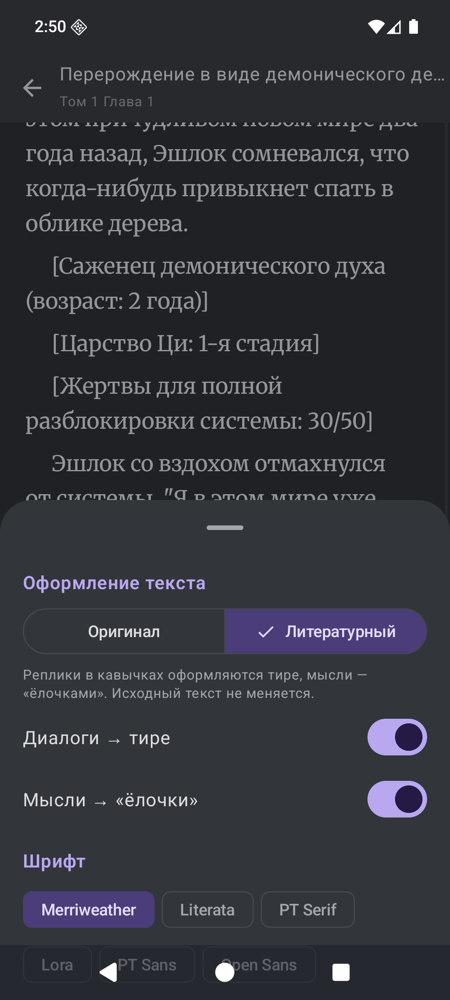

# Shiori

**Shiori** (栞 — «закладка») — неофициальный Android-клиент для чтения ранобэ с [RanobeLib](https://ranobelib.me) и манги с [MangaLib](https://mangalib.me). Каталоги и открытые главы доступны без входа.

> Shiori не связан с LibSocial и не одобрен им. Приложение работает с вашим аккаунтом LibSocial напрямую,
> без собственного сервера: все запросы идут с устройства на API LibSocial.

## Реплики с тире в читалке ранобэ

В режиме **«Литературный»** Shiori распознаёт прямую речь в кавычках и оформляет её как диалог в русскоязычной книге. Например, строка `«Я вернусь завтра», — сказала она.` отображается как `— Я вернусь завтра, — сказала она.`

Откройте **«Настройки чтения» → «Оформление текста»**, чтобы выбрать «Литературный» или «Оригинал». Оформление реплик тире и мыслей «ёлочками» настраивается двумя отдельными переключателями. Режим влияет только на отображение текста на устройстве.

| Оригинал | Литературный |
| --- | --- |
|  |  |

## Комментарии в любой момент чтения

Откройте главу в выбранном источнике и нажмите значок **«Комментарии»** на нижней панели читалки. Лента открывается поверх главы в любом месте чтения. В режиме **«Все переводы»** собраны комментарии ко всем переводам открытой главы. Если переводов несколько, переключатель **«Текущий»** показывает обсуждение того перевода, который вы читаете.

| Значок комментариев на нижней панели | Общая лента «Все переводы» |
| --- | --- |
|  |  |

При нажатии на уведомление об ответе на ваш комментарий Shiori открывает обсуждение главы поверх списка уведомлений и прокручивает его к нужной ветке без перехода в читалку.

## Как выглядит Shiori

| Главная и выбор источника | Каталог RanobeLib | Настройки чтения | Переход к странице манги |
| --- | --- | --- | --- |
|  |  |  |  |

## Возможности

- **Каталог обоих источников.** Поиск, сортировка, список или сетка. Фильтры по жанрам, тегам, количеству глав, году, оценке и возрастному рейтингу.
- **Ранобэ.** Полноэкранная читалка с настройками шрифта, интервалов, цветов и яркости, копированием текста и закладками внутри главы.
- **Манга.** Читалка изображений с номером текущей страницы. Нажмите на номер, чтобы перейти к другой странице ползунком.
- **Закрепление перевода.** Можно закрепить переводчика для тайтла.
- **Офлайн для ранобэ.** Главы можно скачать по диапазону, например `1-100, 155, т3`. Офлайн-режим включается вручную или при потере сети.
- **Местный прогресс.** «Продолжить чтение» доступно без входа. С аккаунтом LibSocial доступны списки библиотеки и опциональная синхронизация прогресса с закладкой на сайте.

## Установка

Скачайте `shiori-X.Y.Z.apk` и `shiori-X.Y.Z.apk.sha256` из [Releases](https://github.com/Velcheor137/shiori/releases) и проверьте файл:

```bash
sha256sum -c shiori-X.Y.Z.apk.sha256
```

Нужен Android 8.0 или новее.

## Сборка из исходников

Нужны JDK 21 и Android SDK (платформа 37.2).

```bash
./gradlew assembleDebug
```

Тесты:

```bash
./gradlew testDebugUnitTest test
```

Подписанная release-сборка локально:

```bash
SHIORI_KEYSTORE_PATH=/путь/к/release.jks SHIORI_KEYSTORE_PASSWORD=… SHIORI_KEY_ALIAS=… SHIORI_KEY_PASSWORD=… \
  ./gradlew assembleRelease -PreleaseVersion=0.4.0
```

## Релизы

Релиз собирается GitHub Actions по тегу `vX.Y.Z` (или `vX.Y.Z-beta.N`) на ветке `main`: проверки → подписанный APK →
GitHub Release с APK и SHA-256. Подробности — в [DEVELOPMENT_PLAN.md](DEVELOPMENT_PLAN.md), §13.

## Приватность

Нет телеметрии, рекламы и сторонних SDK. Настройки, скачанные главы, локальные закладки и прогресс хранятся на
устройстве. При включённой синхронизации Shiori также сохраняет позицию чтения в закладку аккаунта LibSocial.
Токен сессии зашифрован ключом Android Keystore. Журнал диагностики пишется на устройстве, токены в нём
маскируются, отправить его можно только вручную.

## Лицензия

Код — [GNU GPL v3.0 or later](LICENSE). Встроенные шрифты (Merriweather, Literata, PT Serif, PT Sans, Open Sans, Lora) —
SIL Open Font License 1.1, тексты лицензий в `app/src/main/assets/licenses/fonts/`.
